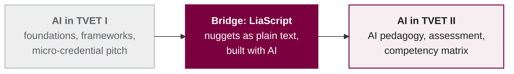
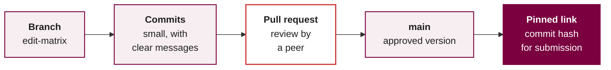
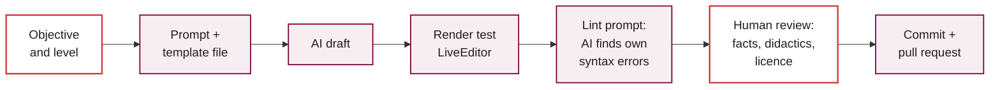

<!--
author:    Dr. Hannes Tegelbeckers
email:     hannes.tegelbeckers@ovgu.de
version:   1.1.0
language:  en
narrator:  UK English Female
mode:      Presentation
classroom: enable

title:     P01 – Kick-off and LiaScript Live (Session slides)
comment:   AI in TVET II – Slides for session 1 (live, 26.11.2026, 180 min): organisation and pass requirements, bridge from AI in TVET I, UNESCO AI CFT self-check, LiaScript Level 2 (feedback-rich quizzes, script-checked answers, playgrounds, macros and imports, professional GitHub hosting, SCORM export, AI generation with templates), group formation.
tags:      AI, TVET, LiaScript, GitHub, OER, UNESCO, Organisation

import:    https://raw.githubusercontent.com/LiaTemplates/mermaid_template/0.1.4/README.md

@AIdeclaration: <small>🤖 Created with AI support (@0), checked and revised by @1 · CC BY 4.0</small>
-->

# Kick-off: From AI in TVET I to AI in TVET II – LiaScript Level 2

**Session 1 · 26.11.2026 · 🟢 Live · 09:00–12:00** · AI in TVET II, OVGU Magdeburg

Organisation · how to pass · UNESCO compass · **LiaScript Level 2: from pitch file to professional OER project** 🛠️

<small>[Self-learning unit S01](https://liascript.github.io/course/?https://raw.githubusercontent.com/OVGU-VET-TechEd/AI_in_TVET_II_WiSe_2026_2027/main/AI_in_TVET_II_WiSe_2026_2027/01_Kick-off_and_LiaScript_Live/S01_Kick-off_LiaScript_Live.md) · [Unit in Moodle (SCORM, obligatory)](https://elearning.ovgu.de/course/section.php?id=202215) · [HTML slides](https://ovgu-vet-teched.github.io/AI_in_TVET_II_WiSe_2026_2027/AI_in_TVET_II_WiSe_2026_2027/01_Kick-off_and_LiaScript_Live/P01_Kick-off_LiaScript_Live.html) · [Organisational overview](https://liascript.github.io/course/?https://raw.githubusercontent.com/OVGU-VET-TechEd/AI_in_TVET_II_WiSe_2026_2027/main/AI_in_TVET_II_WiSe_2026_2027/00_Organisation/organisational_overview_slide_AI_in_TVET_II.md)</small>

    --{{0}}--
Welcome to AI in TVET two. We start where AI in TVET one ended: with LiaScript. First the organisation and how to pass, then we take LiaScript to level two: feedback-rich quizzes, playgrounds, macros, professional hosting on GitHub and SCORM export.

## Welcome Back! 👋

**Did you take part in AI in TVET I?**

- [(yes)] Yes, including the pitch on 19.11.
- [(part)] Partly
- [(no)] No, I am new

**Your LiaScript level right now:**

- [(1)] 😶 never opened a LiaScript file
- [(2)] 🙂 I can read and change a file
- [(3)] 😎 I built my own nugget
- [(4)] 🚀 I built nuggets with AI and published them on GitHub

**One word: what do you expect from this seminar?**

[[___]]

    --{{0}}--
Open the LiaScript version of these slides and join the classroom. Your answers appear for everyone without your name. They tell me how fast we can go in the live LiaScript part.

## Where We Are 🧭

```mermaid @mermaid
flowchart LR
  S1["<b>1 · 26.11.</b><br>Kick-off and<br>LiaScript Level 2"]:::now
  S1 --> S2["<b>2 · 03.12.</b> 🔵<br>AI and prompting<br>Level 2"]:::self
  S2 --> S3["<b>3 · 10.12.</b> 🔵<br>Vocabulary and<br>workflows"]:::self
  S3 --> S4["<b>4 · 17.12.</b><br>Pedagogy, assessment,<br>ethics"]:::live
  S4 --> S5["<b>5 · 07.01.</b><br>Nuggets and<br>matrix workshop"]:::live
  S5 --> S6["<b>6 · 14.01.</b> ⚪<br>Project and peer review<br>format tbc"]:::tbc
  S6 --> S7["<b>7 · 21.01.</b><br>Final<br>presentations"]:::live
  classDef live fill:#f7eef2,stroke:#7a003f,stroke-width:1.5px,color:#1f1f1f
  classDef self fill:#e8f0fb,stroke:#1565c0,stroke-width:1.5px,color:#1f1f1f
  classDef tbc fill:#fff8e1,stroke:#b7791f,stroke-width:1.5px,stroke-dasharray:4 3,color:#1f1f1f
  classDef now fill:#7a003f,stroke:#7a003f,stroke-width:2px,color:#ffffff
  classDef done fill:#eeeeee,stroke:#9ca3af,stroke-width:1px,color:#5f6163
```



**Red line:** every session adds one building block to your **group presentation on 21.01.2027** – and every session has one **obligatory SCORM unit** in Moodle.

    --{{0}}--
Seven sessions: four live, two self-learning and one whose format is still to be confirmed. Every session adds one building block to your group presentation. The dark box shows where we are today.

## Today's Objectives 🎯

By the end of today you can …

    --{{1}}--
First: you know how this seminar works and what you need to pass.

      {{1}}
****************************************

1. **describe** the schedule, the group product and the three pass requirements – including the obligatory SCORM units,
2. **explain** how AI in TVET II builds on AI in TVET I,

****************************************

    --{{2}}--
Second: you level up a LiaScript nugget beyond what you did in AI in TVET one, and you host it like a professional.

      {{2}}
****************************************

3. **extend** a LiaScript nugget with Level-2 features – feedback-rich quizzes, script-checked answers, a playground, macros – using AI with a template and a test protocol,
4. **host** it professionally on GitHub – structure, pull requests, pinned links – and **export** it as SCORM,
5. **choose** a group and shortlist one UNESCO competency for your project.

****************************************

## Today's Agenda 🗓️

<!-- data-type="none" -->
| Time | Block | Mode |
| --- | --- | --- |
| 09:00 | Welcome, organisation, how to pass | Plenary |
| 09:30 | From AI in TVET I to II · UNESCO compass · self-check | Plenary + individual |
| 09:50 | LiaScript Level 2: quizzes, playgrounds, macros | Live coding, everyone joins |
| 10:20 | Break | 10 min |
| 10:30 | Hosting, SCORM export, AI + template · level up your nugget | Live demo + individual build |
| 11:15 | Groups and UNESCO competency shortlist | Groups |
| 11:45 | Exit ticket · your SCORM unit · outlook | Individual |

    --{{0}}--
Three hours, one break. The middle hour is hands-on: please have a laptop and a GitHub account ready.

## 1. Organisation at a Glance 📅

<!-- data-type="none" -->
| No. | Date | Format | Topic |
| --- | --- | --- | --- |
| 1 | 26.11.2026 | 🟢 Live | Kick-off, organisation · **LiaScript Level 2** |
| 2 | 03.12.2026 | 🔵 Self-learning | AI and prompting Level 2: reliable learning material |
| 3 | 10.12.2026 | 🔵 Self-learning | AI vocabulary, models and workflows · choose learning objective · matrix draft |
| 4 | 17.12.2026 | 🟢 Live | Pedagogical trends · AI for assessment and feedback · ethics |
| – | 21.12.–01.01. | ⚪ Break | Christmas break |
| 5 | 07.01.2027 | 🟢 Live | Nuggets and micro-credentials · competency matrix workshop |
| 6 | 14.01.2027 | ⚪ Format tbc | Project development and peer review (live or self-learning) |
| 7 | 21.01.2027 | 🟢 Live | **Final group presentations** and reflection |

Thursdays, 09:00–12:00 · Key reference: [organisational overview](https://liascript.github.io/course/?https://raw.githubusercontent.com/OVGU-VET-TechEd/AI_in_TVET_II_WiSe_2026_2027/main/AI_in_TVET_II_WiSe_2026_2027/00_Organisation/organisational_overview_slide_AI_in_TVET_II.md) · [course website](https://ovgu-vet-teched.github.io/AI_in_TVET_II_WiSe_2026_2027/)

    --{{0}}--
The organisational overview is the key reference for all dates and rules. On the two blue dates, the third and the tenth of December, I am travelling: you work with the self-learning unit and enter your results inside the Moodle unit. The format of the fourteenth of January will be announced in Moodle.

## How to Pass ✅

You need **all three**:

    --{{1}}--
First, and new this year: completing the SCORM units in Moodle is obligatory.

      {{1}}
****************************************

**1 · 📦 All 7 SCORM units completed in Moodle – obligatory, by 15.02.2027.** One self-learning unit per session. Units 3 and 6 contain the group hand-ins (16.12.2026 and 18.01.2027).

****************************************

    --{{2}}--
Second, the group presentation on the twenty-first of January.

      {{2}}
****************************************

**2 · 🎤 Group presentation on 21.01.2027** – 20 minutes + 5 minutes discussion, in LiaScript, on **one UNESCO learning objective**: competency matrix, sample AI-supported learning material, AI workflow.

****************************************

    --{{3}}--
Third, the final submission of your GitHub link.

      {{3}}
****************************************

**3 · 📤 Final submission on 15.02.2027** – GitHub link to your group's LiaScript presentation (incl. competency matrix) in Moodle.

> [!IMPORTANT] Pass requirement
> Without all 7 completed SCORM units you cannot pass – even with an excellent presentation.

****************************************

## Your Group Product 🎁

<!-- data-type="none" -->
| Part of the presentation | What it shows | Built in session |
| --- | --- | --- |
| **Learning objective** | One objective from UNESCO AI CFT Competency 3, 4 or 5 – exact wording, target group | 1 → 3 |
| **Competency matrix** | Acquire → Deepen → Create: content, workflow, AI tool per level | 3 → 5 |
| **Sample material** | At least one AI-supported element (nugget section, quiz, case, diagram), shown live | 1, 5 → 6 |
| **AI workflow** | Tools, prompts, what you kept and what you changed | 2 → 6 |
| **Human role** | Where humans decide and why | 2, 4 → 7 |

A complete stand-alone course is **not** required.

    --{{0}}--
The table shows where each part of your presentation is built. You start today with your first piece of sample material: a nugget levelled up beyond AI in TVET one.

## Check: Pass Requirements 🧐

Which statements are true?

<!-- data-hint-button="1" data-solution-button="2" -->
- [[X]] All 7 SCORM units must be completed in Moodle by 15.02.2027.
- [[ ]] A great group presentation can replace missing SCORM units.
- [[X]] The group presentation is about one UNESCO learning objective.
- [[ ]] You must build a complete stand-alone self-learning course.
[[?]] Look at the red box on the slide "How to Pass".
***
The SCORM units are a pass requirement in addition to the presentation. A complete course is not required – a convincing design with sample material is.
***

## 2. From AI in TVET I to AI in TVET II 🌉



    --{{1}}--
In AI in TVET one you designed a micro-credential and pitched it. Now the question changes: not what to offer, but how to teach and assess it well with AI.

      {{1}}
<!-- data-type="none" -->
| AI in TVET I asked … | AI in TVET II asks … |
| --- | --- |
| What is AI, which frameworks apply? | How does AI change teaching, learning and assessment? |
| Which micro-credential does the labour market need? | How do learners progress from *Acquire* to *Create*? |
| Can I build a nugget in LiaScript? | Can I generate, **check** and justify AI-supported material? |

## The UNESCO Compass 🧭

**UNESCO AI Competency Framework for Teachers** (UNESCO, 2024): 5 dimensions × 3 levels

<!-- data-type="none" -->
| Dimension | Acquire | Deepen | Create |
| --- | --- | --- | --- |
| 1 Human-centred mindset | Human agency | Human accountability | Social responsibility |
| 2 Ethics of AI | Ethical principles | Safe and responsible use | Co-creating ethical rules |
| **3 AI foundations and applications** | Basic AI techniques and applications | Application skills | Creating with AI |
| **4 AI pedagogy** | AI-assisted teaching | AI-pedagogy integration | AI-enhanced pedagogical transformation |
| **5 AI for professional development** | AI enabling lifelong professional learning | AI to enhance organizational learning | AI to support professional transformation |

    --{{1}}--
Your group chooses one learning objective from dimension three, four or five. Dimensions one and two are not optional extras: they are the lens for every design decision.

      {{1}}
> [!NOTE] Your choice
> Your group project uses **one learning objective from dimension 3, 4 or 5**. Dimensions 1 and 2 are the lens for every decision. Source: [UNESCO AI CFT for Teachers](https://doi.org/10.54675/ZJTE2084).

## Playground: Your Baseline 🕸️

You rated yourself at the start and the end of AI in TVET I. **Enter your end values from 19.11.** (or rate now if you are new) – this is your baseline for AI in TVET II. **0** = not yet · **1** = Acquire · **2** = Deepen · **3** = Create

| Dimension | Your level |
| --- | --- |
| 1 Human-centred mindset | <script input="range" min="0" max="3" step="1" value="1" output="cft1">@input</script> |
| 2 Ethics of AI | <script input="range" min="0" max="3" step="1" value="1" output="cft2">@input</script> |
| 3 AI foundations and applications | <script input="range" min="0" max="3" step="1" value="1" output="cft3">@input</script> |
| 4 AI pedagogy | <script input="range" min="0" max="3" step="1" value="1" output="cft4">@input</script> |
| 5 AI for professional development | <script input="range" min="0" max="3" step="1" value="1" output="cft5">@input</script> |

<script modify="false" style="display:block">
const v = [@input(`cft1`), @input(`cft2`), @input(`cft3`), @input(`cft4`), @input(`cft5`)].map(Number);
const dims = ["Human-centred mindset","Ethics of AI","AI foundations and applications","AI pedagogy","AI for prof. development"];
const comp = [
  ["Human agency","Human accountability","Social responsibility"],
  ["Ethical principles","Safe and responsible use","Co-creating ethical rules"],
  ["Basic AI techniques and applications","Application skills","Creating with AI"],
  ["AI-assisted teaching","AI-pedagogy integration","AI-enhanced pedagogical transformation"],
  ["AI enabling lifelong professional learning","AI to enhance organizational learning","AI to support professional transformation"]];
const cx = 160, cy = 150, R = 110;
const pt = (i, r) => { const a = -Math.PI/2 + i * 2*Math.PI/5; return [cx + r*Math.cos(a), cy + r*Math.sin(a)]; };
let grid = "";
for (let l = 1; l <= 3; l++) grid += `<polygon points="${[0,1,2,3,4].map(i => pt(i, R*l/3).join(",")).join(" ")}" fill="none" stroke="#94a3b8" stroke-dasharray="3 3"/>`;
const axes = [0,1,2,3,4].map(i => { const [x,y] = pt(i, R); const [lx,ly] = pt(i, R + 22); return `<line x1="${cx}" y1="${cy}" x2="${x}" y2="${y}" stroke="#94a3b8"/><text x="${lx}" y="${ly}" font-size="11" text-anchor="middle" fill="currentColor">${i+1}</text>`; }).join("");
const poly = `<polygon points="${v.map((x,i) => pt(i, R*x/3).join(",")).join(" ")}" fill="rgba(122,0,63,0.25)" stroke="#7a003f" stroke-width="2"/>`;
const lvl = ["–","Acquire","Deepen","Create"];
const list = v.map((x,i) => `<li><b>${dims[i]}</b>: ${x === 0 ? "not yet" : lvl[x] + " → <i>" + comp[i][x-1] + "</i>"}</li>`).join("");
const cand = [2,3,4].sort((a,b) => v[a] - v[b])[0];
`HTML: <div style="display:flex;flex-wrap:wrap;gap:16px;align-items:center"><svg viewBox="0 0 320 300" style="width:280px;max-width:100%">${grid}${axes}${poly}</svg><div style="flex:1;min-width:240px"><ul>${list}</ul><p>🎯 <b>Candidate for your group project:</b> dimension ${cand+1} – ${dims[cand]}${v[cand] < 3 ? ", next level: <i>" + comp[cand][v[cand]] + "</i>" : ""}</p></div></div>`
</script>

    --{{0}}--
Enter the values from your last radar in AI in TVET one. The suggested candidate dimension is your growth area. Take a screenshot: in the last session you compare, and the difference is evidence for your reflection.

## 3. LiaScript: What You Already Know 🔁

From **AI in TVET I** (session 6, [S06](https://liascript.github.io/course/?https://raw.githubusercontent.com/OVGU-VET-TechEd/AI_in_TVET_I_WiSe_2026_2027/main/Selflearn/S06_Hands_on_LiaScript.md)) you know: header · slides `##` · quizzes · `{{1}}` and `--{{1}}--` · media · GitHub raw link → LiaScript link.

    --{{1}}--
Two minutes of retrieval practice. If you get both right, you are ready for level two. If not, open S06 of AI in TVET one after the session.

      {{1}}
****************************************

**Recall:** Which line creates a drag-and-drop gap?

- [( )] `[[a|(b)]]`
- [(X)] `[->[a|(b)]]`
- [( )] `{{a|b}}`

**Recall:** Which line starts a speaker note read on click 2?

- [( )] `{{2}}`
- [(X)] `--{{2}}--`
- [( )] `[[2]]`

****************************************

    --{{2}}--
Today we go one level up. Your presentation in January must be more than a pitch file: it is a small, well-built, version-controlled OER project.

      {{2}}
> [!NOTE] Today: LiaScript Level 2
> Feedback-rich quizzes · interactive playgrounds · macros and imports · professional GitHub hosting · SCORM export · AI generation with templates.

## Level 2 ①: Feedback-Rich Quizzes 🎯

AI in TVET I: quizzes that say *right / wrong*. Level 2: quizzes that **teach**.

```markdown
<!-- data-hint-button="1" data-solution-button="2" data-randomize -->
- [(X)] Check the answer against the regulation
- [( )] Trust the chatbot
[[?]] Who is accountable for safety at the workplace?
***
The trainer and the apprentice stay accountable – the chatbot is a draft source.
***
```

    --{{1}}--
This is the rendered version. Hints appear after one wrong try, the solution button after two, the options are shuffled, and the explanation appears when the quiz is solved.

      {{1}}
****************************************

A chatbot tells an apprentice a torque value for a wheel nut. What should the apprentice do?

<!-- data-hint-button="1" data-solution-button="2" data-randomize -->
- [(X)] Check the value against the manufacturer's specification.
- [( )] Use the value – chatbots are trained on manuals.
- [( )] Ask the chatbot again until it gives the same value twice.
[[?]] Who is accountable for the wheel staying on?
***
Only the manufacturer's specification is authoritative. Asking twice measures consistency, not correctness.
***

****************************************

## Level 2 ②: Text Answers Checked by Script ✅

A plain `[[torque]]` accepts **exactly one** spelling. A short script accepts variants:

```markdown
[[torque wrench]]
[[?]] It clicks when the value is reached.
<script>
const a = `@input`.trim().toLowerCase();
["torque wrench", "torque spanner", "drehmomentschlüssel"].includes(a)
</script>
```

    --{{1}}--
Try it: type torque spanner, or the German word. All three are accepted. This is important for multilingual vocational classes.

      {{1}}
****************************************

Which tool tightens a bolt to a defined value?

[[torque wrench]]
[[?]] It clicks when the value is reached.
<script>
const a = `@input`.trim().toLowerCase();
["torque wrench", "torque spanner", "drehmomentschlüssel"].includes(a)
</script>

****************************************

## Level 2 ③: Build an Interactive Playground 🎛️

Two lines make a slider, one script computes – a **simulation without programming knowledge**:

```markdown
Voltage (V): <script input="range" min="1" max="24" value="12" output="u">@input</script>
Resistance (Ω): <script input="range" min="1" max="100" value="10" output="r">@input</script>

<script>
const I = @input(`u`) / @input(`r`);
`Current: ${I.toFixed(2)} A`
</script>
```

    --{{1}}--
Here it is running. Every playground in these slides is built like this, and an AI can write such scripts for you if you describe the model precisely.

      {{1}}
****************************************

Voltage (V): <script input="range" min="1" max="24" step="1" value="12" output="u">@input</script>

Resistance (Ω): <script input="range" min="1" max="100" step="1" value="10" output="r">@input</script>

<script>
const I = @input(`u`) / @input(`r`);
`Ohm's law: I = U / R = ${I.toFixed(2)} A ${I > 1 ? "⚠️ above 1 A – check the fuse rating" : "✅"}`
</script>

****************************************

## Level 2 ④: Macros and Imports 🧱

Reusable blocks belong in the **header**, not copied onto every slide:

```markdown
<!--
import: https://raw.githubusercontent.com/LiaTemplates/mermaid_template/0.1.4/README.md

@AIdeclaration: <small>🤖 Created with AI support (@0), checked and revised by @1 · CC BY 4.0</small>
-->

## Last slide
@AIdeclaration(ChatGPT,Group 3)
```

    --{{1}}--
This deck defines exactly this macro in its own header. Here is the output. Change the macro once, and every slide that uses it changes.

      {{1}}
****************************************

**Output:** @AIdeclaration(ChatGPT,Group 3)

- `import:` loads **templates** – e.g. Mermaid diagrams, Python in the browser, text analysis ([LiaTemplates on GitHub](https://github.com/LiaTemplates))
- `@macro` keeps licence lines, AI declarations and branding **identical** across all your nuggets

****************************************

## Level 2 ⑤: Host It Like a Professional 🐙



    --{{1}}--
Three habits make your group repository professional: a clear structure, review through pull requests, and a pinned link for the submission that cannot change afterwards.

      {{1}}
****************************************

**Repository structure:** `README.md` (with LiaScript badge) · `presentation.md` · `nuggets/` · `media/` · `LICENSE`

**Peer review in session 6** runs as a **pull request or issue** in the partner group's repository.

**Pinned link:** replace `main` in the raw link by a **commit hash** → the submitted version can no longer change.

****************************************

## Playground: Link Builder Level 2 🔗

**User or organisation:** <script input="text" value="OVGU-VET-TechEd" output="gU" input-always-active>@input</script>

**Repository:** <script input="text" value="AI_in_TVET_II_WiSe_2026_2027" output="gR" input-always-active>@input</script>

**Branch or commit hash:** <script input="text" value="main" output="gB" input-always-active>@input</script>

**File path:** <script input="text" value="AI_in_TVET_II_WiSe_2026_2027/01_Kick-off_and_LiaScript_Live/P01_Kick-off_LiaScript_Live.md" output="gF" input-always-active>@input</script>

<script modify="false" style="display:block">
const c = s => s.trim().replace(/^\/+|\/+$/g,"").replace(/\s/g,"%20").replace(/[<>"]/g,"");
const u = c(`@input(`gU`)`), r = c(`@input(`gR`)`), b = c(`@input(`gB`)`) || "main", f = c(`@input(`gF`)`);
const raw = `https://raw.githubusercontent.com/${u}/${r}/${b}/${f}`;
const lia = `https://liascript.github.io/course/?${raw}`;
const pinned = /^[0-9a-f]{7,40}$/i.test(b);
const badge = `[](${lia})`;
`HTML: <p><b>LiaScript link:</b><br><a href="${lia}" target="_blank" rel="noopener" style="word-break:break-all">${lia}</a></p>
<p>${pinned ? "📌 <b>Pinned</b> to one commit – this version can never change. Use it for the final submission." : "🔄 <b>Moving</b> link – it always shows the newest version of <code>" + b + "</code>. Good while working, risky for a submission."}</p>
<p><b>README badge</b> (copy into your README.md):</p><pre style="white-space:pre-wrap;background:#f7eef2;border-left:4px solid #7a003f;padding:8px;font-size:0.8em">${badge.replace(/</g,"&lt;")}</pre>`
</script>

    --{{0}}--
Enter your own repository. Then copy the hash of your last commit from GitHub into the branch field and watch the link change from moving to pinned.

## Level 2 ⑥: Export as SCORM for Moodle 📦

The 7 obligatory units of this seminar are LiaScript files, exported with the [LiaScript exporter](https://github.com/LiaScript/LiaScript-Exporter):

```bash
npx @liascript/exporter -i nugget.md -f scorm1.2 \
    --scorm-embed --scorm-masteryScore 0 -o nugget_SCORM
```

    --{{1}}--
Two practical pitfalls: the exporter packs the whole folder of your file, so copy the file into an empty folder first. And a mastery score of zero means completion counts, not a quiz score.

      {{1}}
****************************************

- Copy the `.md` into an **empty folder** first – the exporter packs the whole folder.
- `--scorm-masteryScore 0` → **completion** counts; a number (e.g. 70) → quiz score counts.
- In Moodle: *Add activity → SCORM package* → upload the zip. Your answers in fields are saved per learner.

> [!TIP] Optional for your group
> Export one nugget as SCORM and test it in the [Moodle sandbox](https://sandbox.moodledemo.net/) – a strong point for the *Create* level.

****************************************

## 4. AI + Template → Nugget: Live Demo 🤖✍️

In AI in TVET I you asked an AI for LiaScript. Level 2: give it a **template with Level-2 features** and a **test protocol**.



    --{{1}}--
The lint prompt is new: the AI checks its own LiaScript against a list of known errors. It is fast, but the render test and your human review decide.

      {{1}}
```text
Check the LiaScript below against these rules and list every violation
with line number: (1) no text indented by 4+ spaces, (2) every quiz has
[[?]] hints and a *** solution block, (3) {{n}} steps count 1, 2, 3 without
gaps per slide, (4) every script returns a value, (5) no invented sources.
Do not rewrite the file. """<paste file>"""
```

## Playground: Prompt Builder Level 2 🧰

**Learning objective:** <script input="text" value="Apprentices check a chatbot answer on a safety rule against the regulation" output="pO" input-always-active>@input</script>

**Target group:** <script input="text" value="second-year apprentices, electrical trades, English B1" output="pT" input-always-active>@input</script>

**Level:** <script input="select" options="Acquire,Deepen,Create" value="Deepen" output="pL">@input</script>

**Level-2 feature:** <script input="select" options="quiz with hints and solution,script-checked text answer,slider playground,Mermaid diagram,embedded explorable" value="quiz with hints and solution" output="pE">@input</script>

<script modify="false" style="display:block">
const esc = s => s.replace(/</g,"&lt;").replace(/>/g,"&gt;");
const o = esc(`@input(`pO`)`), t = esc(`@input(`pT`)`), l = `@input(`pL`)`, e = `@input(`pE`)`;
const verbs = {"Acquire":"recognise and explain","Deepen":"apply and check in a realistic case","Create":"design their own solution"};
const p = `You are an instructional designer for vocational education (TVET).
Use the attached LiaScript template file as the pattern for syntax and structure.
Create a LiaScript nugget (mode: Presentation, 4–5 slides) for this objective:
"${o}" – UNESCO level: ${l} (learners ${verbs[l]}).
Target group: ${t}.
Level-2 feature: ${e}. Every quiz: <!-- data-hint-button="1" data-solution-button="2" -->,
hints [[?]] and a *** solution block with an explanation.
Speaker notes --{{0}}-- on every slide; licence line via the macro @AIdeclaration.
Rules: never indent text by 4 or more spaces; do not invent sources or statistics;
mark uncertain facts with <!-- CHECK -->.`;
`HTML: <pre style="white-space:pre-wrap;background:#f7eef2;border-left:4px solid #7a003f;padding:10px;font-size:0.85em">${p}</pre><p>📎 Attach the <a href="https://liascript.github.io/course/?https://raw.githubusercontent.com/OVGU-VET-TechEd/AI_in_TVET_II_WiSe_2026_2027/main/AI_in_TVET_II_WiSe_2026_2027/00_Organisation/Template_LiaScript_Presentation.md" target="_blank" rel="noopener">presentation template</a> or one of your working slides as the template file.</p>`
</script>

## Try It: Level Up Your AI in TVET I Nugget (25 min) 🧪

Take your **nugget or pitch from AI in TVET I** (or a new mini-nugget) and level it up.

    --{{1}}--
Five upgrades. Tick them off. If you are fast, add the SCORM export.

      {{1}}
****************************************

- [ ] one **feedback-rich quiz**: hint, solution block, randomised options
- [ ] one **script-checked text answer** or **slider playground**
- [ ] the **@AIdeclaration macro** in the header and on the last slide
- [ ] pushed to your **group repository** with structure and README badge
- [ ] **render test** in the [LiveEditor](https://liascript.github.io/LiveEditor/) + lint prompt – no raw syntax visible
- [ ] *(extra)* exported as **SCORM** and tested

****************************************

    --{{2}}--
Note what the AI got wrong. That is the start of your AI tools log, and the beginning of the workflow slide in January.

      {{2}}
**What did the AI get wrong – and how did you find it?**

[[___ ___]]

## 5. Groups and Your UNESCO Competency 👥

**Form groups of 3–4.** Which competency does your group lean towards?

- [(3)] 3 – AI foundations and applications
- [(4)] 4 – AI pedagogy
- [(5)] 5 – AI for professional development
- [(unsure)] Not sure yet

    --{{1}}--
Look at what the previous cohort produced. These are student products, not perfect models. Ask yourself what works and what you would do differently.

      {{1}}
****************************************

**Examples from the previous cohort** (public on GitHub, open in LiaScript – look critically):

- [AI Competency Assessment Programme – trainer guide, UNESCO LO 5.1.2, Acquire](https://liascript.github.io/course/?https://raw.githubusercontent.com/OVGU-VET-TechEd/AI_in_TVET_II_-LearningObjective-/main/AI-Competency-Trainer-Assessment-.md)
- [Feedback 4.0: AI-enhanced inclusive teaching in TVET](https://liascript.github.io/course/?https://raw.githubusercontent.com/OVGU-VET-TechEd/AI_in_TVET_II_-LearningObjective-/main/Final%20of%20AI%20in%20Tevt%20II.md)
- [AI-enhanced vocational English teaching](https://liascript.github.io/course/?https://raw.githubusercontent.com/OVGU-VET-TechEd/AI_in_TVET_II_-LearningObjective-/main/AI2%20LP%20V0.4%20for%20Lia.md)

****************************************

## Project Lab: Your To-Dos Today 🛠️

- [ ] group formed (3–4 people), names in the Moodle group list
- [ ] shared GitHub repository created with structure (`README.md` + badge, `presentation.md`, `nuggets/`, `media/`, `LICENSE`), all members added
- [ ] your levelled-up nugget merged via a first **pull request**
- [ ] [presentation template](https://liascript.github.io/course/?https://raw.githubusercontent.com/OVGU-VET-TechEd/AI_in_TVET_II_WiSe_2026_2027/main/AI_in_TVET_II_WiSe_2026_2027/00_Organisation/Template_LiaScript_Presentation.md) opened and copied into the repository
- [ ] 2–3 candidate learning objectives from competency 3, 4 or 5 noted

    --{{1}}--
Write down your shortlist. In session three you decide on one objective and write the first matrix draft.

      {{1}}
**Our group's shortlist (competency + keyword):**

[[___ ___]]

## Exit Ticket 🎟️

**Objective 1:** By when must all SCORM units be completed?

<!-- data-hint-button="1" data-solution-button="2" -->
- [( )] 21.01.2027
- [(X)] 15.02.2027
- [( )] There is no deadline, they are optional.
[[?]] Same date as the final submission.

**Objective 2:** What is new in AI in TVET II compared with AI in TVET I?

<!-- data-hint-button="1" data-solution-button="2" -->
- [( )] We pitch a micro-credential to a panel.
- [(X)] We design, check and justify AI-supported learning material for one UNESCO learning objective.
- [( )] We learn the UNESCO frameworks for the first time.
[[?]] Look at the bridge table.

**Objectives 3–4:** Paste the **pinned** LiaScript link of your levelled-up nugget:

[[___]]

**Objective 5:** Our group leans towards competency …

- [(3)] 3
- [(4)] 4
- [(5)] 5

## Your SCORM Unit and Next Steps 📦

**Obligatory:** complete the self-learning unit **S01** in Moodle – it contains today's LiaScript Level-2 features as a study text and your level-up task.

    --{{1}}--
The unit also works as a reference whenever you are unsure about LiaScript syntax.

      {{1}}
****************************************

- 📦 [S01 in Moodle (SCORM)](https://elearning.ovgu.de/course/section.php?id=202215) · [S01 in LiaScript](https://liascript.github.io/course/?https://raw.githubusercontent.com/OVGU-VET-TechEd/AI_in_TVET_II_WiSe_2026_2027/main/AI_in_TVET_II_WiSe_2026_2027/01_Kick-off_and_LiaScript_Live/S01_Kick-off_LiaScript_Live.md) – all 7 units by **15.02.2027**
- ➡️ **Next session: Thursday, 03.12.2026, 🔵 self-learning** (I am travelling) – AI and prompting Level 2: work through P02 and unit S02 in Moodle
- 📖 Reading for session 2: Schmager et al. (2025), *Understanding human-centred AI* (Moodle)

****************************************

## References

- LiaScript. (n.d.). *LiaScript exporter* [GitHub repository]. https://github.com/LiaScript/LiaScript-Exporter
- LiaScript. (n.d.). *LiaScript documentation*. https://liascript.github.io/course/?https://raw.githubusercontent.com/liaScript/docs/master/README.md
- LiaScript. (n.d.). *LiaAgent – LiaScript teaching agent* [GitHub repository]. https://github.com/LiaScript/LiaAgent
- UNESCO. (2019). *Recommendation on Open Educational Resources (OER)*. https://www.unesco.org/en/legal-affairs/recommendation-open-educational-resources-oer
- UNESCO. (2024). *AI competency framework for teachers*. https://doi.org/10.54675/ZJTE2084

**Tools:** [LiaScript LiveEditor](https://liascript.github.io/LiveEditor/) · [GitHub](https://github.com) · [Presentation template](https://liascript.github.io/course/?https://raw.githubusercontent.com/OVGU-VET-TechEd/AI_in_TVET_II_WiSe_2026_2027/main/AI_in_TVET_II_WiSe_2026_2027/00_Organisation/Template_LiaScript_Presentation.md)

<small>Licence: CC BY 4.0 · Dr. Hannes Tegelbeckers, OVGU Magdeburg · Created with AI support (Claude), builds on AI in TVET I session 6; checked by the author.</small>
