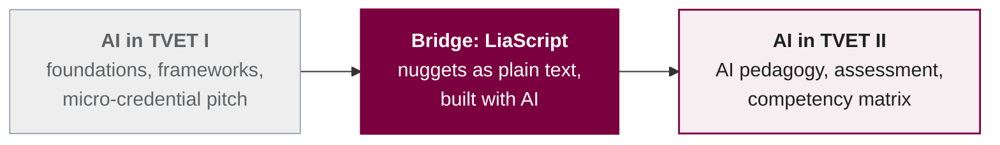
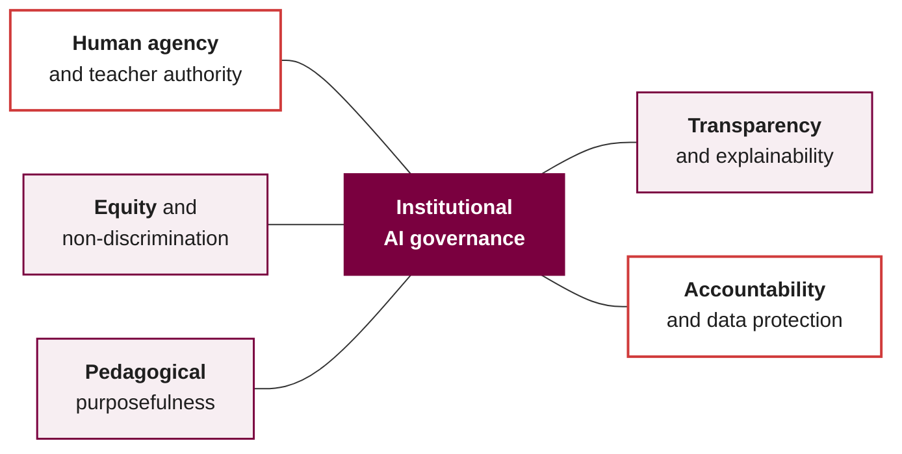
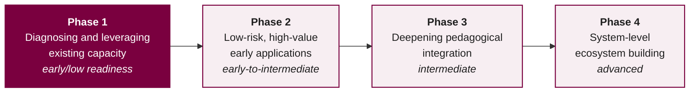
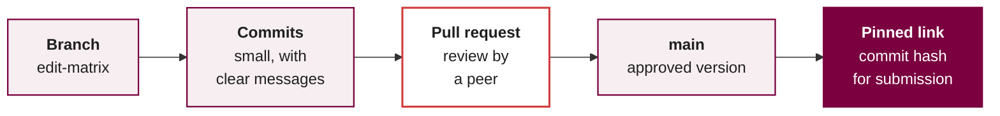
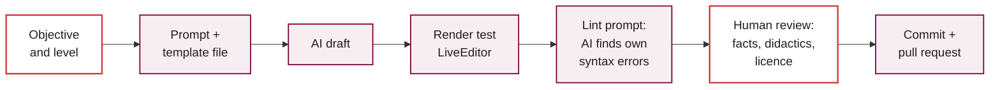

<!--
author:    Dr. Hannes Tegelbeckers
email:     hannes.tegelbeckers@ovgu.de
version:   1.2.0
language:  en
narrator:  UK English Female
mode:      Presentation
classroom: enable

title:     P01 – Kick-off, UNESCO-UNEVOC Practical Guide and LiaScript Live (Session slides)
comment:   AI in TVET II – Slides for session 1 (live, 26.11.2026, 180 min), version with an introduction to the UNESCO-UNEVOC practical guide Integrating AI in TVET (Yang, Wu and Tegelbeckers, 2026): organisation and pass requirements, bridge from AI in TVET I, UNESCO AI CFT self-check, core principles, AI learning spaces, assessment categories, competencies, phased integration and readiness check from the guide, LiaScript Level 2 (feedback-rich quizzes, script-checked answers, playgrounds, macros and imports, professional GitHub hosting, SCORM export, AI generation with templates), group formation.
tags:      AI, TVET, LiaScript, GitHub, OER, UNESCO, UNESCO-UNEVOC, Organisation

import:    https://raw.githubusercontent.com/LiaTemplates/mermaid_template/0.1.4/README.md

@AIdeclaration: <small>🤖 Created with AI support (@0), checked and revised by @1 · CC BY 4.0</small>
-->

# Kick-off: From AI in TVET I to AI in TVET II – LiaScript Level 2

**Session 1 · 26.11.2026 · 🟢 Live · 09:00–12:00** · AI in TVET II, OVGU Magdeburg

Organisation · how to pass · UNESCO compass · **📘 Introduction: the UNESCO-UNEVOC practical guide *Integrating AI in TVET*** · **LiaScript Level 2: from pitch file to professional OER project** 🛠️

<small>[Self-learning unit S01](https://liascript.github.io/course/?https://raw.githubusercontent.com/OVGU-VET-TechEd/AI_in_TVET_II_WiSe_2026_2027/main/AI_in_TVET_II_WiSe_2026_2027/01_Kick-off_and_LiaScript_Live/S01_Kick-off_LiaScript_Live.md) · [Unit in Moodle (SCORM, obligatory)](https://elearning.ovgu.de/course/section.php?id=202215) · [HTML slides](https://ovgu-vet-teched.github.io/AI_in_TVET_II_WiSe_2026_2027/AI_in_TVET_II_WiSe_2026_2027/01_Kick-off_and_LiaScript_Live/P01_Kick-off_UNESCO_Guide_LiaScript_Live.html) · [Organisational overview](https://liascript.github.io/course/?https://raw.githubusercontent.com/OVGU-VET-TechEd/AI_in_TVET_II_WiSe_2026_2027/main/AI_in_TVET_II_WiSe_2026_2027/00_Organisation/organisational_overview_slide_AI_in_TVET_II.md) · [UNESCO-UNEVOC guide (open access)](https://doi.org/10.64043/BOWG1644)</small>

    --{{0}}--
Welcome to AI in TVET two. We start where AI in TVET one ended. First the organisation and how to pass, then an introduction to the new UNESCO-UNEVOC practical guide on integrating AI in TVET, which accompanies the whole seminar. After the break we take LiaScript to level two: feedback-rich quizzes, playgrounds, macros, professional hosting on GitHub and SCORM export.

## Welcome Back! 👋

**Did you take part in AI in TVET I?**

- [(yes)] Yes, including the pitch on 19.11.
- [(part)] Partly
- [(no)] No, I am new

**Your LiaScript level right now:**

- [(1)] 😶 never opened a LiaScript file
- [(2)] 🙂 I can read and change a file
- [(3)] 😎 I built my own nugget
- [(4)] 🚀 I built nuggets with AI and published them on GitHub

**One word: what do you expect from this seminar?**

[[___]]

    --{{0}}--
Open the LiaScript version of these slides and join the classroom. Your answers appear for everyone without your name. They tell me how fast we can go in the live LiaScript part.

## Where We Are 🧭

```mermaid @mermaid
flowchart LR
  S1["<b>1 · 26.11.</b><br>Kick-off and<br>LiaScript Level 2"]:::now
  S1 --> S2["<b>2 · 03.12.</b> 🔵<br>AI and prompting<br>Level 2"]:::self
  S2 --> S3["<b>3 · 10.12.</b> 🔵<br>Vocabulary and<br>workflows"]:::self
  S3 --> S4["<b>4 · 17.12.</b><br>Pedagogy, assessment,<br>ethics"]:::live
  S4 --> S5["<b>5 · 07.01.</b><br>Nuggets and<br>matrix workshop"]:::live
  S5 --> S6["<b>6 · 14.01.</b> ⚪<br>Project and peer review<br>format tbc"]:::tbc
  S6 --> S7["<b>7 · 21.01.</b><br>Final<br>presentations"]:::live
  classDef live fill:#f7eef2,stroke:#7a003f,stroke-width:1.5px,color:#1f1f1f
  classDef self fill:#e8f0fb,stroke:#1565c0,stroke-width:1.5px,color:#1f1f1f
  classDef tbc fill:#fff8e1,stroke:#b7791f,stroke-width:1.5px,stroke-dasharray:4 3,color:#1f1f1f
  classDef now fill:#7a003f,stroke:#7a003f,stroke-width:2px,color:#ffffff
  classDef done fill:#eeeeee,stroke:#9ca3af,stroke-width:1px,color:#5f6163
```



**Red line:** every session adds one building block to your **group presentation on 21.01.2027** – and every session has one **obligatory SCORM unit** in Moodle.

    --{{0}}--
Seven sessions: four live, two self-learning and one whose format is still to be confirmed. Every session adds one building block to your group presentation. The dark box shows where we are today.

## Today's Objectives 🎯

By the end of today you can …

    --{{1}}--
First: you know how this seminar works and what you need to pass.

      {{1}}
****************************************

1. **describe** the schedule, the group product and the three pass requirements – including the obligatory SCORM units,
2. **explain** how AI in TVET II builds on AI in TVET I,

****************************************

    --{{2}}--
Second: you know the UNESCO-UNEVOC practical guide and can use its categories for your own design decisions.

      {{2}}
****************************************

3. **summarise** the purpose and the five core principles of the UNESCO-UNEVOC guide *Integrating AI in TVET* and **classify** a learning activity by its AI learning space and assessment category,

****************************************

    --{{3}}--
Third: you level up a LiaScript nugget beyond what you did in AI in TVET one, and you host it like a professional.

      {{3}}
****************************************

4. **extend** a LiaScript nugget with Level-2 features – feedback-rich quizzes, script-checked answers, a playground, macros – using AI with a template and a test protocol,
5. **host** it professionally on GitHub – structure, pull requests, pinned links – and **export** it as SCORM,
6. **choose** a group and shortlist one UNESCO competency for your project.

****************************************

## Today's Agenda 🗓️

<!-- data-type="none" -->
| Time | Block | Mode |
| --- | --- | --- |
| 09:00 | Welcome, organisation, how to pass | Plenary |
| 09:25 | From AI in TVET I to II · UNESCO compass · self-check | Plenary + individual |
| 09:40 | 📘 **Introduction: UNESCO-UNEVOC guide *Integrating AI in TVET*** – principles, learning spaces, assessment, readiness | Input + quizzes + playgrounds |
| 10:15 | Break | 10 min |
| 10:25 | LiaScript Level 2: quizzes, playgrounds, macros | Live coding, everyone joins |
| 10:50 | Hosting, SCORM export, AI + template · level up your nugget | Live demo + individual build |
| 11:25 | Groups and UNESCO competency shortlist | Groups |
| 11:50 | Exit ticket · your SCORM unit · outlook | Individual |

    --{{0}}--
Three hours, one break. Before the break we look at the new UNESCO-UNEVOC guide. After the break it is hands-on: please have a laptop and a GitHub account ready.

## 1. Organisation at a Glance 📅

<!-- data-type="none" -->
| No. | Date | Format | Topic |
| --- | --- | --- | --- |
| 1 | 26.11.2026 | 🟢 Live | Kick-off, organisation · **LiaScript Level 2** |
| 2 | 03.12.2026 | 🔵 Self-learning | AI and prompting Level 2: reliable learning material |
| 3 | 10.12.2026 | 🔵 Self-learning | AI vocabulary, models and workflows · choose learning objective · matrix draft |
| 4 | 17.12.2026 | 🟢 Live | Pedagogical trends · AI for assessment and feedback · ethics |
| – | 21.12.–01.01. | ⚪ Break | Christmas break |
| 5 | 07.01.2027 | 🟢 Live | Nuggets and micro-credentials · competency matrix workshop |
| 6 | 14.01.2027 | ⚪ Format tbc | Project development and peer review (live or self-learning) |
| 7 | 21.01.2027 | 🟢 Live | **Final group presentations** and reflection |

Thursdays, 09:00–12:00 · Key reference: [organisational overview](https://liascript.github.io/course/?https://raw.githubusercontent.com/OVGU-VET-TechEd/AI_in_TVET_II_WiSe_2026_2027/main/AI_in_TVET_II_WiSe_2026_2027/00_Organisation/organisational_overview_slide_AI_in_TVET_II.md) · [course website](https://ovgu-vet-teched.github.io/AI_in_TVET_II_WiSe_2026_2027/)

    --{{0}}--
The organisational overview is the key reference for all dates and rules. On the two blue dates, the third and the tenth of December, I am travelling: you work with the self-learning unit and enter your results inside the Moodle unit. The format of the fourteenth of January will be announced in Moodle.

## How to Pass ✅

You need **all three**:

    --{{1}}--
First, and new this year: completing the SCORM units in Moodle is obligatory.

      {{1}}
****************************************

**1 · 📦 All 7 SCORM units completed in Moodle – obligatory, by 15.02.2027.** One self-learning unit per session. Units 3 and 6 contain the group hand-ins (16.12.2026 and 18.01.2027).

****************************************

    --{{2}}--
Second, the group presentation on the twenty-first of January.

      {{2}}
****************************************

**2 · 🎤 Group presentation on 21.01.2027** – 20 minutes + 5 minutes discussion, in LiaScript, on **one UNESCO learning objective**: competency matrix, sample AI-supported learning material, AI workflow.

****************************************

    --{{3}}--
Third, the final submission of your GitHub link.

      {{3}}
****************************************

**3 · 📤 Final submission on 15.02.2027** – GitHub link to your group's LiaScript presentation (incl. competency matrix) in Moodle.

> [!IMPORTANT] Pass requirement
> Without all 7 completed SCORM units you cannot pass – even with an excellent presentation.

****************************************

## Your Group Product 🎁

<!-- data-type="none" -->
| Part of the presentation | What it shows | Built in session |
| --- | --- | --- |
| **Learning objective** | One objective from UNESCO AI CFT Competency 3, 4 or 5 – exact wording, target group | 1 → 3 |
| **Competency matrix** | Acquire → Deepen → Create: content, workflow, AI tool per level | 3 → 5 |
| **Sample material** | At least one AI-supported element (nugget section, quiz, case, diagram), shown live | 1, 5 → 6 |
| **AI workflow** | Tools, prompts, what you kept and what you changed | 2 → 6 |
| **Human role** | Where humans decide and why | 2, 4 → 7 |

A complete stand-alone course is **not** required.

    --{{0}}--
The table shows where each part of your presentation is built. You start today with your first piece of sample material: a nugget levelled up beyond AI in TVET one.

## Check: Pass Requirements 🧐

Which statements are true?

<!-- data-hint-button="1" data-solution-button="2" -->
- [[X]] All 7 SCORM units must be completed in Moodle by 15.02.2027.
- [[ ]] A great group presentation can replace missing SCORM units.
- [[X]] The group presentation is about one UNESCO learning objective.
- [[ ]] You must build a complete stand-alone self-learning course.
[[?]] Look at the red box on the slide "How to Pass".
***
The SCORM units are a pass requirement in addition to the presentation. A complete course is not required – a convincing design with sample material is.
***

## 2. From AI in TVET I to AI in TVET II 🌉



    --{{1}}--
In AI in TVET one you designed a micro-credential and pitched it. Now the question changes: not what to offer, but how to teach and assess it well with AI.

      {{1}}
<!-- data-type="none" -->
| AI in TVET I asked … | AI in TVET II asks … |
| --- | --- |
| What is AI, which frameworks apply? | How does AI change teaching, learning and assessment? |
| Which micro-credential does the labour market need? | How do learners progress from *Acquire* to *Create*? |
| Can I build a nugget in LiaScript? | Can I generate, **check** and justify AI-supported material? |

## The UNESCO Compass 🧭

**UNESCO AI Competency Framework for Teachers** (UNESCO, 2024): 5 dimensions × 3 levels

<!-- data-type="none" -->
| Dimension | Acquire | Deepen | Create |
| --- | --- | --- | --- |
| 1 Human-centred mindset | Human agency | Human accountability | Social responsibility |
| 2 Ethics of AI | Ethical principles | Safe and responsible use | Co-creating ethical rules |
| **3 AI foundations and applications** | Basic AI techniques and applications | Application skills | Creating with AI |
| **4 AI pedagogy** | AI-assisted teaching | AI-pedagogy integration | AI-enhanced pedagogical transformation |
| **5 AI for professional development** | AI enabling lifelong professional learning | AI to enhance organizational learning | AI to support professional transformation |

    --{{1}}--
Your group chooses one learning objective from dimension three, four or five. Dimensions one and two are not optional extras: they are the lens for every design decision.

      {{1}}
> [!NOTE] Your choice
> Your group project uses **one learning objective from dimension 3, 4 or 5**. Dimensions 1 and 2 are the lens for every decision. Source: [UNESCO AI CFT for Teachers](https://doi.org/10.54675/ZJTE2084).

## Playground: Your Baseline 🕸️

You rated yourself at the start and the end of AI in TVET I. **Enter your end values from 19.11.** (or rate now if you are new) – this is your baseline for AI in TVET II. **0** = not yet · **1** = Acquire · **2** = Deepen · **3** = Create

| Dimension | Your level |
| --- | --- |
| 1 Human-centred mindset | <script input="range" min="0" max="3" step="1" value="1" output="cft1">@input</script> |
| 2 Ethics of AI | <script input="range" min="0" max="3" step="1" value="1" output="cft2">@input</script> |
| 3 AI foundations and applications | <script input="range" min="0" max="3" step="1" value="1" output="cft3">@input</script> |
| 4 AI pedagogy | <script input="range" min="0" max="3" step="1" value="1" output="cft4">@input</script> |
| 5 AI for professional development | <script input="range" min="0" max="3" step="1" value="1" output="cft5">@input</script> |

<script modify="false" style="display:block">
const v = [@input(`cft1`), @input(`cft2`), @input(`cft3`), @input(`cft4`), @input(`cft5`)].map(Number);
const dims = ["Human-centred mindset","Ethics of AI","AI foundations and applications","AI pedagogy","AI for prof. development"];
const comp = [
  ["Human agency","Human accountability","Social responsibility"],
  ["Ethical principles","Safe and responsible use","Co-creating ethical rules"],
  ["Basic AI techniques and applications","Application skills","Creating with AI"],
  ["AI-assisted teaching","AI-pedagogy integration","AI-enhanced pedagogical transformation"],
  ["AI enabling lifelong professional learning","AI to enhance organizational learning","AI to support professional transformation"]];
const cx = 160, cy = 150, R = 110;
const pt = (i, r) => { const a = -Math.PI/2 + i * 2*Math.PI/5; return [cx + r*Math.cos(a), cy + r*Math.sin(a)]; };
let grid = "";
for (let l = 1; l <= 3; l++) grid += `<polygon points="${[0,1,2,3,4].map(i => pt(i, R*l/3).join(",")).join(" ")}" fill="none" stroke="#94a3b8" stroke-dasharray="3 3"/>`;
const axes = [0,1,2,3,4].map(i => { const [x,y] = pt(i, R); const [lx,ly] = pt(i, R + 22); return `<line x1="${cx}" y1="${cy}" x2="${x}" y2="${y}" stroke="#94a3b8"/><text x="${lx}" y="${ly}" font-size="11" text-anchor="middle" fill="currentColor">${i+1}</text>`; }).join("");
const poly = `<polygon points="${v.map((x,i) => pt(i, R*x/3).join(",")).join(" ")}" fill="rgba(122,0,63,0.25)" stroke="#7a003f" stroke-width="2"/>`;
const lvl = ["–","Acquire","Deepen","Create"];
const list = v.map((x,i) => `<li><b>${dims[i]}</b>: ${x === 0 ? "not yet" : lvl[x] + " → <i>" + comp[i][x-1] + "</i>"}</li>`).join("");
const cand = [2,3,4].sort((a,b) => v[a] - v[b])[0];
`HTML: <div style="display:flex;flex-wrap:wrap;gap:16px;align-items:center"><svg viewBox="0 0 320 300" style="width:280px;max-width:100%">${grid}${axes}${poly}</svg><div style="flex:1;min-width:240px"><ul>${list}</ul><p>🎯 <b>Candidate for your group project:</b> dimension ${cand+1} – ${dims[cand]}${v[cand] < 3 ? ", next level: <i>" + comp[cand][v[cand]] + "</i>" : ""}</p></div></div>`
</script>

    --{{0}}--
Enter the values from your last radar in AI in TVET one. The suggested candidate dimension is your growth area. Take a screenshot: in the last session you compare, and the difference is evidence for your reflection.

## 3. Introduction: Integrating AI in TVET 📘

**Yang, C., Wu, W. & Tegelbeckers, H. (2026).** *Integrating AI in TVET: A practical guide for institutions.* UNESCO and UNESCO-UNEVOC · [doi.org/10.64043/BOWG1644](https://doi.org/10.64043/BOWG1644) · open access

    --{{0}}--
The compass tells you which competencies teachers need. This new guide asks the institutional question: how should a TVET institution integrate AI responsibly? It was developed by UNESCO-UNEVOC and written by Congkun Yang and Wenxi Wu from the UNESCO Chair at Shenzhen Polytechnic University, together with me, with input from an international expert group of the UNEVOC Network.

<!-- data-type="none" -->
| The guide at a glance | |
| --- | --- |
| **Purpose** | Support TVET institutions in a coherent approach to AI that keeps **educational purpose, human agency, equity and safety** at the centre |
| **Not** | a manual for specific AI tools – a guide for institutional planning and implementation |
| **Audiences** | Institutional leaders · teachers and trainers · curriculum and assessment staff · policy-makers |
| **Authors** | Congkun Yang, Wenxi Wu (UNESCO Chair, Shenzhen Polytechnic University) · Hannes Tegelbeckers (OVGU Magdeburg) – both UNEVOC Network members |

    --{{1}}--
The guide moves from context and principles to the ecosystem, then to institutional practice and recommendations. For our seminar, chapters three and five are the most important.

      {{1}}
****************************************

**Structure:** 1 Introduction · 2 Context · **3 Principles** · 4 AI-ready ecosystem · **5 Integrating AI in TVET institutions** (governance, curriculum, **pedagogy**, **assessment**, **competencies**, safety-critical occupations, innovation, M&E) · 6 Recommendations · Annexes: readiness tool, risk register, indicators

> [!NOTE] Why it matters for your project
> Your group designs AI-supported material for one UNESCO learning objective. The guide gives you the **arguments and categories** for every design decision you have to justify on 21.01.

****************************************

<small>📘 Source: Yang, Wu & Tegelbeckers (2026), ch. 1 · © UNESCO 2026, CC BY-SA 3.0 IGO · adapted</small>

## Why AI Matters for TVET 📈

**Quick poll:** Did you receive **formal instruction** on how to use AI during your own training or studies (before AI in TVET I)?

- [(yes)] Yes
- [(part)] A little
- [(no)] No – I taught myself

    --{{0}}--
Answer honestly. Then compare your class with the international numbers that the guide reports.

    --{{1}}--
This gap between use and instruction is the starting point of the guide. AI is already part of everyday learning and work, but formal training lags behind.

      {{1}}
****************************************

<!-- data-type="none" -->
| Evidence cited in the guide | |
| --- | --- |
| Youth who **use AI** in practical learning and work contexts | **62 %** |
| Youth who received **formal instruction** on AI | **30 %** |
| Workers' core skills expected to change by 2030 | up to **39 %** |

<small>UNESCO-UNEVOC (2025b) youth survey · World Economic Forum (2025) – both as cited in the guide, ch. 2.1</small>

****************************************

    --{{2}}--
Two more messages from the context chapter. AI changes work mainly at the level of tasks, through automation and augmentation. And integration in TVET is still early and uneven, concentrated in pilots rather than whole institutions.

      {{2}}
****************************************

- **Automation** delegates tasks to AI · **augmentation** supports people who keep responsibility – both coexist in one occupation
- Demand grows for **hybrid profiles** (technical + transversal skills) faster than for AI specialists
- AI integration in TVET is **early, transitional and fragmented**: pilots, short courses, innovation hubs – not yet whole institutions

****************************************

<small>📘 Source: Yang, Wu & Tegelbeckers (2026), ch. 2 · © UNESCO 2026, CC BY-SA 3.0 IGO · adapted</small>

## Five Core Principles 🏛️



    --{{0}}--
Five interconnected principles form the foundation. They are not decoration: the guide treats them as practical decision tools for procurement, curriculum, assessment, data management and professional development.

    --{{1}}--
The key distinction is augmentation versus replacement. AI may extend what teachers and learners can do, but the teacher stays in a supervisory and interpretive role.

      {{1}}
****************************************

> [!IMPORTANT] Augmentation, not replacement
> Teachers remain the primary pedagogical decision-makers. AI can assist with data processing, preliminary feedback and content recommendations – it cannot replace professional judgement. *Investment in teacher capacity is as important as investment in technology.*

Beyond the five: **safety, sustainability and resilience** (a non-AI pathway for every critical function) and a culture of **critical engagement** with AI.

****************************************

<small>📘 Source: Yang, Wu & Tegelbeckers (2026), ch. 3, Figure 1 · © UNESCO 2026, CC BY-SA 3.0 IGO · adapted</small>

## Check: From Principle to Policy Action 🧐

**Decide:** Which principle does each policy action put into practice?

<!-- data-hint-button="1" data-solution-button="2" data-show-partial-solution -->
[(Agency) (Equity) (Purpose) (Transparency) (Accountability)]
[   (X)      ( )      ( )        ( )            ( )         ] Every AI-assisted assessment includes a human review step.
[   ( )      (X)      ( )        ( )            ( )         ] An equity impact assessment is carried out before AI is used in assessment or guidance.
[   ( )      ( )      (X)        ( )            ( )         ] Every AI tool procurement needs a written competency rationale.
[   ( )      ( )      ( )        (X)            ( )         ] Every AI tool must give a plain-language explanation of its outputs.
[   ( )      ( )      ( )        ( )            (X)         ] An AI ethics committee oversees all deployments; only data needed for the pedagogical goal is collected.

    --{{0}}--
This is table two of the guide. Each principle becomes one concrete policy action. In your project, the slide on the human role should name at least one such action for your own learning material.

<small>📘 Source: Yang, Wu & Tegelbeckers (2026), ch. 3, Table 2 · © UNESCO 2026, CC BY-SA 3.0 IGO · adapted</small>

## How Far Should AI Enter a Learning Activity? 🎚️

**Five AI learning spaces** – a repertoire of design choices, *not* a ladder (drawing on Riis, 2025):

<!-- data-type="none" -->
| Learning space | What learners do | Example from the guide |
| --- | --- | --- |
| **AI-independent** | work without AI to build foundational competence | welding a basic joint by hand, visual inspection |
| **AI-aware** | do not use AI, but examine how it reshapes the occupation | hospitality: AI booking systems and frontline roles |
| **AI-supported** | use AI to plan or prepare; stay responsible for the main task | electrical installation: AI troubleshooting checklist, then a real fault diagnosis |
| **AI-enhanced** | use AI during the task as active support | logistics: AI planning tool in a warehouse simulation |
| **AI-centric** | AI itself is the object of learning | agricultural technology: how a crop-monitoring AI is trained and where it errs |

    --{{0}}--
This is the most practical idea of the pedagogy chapter. For every learning activity you decide how far AI should enter. Teachers combine these spaces in one programme. They are not a progression from bad to good.

    --{{1}}--
One rule is especially important for trades: foundational manual competence comes before AI-assisted methods.

      {{1}}
> [!TIP] Rule for trades with embodied skills
> Learners first develop foundational manual competence, then move on to AI-assisted methods. Choose the space that fits the learning objective – not the most technology-rich option.

<small>📘 Source: Yang, Wu & Tegelbeckers (2026), ch. 5.3 · © UNESCO 2026, CC BY-SA 3.0 IGO · adapted</small>

## Playground: Place Your Learning Activity 🧭

Think of **one activity** from your future group material and answer three questions.

**A · Must learners show independent performance** (manual skill, safety judgement, foundational knowledge)? <script input="select" options="no|yes" value="no" output="lsA">`@input`</script>

**B · How do learners use AI in the activity?** <script input="select" options="not at all|for preparation or planning only|during the task as active support" value="for preparation or planning only" output="lsB">`@input`</script>

**C · Is the AI system itself the object of learning?** <script input="select" options="no|yes" value="no" output="lsC">`@input`</script>

<script modify="false" style="display:block">
const a = `@input(`lsA`)`, b = `@input(`lsB`)`, c = `@input(`lsC`)`;
let s, cat, ex, note = "";
if (c === "yes") {
  s = "AI-centric learning"; cat = "AI-integrated assessment – learners analyse and evaluate the system";
  ex = "Agricultural technology learners examine how an AI crop-monitoring system is trained, which data it uses and where error or bias can arise.";
} else if (b === "not at all") {
  if (a === "yes") {
    s = "AI-independent learning"; cat = "AI-excluded assessment";
    ex = "Welding learners complete a basic weld joint manually, relying on visual inspection, hand control and material response.";
  } else {
    s = "AI-aware learning"; cat = "AI-excluded assessment – learners discuss AI but do not use it";
    ex = "Hospitality learners discuss how AI booking and customer service systems change frontline roles and where human interaction remains essential.";
  }
} else if (b.indexOf("preparation") >= 0) {
  s = "AI-supported learning"; cat = "AI-permitted assessment – specified purposes, with disclosure";
  ex = "Electrical installation learners use an AI tool to generate a troubleshooting checklist before diagnosing a fault in a real training circuit.";
} else {
  s = "AI-enhanced learning"; cat = "AI-integrated assessment – effective and critical AI use is part of the competency";
  ex = "Logistics learners use an AI planning tool in a warehouse simulation to adjust routing, stock movement and scheduling as conditions change.";
}
if (a === "yes" && c !== "yes" && b !== "not at all") note = "⚠️ Independent performance is required: add at least one <b>non-delegable anchor</b> – a step the learner completes without AI, e.g. a live demonstration or an oral check.";
if (a === "yes" && c !== "yes" && b.indexOf("during") >= 0) note += " In trades with embodied skills, split the activity: AI-independent practice first, AI-enhanced practice afterwards.";
`HTML: <p>🎚️ <b>Learning space:</b> ${s}</p><p>📝 <b>Suggested assessment category:</b> ${cat}</p><p>🔧 <b>Example from the guide:</b> ${ex}</p>${note ? "<p>" + note + "</p>" : ""}<p><small>The link between learning space and assessment category is a course suggestion; the guide describes both separately (ch. 5.3 and 5.4).</small></p>`
</script>

    --{{0}}--
Try two different activities. Watch what happens when independent performance is required and learners still use AI: the playground asks for a non-delegable anchor. You will meet that term on the next slide.

## Assessment: Four Categories of AI Involvement 📝

<!-- data-type="none" -->
| Category | Definition | Appropriate when … | Examples |
| --- | --- | --- | --- |
| **AI-excluded** | AI not permitted | independent knowledge, manual skill, direct performance or safety-critical judgement must be shown | supervised exams, live practical demonstration, oral check |
| **AI-permitted** | AI allowed for specified purposes, with disclosure | cognitive or preparatory work – but learners must show independent understanding | research support, planning, drafting, language support |
| **AI-integrated** | AI use expected | effective and critical AI use is part of authentic occupational practice | AI-assisted diagnostics, design, forecasting, simulation |
| **AI-enabled** | the institution or assessor uses AI | AI supports assessment operations; humans keep every evaluative decision | feedback drafts, moderation support, item development |

    --{{0}}--
Generative AI makes product-oriented assessment less reliable. The guide adapts the AI assessment scale by Perkins and colleagues to TVET and distinguishes four categories. Decide at task level, not for a whole course.

    --{{1}}--
The central safeguard is the non-delegable anchor. And there are several ways to verify authentic competence when AI is available.

      {{1}}
****************************************

> [!IMPORTANT] Non-delegable anchor
> Where AI is permitted, every assessment contains at least one step that **the specific learner must complete in their own context**. Human judgement stays the final authority for summative decisions.

**Verify authentic competence:** process documentation (AI log) · oral defence · layered assessment · project- and performance-based tasks · in-class reflections · **AI use itself as an assessable competency**

****************************************

<small>📘 Source: Yang, Wu & Tegelbeckers (2026), ch. 5.4, Table 11 (adapted from Perkins et al., 2024) · © UNESCO 2026, CC BY-SA 3.0 IGO · adapted</small>

## Check: Which Assessment Category? 🧐

**Decide:** Classify each assessment task.

<!-- data-hint-button="1" data-solution-button="2" data-show-partial-solution -->
[(excluded) (permitted) (integrated) (enabled)]
[    (X)         ( )         ( )        ( )    ] Apprentices diagnose a fault on a training circuit live, observed by the examiner.
[    ( )         (X)         ( )        ( )    ] Learners may use AI to draft a project plan, must declare it and defend the plan orally.
[    ( )         ( )         (X)        ( )    ] Logistics learners are assessed on how well they steer an AI planning tool in a warehouse simulation.
[    ( )         ( )         ( )        (X)    ] The trainer lets AI draft first feedback on 25 reports and reviews every comment before release.

    --{{0}}--
The last row is different: here the assessor uses AI, not the learner. Notice the human review step: it is the policy action of the human agency principle.

<small>📘 Source: Yang, Wu & Tegelbeckers (2026), ch. 5.4 · © UNESCO 2026, CC BY-SA 3.0 IGO · adapted</small>

## Competencies for Staff and Learners 👩‍🏫

The guide builds on the **UNESCO AI CFT** (our compass) and the **AI CFS** for students – and grounds both in occupations.

    --{{0}}--
The guide uses the same competency framework as our compass and extends it. For teachers and trainers, AI competency is an applied professional capability.

    --{{1}}--
For teachers and trainers, the guide names role-specific competencies. These are good raw material for the Deepen and Create levels of your matrix.

      {{1}}
****************************************

**Teachers and trainers** (Table 13): integrate AI tools purposefully into teaching, training and assessment · redesign learning activities to develop learners' AI competencies · critically evaluate AI content for accuracy, bias and pedagogical suitability · document and disclose AI use

****************************************

    --{{2}}--
For learners, the guide proposes three pathways. Most of your target groups will need the foundational and the occupational pathway.

      {{2}}
****************************************

<!-- data-type="none" -->
| Learner pathway (Table 15) | For whom | Indicative expectations |
| --- | --- | --- |
| **Foundational** | all TVET learners | use AI critically, verify outputs against professional standards, protect data |
| **Occupational** | occupations where AI reshapes practice | apply AI in trade workflows, decide when to follow, modify or override AI |
| **Specialist** | AI, data or ML programmes | design, validate and govern AI systems |

****************************************

<small>📘 Source: Yang, Wu & Tegelbeckers (2026), ch. 5.5, Tables 12–15 · © UNESCO 2026, CC BY-SA 3.0 IGO · adapted</small>

## Phased Integration 🪜



    --{{0}}--
AI integration is a multi-year process, not a single procurement. Institutions enter at the phase that fits their readiness. Phase one may take a year or more without any new technology: its value lies in the clarity it produces.

    --{{1}}--
Each phase has a typical focus. Before moving on to phase three, the guide expects a basic AI use policy and a clear responsibility for data governance.

      {{1}}
****************************************

<!-- data-type="none" -->
| Phase | Primary focus | Typical applications |
| --- | --- | --- |
| 1 Diagnosis | mapping existing capacities | infrastructure audit, staff digital literacy assessment, stakeholder mapping |
| 2 Early adoption | administrative and formative functions | automated marking of formative tasks, learning analytics dashboards, scheduling |
| 3 Pedagogical deepening | teaching, learning, simulation | adaptive simulations, curriculum modules on AI, intelligent tutoring |
| 4 Ecosystem integration | governance, curriculum, partnerships | AI-aligned curricula, joint industry platforms, mature ethics governance |

**Not one obligatory sequence** · *show value before scaling up*

****************************************

<small>📘 Source: Yang, Wu & Tegelbeckers (2026), ch. 4.4, Figure 3, Table 3 · © UNESCO 2026, CC BY-SA 3.0 IGO · adapted</small>

## Playground: Readiness Check for a TVET Institution 🏫

Pick a TVET institution you know (vocational school, training centre, company). Rate its maturity per dimension of the guide's **self-reflection tool (Annex A)**. **0** = not yet started · **1** = emerging · **2** = developing · **3** = established

| Dimension | Maturity |
| --- | --- |
| 1 Leadership, governance and ethics | <script input="range" min="0" max="3" step="1" value="1" output="rd1">@input</script> |
| 2 Digital infrastructure and technical capacity | <script input="range" min="0" max="3" step="1" value="1" output="rd2">@input</script> |
| 3 Data readiness and management | <script input="range" min="0" max="3" step="1" value="1" output="rd3">@input</script> |
| 4 Human capacity and institutional culture | <script input="range" min="0" max="3" step="1" value="1" output="rd4">@input</script> |

<script modify="false" style="display:block">
const v = [@input(`rd1`), @input(`rd2`), @input(`rd3`), @input(`rd4`)].map(Number);
const dims = ["Leadership, governance and ethics", "Digital infrastructure and technical capacity", "Data readiness and management", "Human capacity and institutional culture"];
const lv = ["Not yet started", "Emerging", "Developing", "Established"];
const q = ["Is there a designated person, team or committee responsible for coordinating AI-related initiatives?",
  "Is there technical support capacity to deploy, maintain and troubleshoot AI-related technologies?",
  "Are there clear policies and processes for data classification, access authorization, storage, sharing and deletion?",
  "Are teachers and trainers given time and support to explore whether and how AI tools could enhance their practice?"];
const bars = v.map((x, i) => `<div style="margin:6px 0"><div style="font-size:0.85em">${i + 1} ${dims[i]}: <b>${lv[x]}</b></div><div style="background:#e5e7eb;border-radius:4px;height:12px"><div style="background:#7a003f;border-radius:4px;height:12px;width:${Math.max(3, x / 3 * 100)}%"></div></div></div>`).join("");
const low = v.indexOf(Math.min(...v));
const mean = v.reduce((s, x) => s + x, 0) / v.length;
const ph = mean < 1 ? "Phase 1 – diagnosing and leveraging existing capacity" : mean < 1.75 ? "Phase 2 – low-risk, high-value early applications" : mean < 2.5 ? "Phase 3 – deepening pedagogical integration" : "Phase 4 – system-level ecosystem building";
`HTML: ${bars}<p>🔎 <b>Weakest dimension:</b> ${dims[low]}<br>Guiding question from Annex A: <i>${q[low]}</i></p><p>🪜 <b>Indicative entry phase:</b> ${ph}</p><p><small>Course simplification: in the guide, a cross-functional team agrees on a level per dimension and derives priority next steps – it does not compute a phase from scores.</small></p>`
</script>

    --{{0}}--
Rate an institution you know, for example your internship school. The weakest dimension shows where a first step would make sense. Keep in mind that the phase is our simplification for the classroom, not a score from the guide.

## Recommendations for Teachers and Trainers 🧑‍🔧

From the guide's ten recommendations for TVET teachers and trainers (ch. 6.3):

    --{{0}}--
The guide ends with recommendations for policy-makers, institutions, and teachers and trainers. These six are directly relevant for the material you design in this seminar.

    --{{1}}--
The second column shows where each recommendation appears in your group product.

      {{1}}
<!-- data-type="none" -->
| Recommendation | Where it appears in your group product |
| --- | --- |
| **Maintain professional authority** in AI-supported teaching, training and assessment | *Human role* slide |
| **Check AI outputs** against occupational standards, evidence and professional judgement | *AI workflow*: fact-check step |
| **Make learning processes visible** – documented problem-solving, oral explanation, demonstration | *Sample material*: tasks and quizzes |
| **Adapt AI use to the language** of instruction and occupational terminology | test your material in the learners' language |
| **Relate AI use to realistic work contexts** – incl. small enterprises and self-employment | cases in your *sample material* |
| **Apply precautionary standards** in safety-critical training | human checkpoints in your *AI workflow* |

<small>📘 Source: Yang, Wu & Tegelbeckers (2026), ch. 6.3 · © UNESCO 2026, CC BY-SA 3.0 IGO · adapted</small>

## Reflect: The Guide and Your Project 💬

**Which part of the guide will help your group most?**

- [(principles)] Five core principles
- [(spaces)] AI learning spaces
- [(assessment)] Assessment categories and non-delegable anchor
- [(competencies)] Staff and learner competencies
- [(recs)] Recommendations for teachers and trainers

**One sentence: which design decision in your material could you now justify with the guide?**

[[___ ___]]

    --{{0}}--
Your answers appear anonymously in the classroom. Keep the guide open during the whole seminar: in session four on pedagogy, assessment and ethics we come back to chapters five point three and five point four.

## 4. LiaScript: What You Already Know 🔁

From **AI in TVET I** (session 6, [S06](https://liascript.github.io/course/?https://raw.githubusercontent.com/OVGU-VET-TechEd/AI_in_TVET_I_WiSe_2026_2027/main/Selflearn/S06_Hands_on_LiaScript.md)) you know: header · slides `##` · quizzes · `{{1}}` and `--{{1}}--` · media · GitHub raw link → LiaScript link.

    --{{1}}--
Two minutes of retrieval practice. If you get both right, you are ready for level two. If not, open S06 of AI in TVET one after the session.

      {{1}}
****************************************

**Recall:** Which line creates a drag-and-drop gap?

- [( )] `[[a|(b)]]`
- [(X)] `[->[a|(b)]]`
- [( )] `{{a|b}}`

**Recall:** Which line starts a speaker note read on click 2?

- [( )] `{{2}}`
- [(X)] `--{{2}}--`
- [( )] `[[2]]`

****************************************

    --{{2}}--
Today we go one level up. Your presentation in January must be more than a pitch file: it is a small, well-built, version-controlled OER project.

      {{2}}
> [!NOTE] Today: LiaScript Level 2
> Feedback-rich quizzes · interactive playgrounds · macros and imports · professional GitHub hosting · SCORM export · AI generation with templates.

## Level 2 ①: Feedback-Rich Quizzes 🎯

AI in TVET I: quizzes that say *right / wrong*. Level 2: quizzes that **teach**.

```markdown
<!-- data-hint-button="1" data-solution-button="2" data-randomize -->
- [(X)] Check the answer against the regulation
- [( )] Trust the chatbot
[[?]] Who is accountable for safety at the workplace?
***
The trainer and the apprentice stay accountable – the chatbot is a draft source.
***
```

    --{{1}}--
This is the rendered version. Hints appear after one wrong try, the solution button after two, the options are shuffled, and the explanation appears when the quiz is solved.

      {{1}}
****************************************

A chatbot tells an apprentice a torque value for a wheel nut. What should the apprentice do?

<!-- data-hint-button="1" data-solution-button="2" data-randomize -->
- [(X)] Check the value against the manufacturer's specification.
- [( )] Use the value – chatbots are trained on manuals.
- [( )] Ask the chatbot again until it gives the same value twice.
[[?]] Who is accountable for the wheel staying on?
***
Only the manufacturer's specification is authoritative. Asking twice measures consistency, not correctness.
***

****************************************

## Level 2 ②: Text Answers Checked by Script ✅

A plain `[[torque]]` accepts **exactly one** spelling. A short script accepts variants:

```markdown
[[torque wrench]]
[[?]] It clicks when the value is reached.
<script>
const a = `@input`.trim().toLowerCase();
["torque wrench", "torque spanner", "drehmomentschlüssel"].includes(a)
</script>
```

    --{{1}}--
Try it: type torque spanner, or the German word. All three are accepted. This is important for multilingual vocational classes.

      {{1}}
****************************************

Which tool tightens a bolt to a defined value?

[[torque wrench]]
[[?]] It clicks when the value is reached.
<script>
const a = `@input`.trim().toLowerCase();
["torque wrench", "torque spanner", "drehmomentschlüssel"].includes(a)
</script>

****************************************

## Level 2 ③: Build an Interactive Playground 🎛️

Two lines make a slider, one script computes – a **simulation without programming knowledge**:

```markdown
Voltage (V): <script input="range" min="1" max="24" value="12" output="u">@input</script>
Resistance (Ω): <script input="range" min="1" max="100" value="10" output="r">@input</script>

<script>
const I = @input(`u`) / @input(`r`);
`Current: ${I.toFixed(2)} A`
</script>
```

    --{{1}}--
Here it is running. Every playground in these slides is built like this, and an AI can write such scripts for you if you describe the model precisely.

      {{1}}
****************************************

Voltage (V): <script input="range" min="1" max="24" step="1" value="12" output="u">@input</script>

Resistance (Ω): <script input="range" min="1" max="100" step="1" value="10" output="r">@input</script>

<script>
const I = @input(`u`) / @input(`r`);
`Ohm's law: I = U / R = ${I.toFixed(2)} A ${I > 1 ? "⚠️ above 1 A – check the fuse rating" : "✅"}`
</script>

****************************************

## Level 2 ④: Macros and Imports 🧱

Reusable blocks belong in the **header**, not copied onto every slide:

```markdown
<!--
import: https://raw.githubusercontent.com/LiaTemplates/mermaid_template/0.1.4/README.md

@AIdeclaration: <small>🤖 Created with AI support (@0), checked and revised by @1 · CC BY 4.0</small>
-->

## Last slide
@AIdeclaration(ChatGPT,Group 3)
```

    --{{1}}--
This deck defines exactly this macro in its own header. Here is the output. Change the macro once, and every slide that uses it changes.

      {{1}}
****************************************

**Output:** @AIdeclaration(ChatGPT,Group 3)

- `import:` loads **templates** – e.g. Mermaid diagrams, Python in the browser, text analysis ([LiaTemplates on GitHub](https://github.com/LiaTemplates))
- `@macro` keeps licence lines, AI declarations and branding **identical** across all your nuggets

****************************************

## Level 2 ⑤: Host It Like a Professional 🐙



    --{{1}}--
Three habits make your group repository professional: a clear structure, review through pull requests, and a pinned link for the submission that cannot change afterwards.

      {{1}}
****************************************

**Repository structure:** `README.md` (with LiaScript badge) · `presentation.md` · `nuggets/` · `media/` · `LICENSE`

**Peer review in session 6** runs as a **pull request or issue** in the partner group's repository.

**Pinned link:** replace `main` in the raw link by a **commit hash** → the submitted version can no longer change.

****************************************

## Playground: Link Builder Level 2 🔗

**User or organisation:** <script input="text" value="OVGU-VET-TechEd" output="gU" input-always-active>`@input`</script>

**Repository:** <script input="text" value="AI_in_TVET_II_WiSe_2026_2027" output="gR" input-always-active>`@input`</script>

**Branch or commit hash:** <script input="text" value="main" output="gB" input-always-active>`@input`</script>

**File path:** <script input="text" value="AI_in_TVET_II_WiSe_2026_2027/01_Kick-off_and_LiaScript_Live/P01_Kick-off_UNESCO_Guide_LiaScript_Live.md" output="gF" input-always-active>`@input`</script>

<script modify="false" style="display:block">
const c = s => s.trim().replace(/^\/+|\/+$/g,"").replace(/\s/g,"%20").replace(/[<>"]/g,"");
const u = c(`@input(`gU`)`), r = c(`@input(`gR`)`), b = c(`@input(`gB`)`) || "main", f = c(`@input(`gF`)`);
const raw = `https://raw.githubusercontent.com/${u}/${r}/${b}/${f}`;
const lia = `https://liascript.github.io/course/?${raw}`;
const pinned = /^[0-9a-f]{7,40}$/i.test(b);
const badge = `[](${lia})`;
`HTML: <p><b>LiaScript link:</b><br><a href="${lia}" target="_blank" rel="noopener" style="word-break:break-all">${lia}</a></p>
<p>${pinned ? "📌 <b>Pinned</b> to one commit – this version can never change. Use it for the final submission." : "🔄 <b>Moving</b> link – it always shows the newest version of <code>" + b + "</code>. Good while working, risky for a submission."}</p>
<p><b>README badge</b> (copy into your README.md):</p><pre style="white-space:pre-wrap;background:#f7eef2;border-left:4px solid #7a003f;padding:8px;font-size:0.8em">${badge.replace(/</g,"&lt;")}</pre>`
</script>

    --{{0}}--
Enter your own repository. Then copy the hash of your last commit from GitHub into the branch field and watch the link change from moving to pinned.

## Level 2 ⑥: Export as SCORM for Moodle 📦

The 7 obligatory units of this seminar are LiaScript files, exported with the [LiaScript exporter](https://github.com/LiaScript/LiaScript-Exporter):

```bash
npx @liascript/exporter -i nugget.md -f scorm1.2 \
    --scorm-embed --scorm-masteryScore 0 -o nugget_SCORM
```

    --{{1}}--
Two practical pitfalls: the exporter packs the whole folder of your file, so copy the file into an empty folder first. And a mastery score of zero means completion counts, not a quiz score.

      {{1}}
****************************************

- Copy the `.md` into an **empty folder** first – the exporter packs the whole folder.
- `--scorm-masteryScore 0` → **completion** counts; a number (e.g. 70) → quiz score counts.
- In Moodle: *Add activity → SCORM package* → upload the zip. Your answers in fields are saved per learner.

> [!TIP] Optional for your group
> Export one nugget as SCORM and test it in the [Moodle sandbox](https://sandbox.moodledemo.net/) – a strong point for the *Create* level.

****************************************

## 5. AI + Template → Nugget: Live Demo 🤖✍️

In AI in TVET I you asked an AI for LiaScript. Level 2: give it a **template with Level-2 features** and a **test protocol**.



    --{{1}}--
The lint prompt is new: the AI checks its own LiaScript against a list of known errors. It is fast, but the render test and your human review decide.

      {{1}}
```text
Check the LiaScript below against these rules and list every violation
with line number: (1) no text indented by 4+ spaces, (2) every quiz has
[[?]] hints and a *** solution block, (3) {{n}} steps count 1, 2, 3 without
gaps per slide, (4) every script returns a value, (5) no invented sources.
Do not rewrite the file. """<paste file>"""
```

## Playground: Prompt Builder Level 2 🧰

**Learning objective:** <script input="text" value="Apprentices check a chatbot answer on a safety rule against the regulation" output="pO" input-always-active>`@input`</script>

**Target group:** <script input="text" value="second-year apprentices, electrical trades, English B1" output="pT" input-always-active>`@input`</script>

**Level:** <script input="select" options="Acquire|Deepen|Create" value="Deepen" output="pL">`@input`</script>

**Level-2 feature:** <script input="select" options="quiz with hints and solution|script-checked text answer|slider playground|Mermaid diagram|embedded explorable" value="quiz with hints and solution" output="pE">`@input`</script>

<script modify="false" style="display:block">
const esc = s => s.replace(/</g,"&lt;").replace(/>/g,"&gt;");
const lt = String.fromCharCode(60), gt = String.fromCharCode(62);
const o = `@input(`pO`)`, t = `@input(`pT`)`, l = `@input(`pL`)`, e = `@input(`pE`)`;
const verbs = {"Acquire":"recognise and explain","Deepen":"apply and check in a realistic case","Create":"design their own solution"};
const p = `You are an instructional designer for vocational education (TVET).
Use the attached LiaScript template file as the pattern for syntax and structure.
Create a LiaScript nugget (mode: Presentation, 4–5 slides) for this objective:
"${o}" – UNESCO level: ${l} (learners ${verbs[l]}).
Target group: ${t}.
Level-2 feature: ${e}. Every quiz: ${lt}!-- data-hint-button="1" data-solution-button="2" --${gt},
hints [[?]] and a *** solution block with an explanation.
Speaker notes --{{0}}-- on every slide; licence line via the macro @AIdeclaration.
Rules: never indent text by 4 or more spaces; do not invent sources or statistics;
mark uncertain facts with ${lt}!-- CHECK --${gt}.`;
`HTML: <pre style="white-space:pre-wrap;background:#f7eef2;border-left:4px solid #7a003f;padding:10px;font-size:0.85em">${esc(p)}</pre><p>📎 Attach the <a href="https://liascript.github.io/course/?https://raw.githubusercontent.com/OVGU-VET-TechEd/AI_in_TVET_II_WiSe_2026_2027/main/AI_in_TVET_II_WiSe_2026_2027/00_Organisation/Template_LiaScript_Presentation.md" target="_blank" rel="noopener">presentation template</a> or one of your working slides as the template file.</p>`
</script>

## Try It: Level Up Your AI in TVET I Nugget (20 min) 🧪

Take your **nugget or pitch from AI in TVET I** (or a new mini-nugget) and level it up.

    --{{1}}--
Five upgrades. Tick them off. If you are fast, add the SCORM export.

      {{1}}
****************************************

- [ ] one **feedback-rich quiz**: hint, solution block, randomised options
- [ ] one **script-checked text answer** or **slider playground**
- [ ] the **@AIdeclaration macro** in the header and on the last slide
- [ ] pushed to your **group repository** with structure and README badge
- [ ] **render test** in the [LiveEditor](https://liascript.github.io/LiveEditor/) + lint prompt – no raw syntax visible
- [ ] *(extra)* exported as **SCORM** and tested

****************************************

    --{{2}}--
Note what the AI got wrong. That is the start of your AI tools log, and the beginning of the workflow slide in January.

      {{2}}
**What did the AI get wrong – and how did you find it?**

[[___ ___]]

## 6. Groups and Your UNESCO Competency 👥

**Form groups of 3–4.** Which competency does your group lean towards?

- [(3)] 3 – AI foundations and applications
- [(4)] 4 – AI pedagogy
- [(5)] 5 – AI for professional development
- [(unsure)] Not sure yet

    --{{1}}--
Look at what the previous cohort produced. These are student products, not perfect models. Ask yourself what works and what you would do differently.

      {{1}}
****************************************

**Examples from the previous cohort** (public on GitHub, open in LiaScript – look critically):

- [AI Competency Assessment Programme – trainer guide, UNESCO LO 5.1.2, Acquire](https://liascript.github.io/course/?https://raw.githubusercontent.com/OVGU-VET-TechEd/AI_in_TVET_II_-LearningObjective-/main/AI-Competency-Trainer-Assessment-.md)
- [Feedback 4.0: AI-enhanced inclusive teaching in TVET](https://liascript.github.io/course/?https://raw.githubusercontent.com/OVGU-VET-TechEd/AI_in_TVET_II_-LearningObjective-/main/Final%20of%20AI%20in%20Tevt%20II.md)
- [AI-enhanced vocational English teaching](https://liascript.github.io/course/?https://raw.githubusercontent.com/OVGU-VET-TechEd/AI_in_TVET_II_-LearningObjective-/main/AI2%20LP%20V0.4%20for%20Lia.md)

****************************************

## Project Lab: Your To-Dos Today 🛠️

- [ ] group formed (3–4 people), names in the Moodle group list
- [ ] shared GitHub repository created with structure (`README.md` + badge, `presentation.md`, `nuggets/`, `media/`, `LICENSE`), all members added
- [ ] your levelled-up nugget merged via a first **pull request**
- [ ] [presentation template](https://liascript.github.io/course/?https://raw.githubusercontent.com/OVGU-VET-TechEd/AI_in_TVET_II_WiSe_2026_2027/main/AI_in_TVET_II_WiSe_2026_2027/00_Organisation/Template_LiaScript_Presentation.md) opened and copied into the repository
- [ ] 2–3 candidate learning objectives from competency 3, 4 or 5 noted

    --{{1}}--
Write down your shortlist. In session three you decide on one objective and write the first matrix draft.

      {{1}}
**Our group's shortlist (competency + keyword):**

[[___ ___]]

## Exit Ticket 🎟️

**Objective 1:** By when must all SCORM units be completed?

<!-- data-hint-button="1" data-solution-button="2" -->
- [( )] 21.01.2027
- [(X)] 15.02.2027
- [( )] There is no deadline, they are optional.
[[?]] Same date as the final submission.

**Objective 2:** What is new in AI in TVET II compared with AI in TVET I?

<!-- data-hint-button="1" data-solution-button="2" -->
- [( )] We pitch a micro-credential to a panel.
- [(X)] We design, check and justify AI-supported learning material for one UNESCO learning objective.
- [( )] We learn the UNESCO frameworks for the first time.
[[?]] Look at the bridge table.

**Objective 3:** Apprentices may use AI to draft a work plan, must declare it and then explain the plan orally. Which assessment category of the UNESCO-UNEVOC guide is this?

<!-- data-hint-button="1" data-solution-button="2" -->
- [( )] AI-excluded
- [(X)] AI-permitted
- [( )] AI-integrated
- [( )] AI-enabled
[[?]] AI helps with preparatory work; the oral explanation is the non-delegable anchor.

**Objectives 4–5:** Paste the **pinned** LiaScript link of your levelled-up nugget:

[[___]]

**Objective 6:** Our group leans towards competency …

- [(3)] 3
- [(4)] 4
- [(5)] 5

## Your SCORM Unit and Next Steps 📦

**Obligatory:** complete the self-learning unit **S01** in Moodle – it contains today's LiaScript Level-2 features as a study text and your level-up task.

    --{{1}}--
The unit also works as a reference whenever you are unsure about LiaScript syntax.

      {{1}}
****************************************

- 📦 [S01 in Moodle (SCORM)](https://elearning.ovgu.de/course/section.php?id=202215) · [S01 in LiaScript](https://liascript.github.io/course/?https://raw.githubusercontent.com/OVGU-VET-TechEd/AI_in_TVET_II_WiSe_2026_2027/main/AI_in_TVET_II_WiSe_2026_2027/01_Kick-off_and_LiaScript_Live/S01_Kick-off_LiaScript_Live.md) – all 7 units by **15.02.2027**
- ➡️ **Next session: Thursday, 03.12.2026, 🔵 self-learning** (I am travelling) – AI and prompting Level 2: work through P02 and unit S02 in Moodle
- 📖 Reading for session 2: Schmager et al. (2025), *Understanding human-centred AI* (Moodle)
- 📘 Reference for the whole seminar: Yang, Wu & Tegelbeckers (2026), *Integrating AI in TVET* – read **ch. 3 and 5.3–5.5** before session 4 ([open access](https://doi.org/10.64043/BOWG1644))

****************************************

## References

- LiaScript. (n.d.). *LiaScript exporter* [GitHub repository]. https://github.com/LiaScript/LiaScript-Exporter
- LiaScript. (n.d.). *LiaScript documentation*. https://liascript.github.io/course/?https://raw.githubusercontent.com/liaScript/docs/master/README.md
- LiaScript. (n.d.). *LiaAgent – LiaScript teaching agent* [GitHub repository]. https://github.com/LiaScript/LiaAgent
- Perkins, M., Furze, L., Roe, J., & MacVaugh, J. (2024). The Artificial Intelligence Assessment Scale (AIAS): A framework for ethical integration of generative AI in educational assessment. *Journal of University Teaching and Learning Practice, 21*(06). https://doi.org/10.53761/q3azde36
- Riis, M. (2025). *Between wood and algorithms: Crafting AI literacy in TVET*. UNESCO. https://www.unesco.org/en/articles/between-wood-and-algorithms-crafting-ai-literacy-tvet
- UNESCO. (2019). *Recommendation on Open Educational Resources (OER)*. https://www.unesco.org/en/legal-affairs/recommendation-open-educational-resources-oer
- UNESCO. (2024). *AI competency framework for teachers*. https://doi.org/10.54675/ZJTE2084
- Yang, C., Wu, W., & Tegelbeckers, H. (2026). *Integrating AI in TVET: A practical guide for institutions*. UNESCO; UNESCO-UNEVOC. https://doi.org/10.64043/BOWG1644

**Tools:** [LiaScript LiveEditor](https://liascript.github.io/LiveEditor/) · [GitHub](https://github.com) · [Presentation template](https://liascript.github.io/course/?https://raw.githubusercontent.com/OVGU-VET-TechEd/AI_in_TVET_II_WiSe_2026_2027/main/AI_in_TVET_II_WiSe_2026_2027/00_Organisation/Template_LiaScript_Presentation.md)

<small>Licence: CC BY 4.0 · Dr. Hannes Tegelbeckers, OVGU Magdeburg · Created with AI support (Claude), builds on AI in TVET I session 6; checked by the author. **Exception:** the slides in section 3 marked 📘 summarise and adapt Yang, Wu & Tegelbeckers (2026), © UNESCO 2026, licensed under [CC BY-SA 3.0 IGO](https://creativecommons.org/licenses/by-sa/3.0/igo/); these adapted slides are shared under the same licence.</small>
