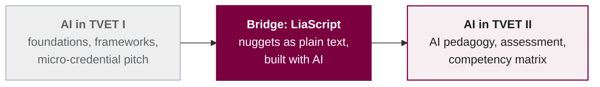
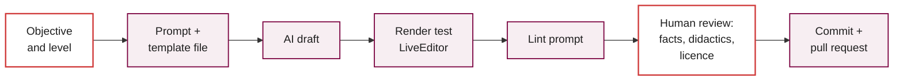

<!--
author:    Dr. Hannes Tegelbeckers
email:     hannes.tegelbeckers@ovgu.de
version:   1.1.0
language:  en
narrator:  UK English Female
mode:      Textbook

title:     S01 – Kick-off and LiaScript Live: organisation and your first AI-supported nugget (Self-learning unit)
comment:   AI in TVET II – Self-learning unit for session 1 (live, 26.11.2026): how the seminar works and how to pass, from AI in TVET I to AI in TVET II, the UNESCO AI CFT as compass, LiaScript Level 2 (feedback-rich quizzes, script-checked answers, playgrounds, macros and imports), professional hosting on GitHub, SCORM export, AI generation with template and test protocol. Obligatory SCORM unit.

import:    https://raw.githubusercontent.com/LiaTemplates/mermaid_template/0.1.4/README.md
-->

# S01 – Kick-off and LiaScript Live

> **Session 1 · 26.11.2026 · 🟢 Live** – this unit accompanies the kick-off. It contains the organisation and LiaScript Level 2 as a study text. It builds on AI in TVET I and does not repeat the basics.
>
> **Time needed:** about 90 minutes
>
> **📦 Obligatory:** completing this unit [in Moodle (SCORM)](https://elearning.ovgu.de/course/section.php?id=202215) is part of the pass requirement – all 7 units by **15.02.2027**.

**After this unit you will be able to …**

1. describe the schedule, the group product and the three pass requirements of AI in TVET II,
2. explain how AI in TVET II builds on AI in TVET I and how the UNESCO AI Competency Framework for Teachers guides your project,
3. extend a LiaScript nugget with Level-2 features – feedback-rich quizzes, script-checked answers, a playground, macros – using AI with a template and a test protocol,
4. host a group project professionally on GitHub (structure, pull requests, pinned links) and export a nugget as SCORM,
5. shortlist UNESCO learning objectives for your group project.

## 1. How This Seminar Works

AI in TVET II has **seven sessions** between 26.11.2026 and 21.01.2027, always on Thursdays from 09:00 to 12:00. Four sessions are live (26.11., 17.12., 07.01., 21.01.), two are self-learning sessions (03.12., 10.12.) in which you work with a unit like this one and enter your results inside the unit, and the format of 14.01. (live or self-learning) is announced in Moodle.

<!-- data-type="none" -->
| No. | Date | Format | Topic |
| --- | --- | --- | --- |
| 1 | 26.11.2026 | 🟢 Live | Kick-off, organisation · LiaScript Level 2 |
| 2 | 03.12.2026 | 🔵 Self-learning | AI and prompting Level 2: reliable learning material |
| 3 | 10.12.2026 | 🔵 Self-learning | AI vocabulary, models and workflows · choose your learning objective · matrix draft |
| 4 | 17.12.2026 | 🟢 Live | Pedagogical trends · AI for assessment and feedback · ethics |
| – | 21.12.2026 – 01.01.2027 | ⚪ Break | Christmas break |
| 5 | 07.01.2027 | 🟢 Live | Nuggets and micro-credentials · competency matrix workshop |
| 6 | 14.01.2027 | ⚪ Format tbc | Project development and peer review (live or self-learning) |
| 7 | 21.01.2027 | 🟢 Live | Final group presentations and reflection |

The [organisational overview](https://liascript.github.io/course/?https://raw.githubusercontent.com/OVGU-VET-TechEd/AI_in_TVET_II_WiSe_2026_2027/main/AI_in_TVET_II_WiSe_2026_2027/00_Organisation/organisational_overview_slide_AI_in_TVET_II.md) is the key reference for all dates and rules.

### How to pass

To pass the seminar you need **all three** of the following. They are not alternatives.

<!-- data-type="none" -->
| Requirement | What exactly | Deadline |
| --- | --- | --- |
| **1 · 📦 SCORM units** | All 7 self-learning units completed in Moodle (one per session). Units 3 and 6 contain the group hand-ins. | 15.02.2027 (hand-ins in units 3 and 6: 16.12.2026 and 18.01.2027) |
| **2 · 🎤 Group presentation** | 20 minutes + 5 minutes discussion in LiaScript on **one UNESCO learning objective**: competency matrix, sample AI-supported learning material, AI workflow | 21.01.2027 (file: 20.01.2027, 23:59) |
| **3 · 📤 Final submission** | GitHub link to your group's LiaScript presentation (incl. competency matrix) in Moodle | 15.02.2027 |

> [!IMPORTANT] Pass requirement
> Without all 7 completed SCORM units you cannot pass – even with an excellent presentation. The SCORM units are not graded; the group presentation is.

### Your group product

Your group (3–4 people) builds **one 20-minute LiaScript presentation**. Every session adds one building block to it:

<!-- data-type="none" -->
| Part of the presentation | What it shows | Built in session |
| --- | --- | --- |
| Learning objective | One objective from UNESCO AI CFT Competency 3, 4 or 5, exact wording, with a target group | 1 → 3 |
| Competency matrix | Acquire → Deepen → Create: content, workflow and AI tool per level | 3 → 5 |
| Sample material | At least one AI-supported learning element (nugget section, quiz, case, diagram), shown live | 1, 5 → 6 |
| AI workflow | Tools, prompts, what you kept and what you changed | 2 → 6 |
| Human role | Where humans decide and why | 2, 4 → 7 |

A complete, stand-alone self-learning course is **not** required.

**Check:** Which statements are true?

<!-- data-hint-button="1" data-solution-button="2" -->
- [[X]] All 7 SCORM units must be completed in Moodle by 15.02.2027.
- [[ ]] A very good group presentation can replace missing SCORM units.
- [[X]] The group presentation is about one UNESCO learning objective.
- [[ ]] Each group must build a complete stand-alone self-learning course.
[[?]] Read the red box "Pass requirement" again.
***
The SCORM units are an additional pass requirement. A complete course is not required – a convincing design with sample material is.
***

## 2. From AI in TVET I to AI in TVET II

AI in TVET I introduced AI foundations, the UNESCO and EU frameworks and the idea of AI-supported micro-credentials, and it ended with LiaScript and your pitch. AI in TVET II starts exactly there and changes the question: no longer *what* to offer, but *how* to teach, assess and justify AI-supported learning.



<!-- data-type="none" -->
| AI in TVET I asked … | AI in TVET II asks … |
| --- | --- |
| What is AI, which frameworks apply? | How does AI change teaching, learning and assessment? |
| Which micro-credential does the labour market need? | How do learners progress from *Acquire* to *Create*? |
| Can I build a nugget in LiaScript? | Can I generate, **check** and justify AI-supported material? |

If you did not attend AI in TVET I, the course website of [AI in TVET I](https://ovgu-vet-teched.github.io/AI_in_TVET_I_WiSe_2026_2027/) has all slides and self-learning units.

### The UNESCO compass

The **UNESCO AI Competency Framework for Teachers** (UNESCO, 2024) describes 15 competencies in five dimensions and three progression levels. The levels are the backbone of your competency matrix: *Acquire* means understanding and using basics, *Deepen* means applying and integrating, *Create* means designing new solutions.

<!-- data-type="none" -->
| Dimension | Acquire | Deepen | Create |
| --- | --- | --- | --- |
| 1 Human-centred mindset | Human agency | Human accountability | Social responsibility |
| 2 Ethics of AI | Ethical principles | Safe and responsible use | Co-creating ethical rules |
| **3 AI foundations and applications** | Basic AI techniques and applications | Application skills | Creating with AI |
| **4 AI pedagogy** | AI-assisted teaching | AI-pedagogy integration | AI-enhanced pedagogical transformation |
| **5 AI for professional development** | AI enabling lifelong professional learning | AI to enhance organizational learning | AI to support professional transformation |

Your group chooses **one learning objective from dimension 3, 4 or 5**. Dimensions 1 and 2 are not optional extras: they are the lens through which you check every design decision. Use the exact wording from the framework document and cite it – never let an AI tool invent competency numbers.

### Your baseline

You rated yourself on these dimensions at the start and the end of AI in TVET I. Enter your **end values from 19.11.2026** (or rate yourself now if you are new). **0** = not yet · **1** = Acquire · **2** = Deepen · **3** = Create. In the last session you compare – the difference is evidence for your reflection.

| Dimension | Your level |
| --- | --- |
| 1 Human-centred mindset | <script input="range" min="0" max="3" step="1" value="1" output="cft1">@input</script> |
| 2 Ethics of AI | <script input="range" min="0" max="3" step="1" value="1" output="cft2">@input</script> |
| 3 AI foundations and applications | <script input="range" min="0" max="3" step="1" value="1" output="cft3">@input</script> |
| 4 AI pedagogy | <script input="range" min="0" max="3" step="1" value="1" output="cft4">@input</script> |
| 5 AI for professional development | <script input="range" min="0" max="3" step="1" value="1" output="cft5">@input</script> |

<script modify="false" style="display:block">
const v = [@input(`cft1`), @input(`cft2`), @input(`cft3`), @input(`cft4`), @input(`cft5`)].map(Number);
const dims = ["Human-centred mindset","Ethics of AI","AI foundations and applications","AI pedagogy","AI for professional development"];
const lvl = ["not yet","Acquire","Deepen","Create"];
const bars = v.map((x,i) => `<div style="display:flex;align-items:center;gap:8px;margin:3px 0"><span style="width:240px">${i+1} ${dims[i]}</span><span style="display:inline-block;height:14px;width:${x*60+4}px;background:#7a003f;border-radius:3px"></span><span>${lvl[x]}</span></div>`).join("");
`HTML: ${bars}<p>📸 Take a screenshot – you compare it on 21.01.2027.</p>`
</script>

## 3. LiaScript Level 2

In AI in TVET I you learned the LiaScript basics: header, slides, quizzes, animations, narration, media and the GitHub raw link ([S06 of AI in TVET I](https://liascript.github.io/course/?https://raw.githubusercontent.com/OVGU-VET-TechEd/AI_in_TVET_I_WiSe_2026_2027/main/Selflearn/S06_Hands_on_LiaScript.md) – open it if anything below is unclear). AI in TVET II builds on that: your final presentation is not only a pitch file, but a small, well-built and version-controlled **OER project**. This chapter covers the features that turn a nugget into good self-learning material.

**Recall first** – two questions on the basics:

Which line creates a drag-and-drop gap?

- [( )] `[[a|(b)]]`
- [(X)] `[->[a|(b)]]`
- [( )] `{{a|b}}`

Which line starts a speaker note that is read on click 2?

- [( )] `{{2}}`
- [(X)] `--{{2}}--`
- [( )] `[[2]]`

### Feedback-rich quizzes

A quiz that only says *right* or *wrong* tests; a quiz with hints and explanations **teaches**. Three additions make the difference: an attribute comment directly above the options (hint button after one wrong try, solution button after two, shuffled options), hints with `[[?]]`, and an explanation between two `***` lines that appears when the quiz is solved.

```markdown
<!-- data-hint-button="1" data-solution-button="2" data-randomize -->
- [(X)] Check the value against the manufacturer's specification.
- [( )] Use the value – chatbots are trained on manuals.
[[?]] Who is accountable for the wheel staying on?
***
Only the manufacturer's specification is authoritative.
***
```

Try it: a chatbot tells an apprentice a torque value for a wheel nut. What should the apprentice do?

<!-- data-hint-button="1" data-solution-button="2" data-randomize -->
- [(X)] Check the value against the manufacturer's specification.
- [( )] Use the value – chatbots are trained on manuals.
- [( )] Ask the chatbot again until it gives the same value twice.
[[?]] Who is accountable for the wheel staying on?
***
Only the manufacturer's specification is authoritative. Asking twice measures consistency, not correctness.
***

### Text answers checked by script

A plain text gap `[[torque wrench]]` accepts exactly one spelling. In multilingual vocational classes this is unfair. A short script after the gap accepts variants – the script returns `true` or `false`:

```markdown
[[torque wrench]]
[[?]] It clicks when the value is reached.
<script>
const a = `@input`.trim().toLowerCase();
["torque wrench", "torque spanner", "drehmomentschlüssel"].includes(a)
</script>
```

Try it – type *torque spanner* or the German word:

Which tool tightens a bolt to a defined value?

[[torque wrench]]
[[?]] It clicks when the value is reached.
<script>
const a = `@input`.trim().toLowerCase();
["torque wrench", "torque spanner", "drehmomentschlüssel"].includes(a)
</script>

### Interactive playgrounds

Sliders and a short script turn a slide into a simulation. Each input gets a name (`output="u"`), the result script reads it with `@input(`u`)` and returns text. You do not need to be a programmer: describe the model precisely and let an AI write the script – then test it.

```markdown
Voltage (V): <script input="range" min="1" max="24" value="12" output="u">@input</script>
Resistance (Ω): <script input="range" min="1" max="100" value="10" output="r">@input</script>

<script>
const I = @input(`u`) / @input(`r`);
`Current: ${I.toFixed(2)} A`
</script>
```

Voltage (V): <script input="range" min="1" max="24" step="1" value="12" output="u">@input</script>

Resistance (Ω): <script input="range" min="1" max="100" step="1" value="10" output="r">@input</script>

<script>
const I = @input(`u`) / @input(`r`);
`Ohm's law: I = U / R = ${I.toFixed(2)} A ${I > 1 ? "⚠️ above 1 A – check the fuse rating" : "✅"}`
</script>

### Macros and imports

Reusable blocks belong in the header. A **macro** is defined once (`@name: …`, with parameters `@0`, `@1`) and used anywhere (`@name(a,b)`). **Imports** load templates from other LiaScript files, e.g. Mermaid diagrams, Python in the browser or text analysis tools from [LiaTemplates](https://github.com/LiaTemplates).

```markdown
<!--
import: https://raw.githubusercontent.com/LiaTemplates/mermaid_template/0.1.4/README.md

@AIdeclaration: <small>🤖 Created with AI support (@0), checked and revised by @1 · CC BY 4.0</small>
-->

## Last slide

@AIdeclaration(ChatGPT,Group 3)
```

With a macro, your licence line and AI declaration are identical in every nugget – and you change them in one place.

**Check:** Your group has five nuggets and wants to change the licence line in all of them. What is the best solution?

<!-- data-hint-button="1" data-solution-button="2" -->
- [( )] Edit the last slide of every nugget by hand.
- [(X)] Define a macro in one shared header file and import it into every nugget.
- [( )] Ask an AI to rewrite all five files.
[[?]] Where do reusable blocks belong?
***
A shared header file with the macro, imported via `import:`, keeps all nuggets consistent – one change updates everything.
***

## 4. Hosting Like a Professional

In AI in TVET I you uploaded a file to GitHub and opened its raw link. For a group project that several people edit over eight weeks, three habits make the difference.

### Structure

```text
AI_in_TVET_II_<topic>/
  README.md          what the project is + LiaScript badge + licence
  presentation.md    the 20-minute group presentation
  nuggets/           sample material, one file per nugget
  media/             images with credits
  LICENSE            CC BY 4.0
```

### Branches and pull requests

Instead of everybody editing `main`, each member works on a **branch** (e.g. `edit-matrix`), commits small changes with clear messages and opens a **pull request**. Another member reviews it before it is merged. The peer review in session 6 uses the same mechanism: you comment on the partner group's repository via an issue or pull request. Documentation: [GitHub Docs](https://docs.github.com/en/pull-requests).

### Pinned links

A raw link with `main` always shows the newest version – good while working, risky for a submission. Replace `main` by a **commit hash** and the link points to exactly one version forever. Submit the pinned link.

**Build your links:**

**User or organisation:** <script input="text" value="OVGU-VET-TechEd" output="gU" input-always-active>@input</script>

**Repository:** <script input="text" value="AI_in_TVET_II_WiSe_2026_2027" output="gR" input-always-active>@input</script>

**Branch or commit hash:** <script input="text" value="main" output="gB" input-always-active>@input</script>

**File path:** <script input="text" value="AI_in_TVET_II_WiSe_2026_2027/01_Kick-off_and_LiaScript_Live/S01_Kick-off_LiaScript_Live.md" output="gF" input-always-active>@input</script>

<script modify="false" style="display:block">
const c = s => s.trim().replace(/^\/+|\/+$/g,"").replace(/\s/g,"%20").replace(/[<>"]/g,"");
const u = c(`@input(`gU`)`), r = c(`@input(`gR`)`), b = c(`@input(`gB`)`) || "main", f = c(`@input(`gF`)`);
const lia = `https://liascript.github.io/course/?https://raw.githubusercontent.com/${u}/${r}/${b}/${f}`;
const pinned = /^[0-9a-f]{7,40}$/i.test(b);
const badge = `[](${lia})`;
`HTML: <p><b>LiaScript link:</b><br><a href="${lia}" target="_blank" rel="noopener" style="word-break:break-all">${lia}</a></p><p>${pinned ? "📌 <b>Pinned</b> to one commit – use it for the submission." : "🔄 <b>Moving</b> link – shows the newest version of <code>" + b + "</code>."}</p><p><b>README badge:</b></p><pre style="white-space:pre-wrap;background:#f7eef2;padding:8px;font-size:0.8em">${badge.replace(/</g,"&lt;")}</pre>`
</script>

### Export as SCORM

The 7 obligatory units of this seminar are LiaScript files exported with the [LiaScript exporter](https://github.com/LiaScript/LiaScript-Exporter) and uploaded to Moodle as SCORM activities. You can do the same with one of your nuggets – a strong argument at the *Create* level:

```bash
npx @liascript/exporter -i nugget.md -f scorm1.2 \
    --scorm-embed --scorm-masteryScore 0 -o nugget_SCORM
```

Two pitfalls: copy the `.md` into an **empty folder** first (the exporter packs the whole folder), and remember that `--scorm-masteryScore 0` means completion counts, not a quiz score. Test the zip in the [Moodle sandbox](https://sandbox.moodledemo.net/).

## 5. AI + Template + Test Protocol

In AI in TVET I you asked an AI to write LiaScript. Level 2 adds two things: a **template file** that shows the AI the exact syntax and structure you want, and a **test protocol** that catches errors before learners see them.



### Generation prompt

```text
You are an instructional designer for vocational education (TVET).
Use the attached LiaScript template file as the pattern for syntax and structure.
Create a LiaScript nugget (mode: Presentation, 4–5 slides) for this objective:
"<objective>" – UNESCO level: <Acquire | Deepen | Create>.
Target group: <…>.
Level-2 feature: <quiz with hints and solution | script-checked answer | slider playground>.
Every quiz: <!-- data-hint-button="1" data-solution-button="2" -->, hints [[?]]
and a *** solution block. Speaker notes --{{0}}-- on every slide.
Rules: never indent text by 4 or more spaces; do not invent sources or statistics;
mark uncertain facts with <!-- CHECK -->.
```

Attach the [presentation template](https://liascript.github.io/course/?https://raw.githubusercontent.com/OVGU-VET-TechEd/AI_in_TVET_II_WiSe_2026_2027/main/AI_in_TVET_II_WiSe_2026_2027/00_Organisation/Template_LiaScript_Presentation.md) or one of your working slides as the template file. The [LiaAgent](https://github.com/LiaScript/LiaAgent) of the LiaScript project shows where this leads: an agent that builds a course in phases and asks the author for approval after each phase.

### Lint prompt

Let the AI check its own output against known error patterns – fast, but not a replacement for the render test and your review:

```text
Check the LiaScript below against these rules and list every violation
with line number: (1) no text indented by 4+ spaces, (2) every quiz has
[[?]] hints and a *** solution block, (3) {{n}} steps count 1, 2, 3 without
gaps per slide, (4) every script returns a value, (5) no invented sources.
Do not rewrite the file. """<paste file>"""
```

### The AI tools log

Document every relevant AI use. Your group's log becomes the **AI workflow** slide of the final presentation – now including what the lint prompt and the render test found.

<!-- data-type="none" -->
| Date | Tool | Purpose | Prompt (short) | Found by test / review | What we changed and why |
| --- | --- | --- | --- | --- | --- |
| 26.11. | ChatGPT | Nugget level-up | "Use the attached template …" | Render test: indented solution block shown as code | Indentation removed; distractor rewritten |

## 6. Your Task for Session 1

This is the part you **submit inside this unit** – there is no separate upload. Your entries are saved when you press the submit button under each field.

### Task 1: level up a nugget

Take your **nugget or pitch from AI in TVET I** (or write a new 3–4 slide nugget) and level it up: one feedback-rich quiz (hint, solution block, randomised options), one script-checked text answer **or** slider playground, the AI declaration as a macro, render test and lint prompt passed, merged into your group repository via a pull request. Optional: export it as SCORM and test it in the Moodle sandbox.

**The pinned LiaScript link of your levelled-up nugget:**

[[___]]

**What did the AI get wrong – and how did you find it (render test, lint prompt, review)? (2–4 sentences)**

[[___ ___ ___]]

### Task 2: your group and shortlist

**Group members and repository link:**

[[___ ___]]

Look at two examples from the previous cohort (student products, public on GitHub). Ask yourself what works and what you would do differently:

- [AI Competency Assessment Programme – trainer guide, UNESCO LO 5.1.2, Acquire](https://liascript.github.io/course/?https://raw.githubusercontent.com/OVGU-VET-TechEd/AI_in_TVET_II_-LearningObjective-/main/AI-Competency-Trainer-Assessment-.md)
- [Feedback 4.0: AI-enhanced inclusive teaching in TVET](https://liascript.github.io/course/?https://raw.githubusercontent.com/OVGU-VET-TechEd/AI_in_TVET_II_-LearningObjective-/main/Final%20of%20AI%20in%20Tevt%20II.md)
- [AI-enhanced vocational English teaching](https://liascript.github.io/course/?https://raw.githubusercontent.com/OVGU-VET-TechEd/AI_in_TVET_II_-LearningObjective-/main/AI2%20LP%20V0.4%20for%20Lia.md)

**Your group's shortlist: 2–3 candidate learning objectives (competency + keyword), and one thing you learned from the examples:**

[[___ ___ ___]]

## Summary and Self-Check

- AI in TVET II has 7 sessions; **all 7 SCORM units are obligatory** (by 15.02.2027), in addition to the group presentation on 21.01.2027 and the final submission.
- Your group presents **one UNESCO learning objective** (competency 3, 4 or 5) with matrix, sample material and AI workflow.
- LiaScript Level 2: feedback-rich quizzes, script-checked answers, playgrounds, macros and imports make nuggets teach, not only test.
- A group project lives in a structured repository; changes go through pull requests; submissions use pinned links; nuggets can be exported as SCORM.
- AI writes LiaScript faster with a template – a render test, a lint prompt and your review catch its errors. The human steps cannot be delegated.

**Tick what you can do now:**

- [ ] I can name the three pass requirements and their deadlines.
- [ ] I can explain how AI in TVET II builds on AI in TVET I.
- [ ] I can write a quiz with hints and solution and a script-checked text answer.
- [ ] I can build a slider playground and a macro.
- [ ] I can create a pinned LiaScript link and open a pull request.
- [ ] Our group has a repository and a shortlist of learning objectives.

**Next session:** Thursday, 03.12.2026, 🔵 self-learning (I am travelling) – AI and prompting Level 2, unit S02. Reading: Schmager et al. (2025), *Understanding human-centred AI* (Moodle).

## References

- LiaScript. (n.d.). *LiaScript exporter* [GitHub repository]. https://github.com/LiaScript/LiaScript-Exporter
- LiaScript. (n.d.). *LiaScript documentation*. https://liascript.github.io/course/?https://raw.githubusercontent.com/liaScript/docs/master/README.md
- LiaScript. (n.d.). *LiaAgent – LiaScript teaching agent* [GitHub repository]. https://github.com/LiaScript/LiaAgent
- UNESCO. (2019). *Recommendation on Open Educational Resources (OER)*. https://www.unesco.org/en/legal-affairs/recommendation-open-educational-resources-oer
- UNESCO. (2024). *AI competency framework for teachers*. https://doi.org/10.54675/ZJTE2084

<small>Licence: CC BY 4.0 · Dr. Hannes Tegelbeckers, OVGU Magdeburg · Created with AI support (Claude), checked and revised by the author.</small>
