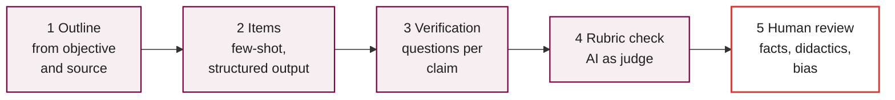

<!--
author:    Dr. Hannes Tegelbeckers
email:     hannes.tegelbeckers@ovgu.de
version:   2.0.0
language:  en
narrator:  UK English Female
mode:      Presentation
classroom: enable

title:     P02 – AI and Prompting Level 2: Reliable Learning Material (Session slides)
comment:   AI in TVET II – Slides for session 2 (self-learning, 03.12.2026, 180 min). Builds on AI in TVET I sessions 1–3: attention and context window, reliability of AI material generators, grounded vs. ungrounded generation, prompt pipelines (few-shot, structured output, chain-of-verification, LLM-as-judge), bias audit, human-centred AI lens applied. Interactive: Transformer Explainer attention task, reliability calculator, pipeline builder, bias audit.
tags:      AI, LLM, Prompting, Reliability, Grounding, Bias audit, Human-centred AI

import:    https://raw.githubusercontent.com/LiaTemplates/mermaid_template/0.1.4/README.md
-->

# AI and Prompting Level 2: Reliable Learning Material

**Session 2 · 03.12.2026 · 🔵 Self-learning** · AI in TVET II, OVGU Magdeburg

Attention and context · **how reliable is your generator?** · grounded vs. ungrounded · prompt pipelines · bias audit · the human-centred lens applied

<small>[Self-learning unit S02](https://liascript.github.io/course/?https://raw.githubusercontent.com/OVGU-VET-TechEd/AI_in_TVET_II_WiSe_2026_2027/main/AI_in_TVET_II_WiSe_2026_2027/02_Introduction_AI_and_Prompting/S02_Introduction_AI_Prompting.md) · [Unit in Moodle (SCORM, obligatory)](https://elearning.ovgu.de/course/section.php?id=202215) · [HTML slides](https://ovgu-vet-teched.github.io/AI_in_TVET_II_WiSe_2026_2027/AI_in_TVET_II_WiSe_2026_2027/02_Introduction_AI_and_Prompting/P02_Introduction_AI_Prompting.html) · [Organisational overview](https://liascript.github.io/course/?https://raw.githubusercontent.com/OVGU-VET-TechEd/AI_in_TVET_II_WiSe_2026_2027/main/AI_in_TVET_II_WiSe_2026_2027/00_Organisation/organisational_overview_slide_AI_in_TVET_II.md)</small>

    --{{0}}--
Today I am travelling, so you work with these slides and the self-learning unit S02. In AI in TVET one you learned how a language model writes and how to prompt it. Today you test how reliable it is when it produces learning material, and you build a prompt pipeline that catches its errors.

## Check-in: What Do You Bring From AI in TVET I? 🎒

**Which of these could you explain to a colleague right now?** (AI in TVET I, sessions 1–3)

- [[tok]] Tokens and next-token prediction
- [[temp]] Temperature
- [[five]] The five prompt building blocks
- [[clear]] The CLEAR framework
- [[pat]] Prompt patterns (persona, template, fact-check …)
- [[ref]] Why AI references must be checked
- [[hcai]] Human-centred AI

**Which one is shaky?**

[[___]]

    --{{0}}--
Everything on this list comes from AI in TVET one. If one item is shaky, revisit the slides of AI in TVET one, sessions one to three. Today assumes this knowledge and goes further.

## Where We Are 🧭

```mermaid @mermaid
flowchart LR
  S1["<b>1 · 26.11.</b><br>Kick-off and<br>LiaScript Level 2"]:::done
  S1 --> S2["<b>2 · 03.12.</b> 🔵<br>AI and prompting<br>Level 2"]:::now
  S2 --> S3["<b>3 · 10.12.</b> 🔵<br>Vocabulary and<br>workflows"]:::self
  S3 --> S4["<b>4 · 17.12.</b><br>Pedagogy, assessment,<br>ethics"]:::live
  S4 --> S5["<b>5 · 07.01.</b><br>Nuggets and<br>matrix workshop"]:::live
  S5 --> S6["<b>6 · 14.01.</b> ⚪<br>Project and peer review<br>format tbc"]:::tbc
  S6 --> S7["<b>7 · 21.01.</b><br>Final<br>presentations"]:::live
  classDef live fill:#f7eef2,stroke:#7a003f,stroke-width:1.5px,color:#1f1f1f
  classDef self fill:#e8f0fb,stroke:#1565c0,stroke-width:1.5px,color:#1f1f1f
  classDef tbc fill:#fff8e1,stroke:#b7791f,stroke-width:1.5px,stroke-dasharray:4 3,color:#1f1f1f
  classDef now fill:#7a003f,stroke:#7a003f,stroke-width:2px,color:#ffffff
  classDef done fill:#eeeeee,stroke:#9ca3af,stroke-width:1px,color:#5f6163
```



**Building block today:** your **AI workflow** – a tested prompt pipeline for your group's sample material, documented in the AI tools log.

## Today's Objectives 🎯

By the end of today you can …

    --{{1}}--
First, why AI-generated material is unreliable – and how to measure it.

      {{1}}
****************************************

1. **explain** how attention, context window and sampling affect AI-generated learning material,
2. **measure** the reliability of an AI material generator and **audit** its output for bias,
3. **compare** grounded and ungrounded generation with an authoritative source,

****************************************

    --{{2}}--
Second, how to build a pipeline that catches the errors – and where humans stay in control.

      {{2}}
****************************************

4. **design** a prompt pipeline for learning material: few-shot, structured output, verification, rubric check,
5. **justify** the human checkpoints of your pipeline with the human-centred AI lens.

****************************************

## Suggested Time Plan 🗓️

<!-- data-type="none" -->
| Time | Block | Mode |
| --- | --- | --- |
| 0:00 | Check-in · attention and context window | Individual |
| 0:30 | Reliability experiment: same prompt, five runs | Individual |
| 1:00 | Grounded vs. ungrounded generation | Individual |
| 1:30 | Break | 15 min |
| 1:45 | Prompt pipeline: build and run | Group (online) |
| 2:25 | Bias audit · human-centred checkpoints | Group |
| 2:50 | Unit S02 entries · exit ticket | Individual |

    --{{0}}--
This is a suggestion. Questions go to the Moodle forum; we discuss them at the start of session four.

## 1. Attention: What Does the Model Look At? 👀

In AI in TVET I you watched the **next-token** prediction. Now look one layer deeper: **attention** decides which earlier tokens shape the next one.

??[Transformer Explainer – Polo Club, Georgia Tech](https://poloclub.github.io/transformer-explainer/)

    --{{1}}--
Type the sentence below and open the attention view. Which word does "it" attend to? This is how the model resolves references, and where it can go wrong in technical texts.

      {{1}}
****************************************

**Task (10 min):** type *"The apprentice replaced the fuse because it was broken"* and open the **attention** view.

1. Which tokens does *"it"* attend to most?
2. Change *"broken"* to *"cheap"*. Does the attention shift?

**What does this mean for long technical instructions with many "it", "this", "the part"?**

[[___ ___]]

****************************************

## Context Window: Lost in the Middle 📚

Long contexts are not read evenly: models use information at the **beginning and end** of a long input better than in the **middle** (Liu et al., 2024).

    --{{1}}--
This has direct consequences for how you give a model your source material.

      {{1}}
<!-- data-type="none" -->
| If you … | Risk | Better |
| --- | --- | --- |
| paste a 60-page regulation and ask for a quiz | key rules in the middle are ignored | paste only the relevant section |
| put the instructions before a long text | instructions "forgotten" | instructions **before and after** the source |
| ask about many topics at once | shallow, generic items | one topic per prompt (→ pipeline) |

**Decide:** You need quiz items on section 7 of a 40-page safety regulation. Best input?

<!-- data-hint-button="1" data-solution-button="2" -->
- [( )] The whole regulation – more context is always better.
- [(X)] Section 7 only, delimited, with the instruction repeated after it.
- [( )] No source – the model knows the regulation.
[[?]] Remember "lost in the middle".

## 2. How Reliable Is Your Generator? 🎲

Sampling makes every run different. For learning material this is a **quality problem**: the same prompt can give a correct answer key today and a wrong one tomorrow.

    --{{1}}--
Run a small experiment. It takes twenty minutes and tells you more about AI-generated material than any article.

      {{1}}
****************************************

**Experiment (20 min):** run **the same prompt five times** in new chats:

```text
Create 4 single-choice items (4 options each) with answer key on: <your topic>.
Target group: <…>. Format: LiaScript - [( )] / - [(X)].
```

Count: **(a)** items with a **correct** answer key, **(b)** items whose key is the **same** across runs (for comparable questions).

****************************************

## Playground: Reliability Calculator 📏

**Runs:** <script input="range" min="2" max="10" step="1" value="5" output="n">@input</script>

**Items per run:** <script input="range" min="1" max="10" step="1" value="4" output="k">@input</script>

**Items with a correct key (all runs together):** <script input="range" min="0" max="100" step="1" value="16" output="c">@input</script>

**Comparable items with the same key in every run:** <script input="range" min="0" max="10" step="1" value="2" output="s">@input</script>

<script modify="false" style="display:block">
const n = +@input(`n`), k = +@input(`k`), total = n * k;
const c = Math.min(+@input(`c`), total), s = Math.min(+@input(`s`), k);
const acc = c / total, cons = s / k;
const col = x => x >= 0.9 ? "#2e7d32" : (x >= 0.7 ? "#b7791f" : "#d03b3b");
const bar = (x, l) => `<div style="margin:4px 0"><span style="display:inline-block;width:150px">${l}</span><span style="display:inline-block;height:14px;width:${Math.round(x*260)}px;background:${col(x)};border-radius:3px"></span> <b>${Math.round(x*100)} %</b></div>`;
const verdict = acc >= 0.95 && cons >= 0.9 ? "🟢 Reliable enough for <b>drafts</b> – still check every item before learners see it." : (acc >= 0.8 ? "🟡 <b>Every item needs a human check</b> – about one in " + Math.max(2, Math.round(1/(1-acc))) + " keys is wrong." : "🔴 <b>Not usable without grounding and verification</b> – use a source and a verification step.");
`HTML: ${bar(acc, "Correct keys")}${bar(cons, "Consistent keys")}<p>${verdict}</p><p><small>${total} items generated in total.</small></p>`
</script>

    --{{0}}--
Enter your counts. Even ninety percent correct keys means: in a quiz of ten items, one teaches something wrong. That is why every pipeline needs a verification step and a human check.

## 3. Grounded vs. Ungrounded Generation 📎

In AI in TVET I you met NotebookLM as a tool. Now **test** what grounding changes.

    --{{1}}--
Choose an authoritative source for your topic, ask the same five questions with and without the source, and count the errors.

      {{1}}
****************************************

**Experiment (25 min):**

1. Take **one authoritative source** for your topic (e.g. a manufacturer manual, an occupational safety rule, a curriculum section).
2. Upload it to [NotebookLM](https://notebooklm.google.com) (grounded) – ask the same questions in a normal chat (ungrounded).
3. Ask **5 questions**, including **one that the source cannot answer**.

<!-- data-type="none" -->
| Question | Ungrounded: correct? | Grounded: correct? | Grounded: cites the passage? |
| --- | --- | --- | --- |
| 1 … 4 | | | |
| 5 (not in the source) | invented? | "not in the source"? | – |

****************************************

**Decide:** Question 5 is not covered by the source. Which answer shows good grounding?

<!-- data-hint-button="1" data-solution-button="2" -->
- [( )] A confident answer with general knowledge.
- [(X)] "The source does not cover this" – possibly with a suggestion where to look.
- [( )] A made-up quotation from the source.
[[?]] What should a grounded system do when the source is silent?

## 4. From Prompt to Pipeline 🔗

A single prompt does everything at once. A **pipeline** splits the work – and adds checks between the steps.



    --{{1}}--
Each step uses a technique that goes beyond the prompt patterns of AI in TVET one.

      {{1}}
<!-- data-type="none" -->
| Step | Technique | Why |
| --- | --- | --- |
| 2 | **Few-shot** with one model item you wrote | Quality and style follow your example |
| 2 | **Structured output** (LiaScript syntax or JSON schema) | Output can be tested and reused |
| 3 | **Chain-of-verification:** the model writes check questions for each claim, answers them independently, then revises | Fewer hallucinations (Dhuliawala et al., 2023) |
| 4 | **LLM-as-judge** with your rubric | Fast screening – but judges prefer long answers and their own style (Zheng et al., 2023) |
| all | **Reusable assistant** with a system prompt (Custom GPT, Claude Project, Gemini Gem) | The group uses the same rules every time |

## Playground: Pipeline Builder 🛠️

**Objective:** <script input="text" value="Apprentices check a chatbot answer on a safety rule against the regulation" output="o" input-always-active>`@input`</script>

**Target group:** <script input="text" value="second-year apprentices, electrical trades, English B1" output="t" input-always-active>`@input`</script>

**Source:** <script input="text" value="DGUV Regulation 3, section 5 (pasted below the prompt)" output="q" input-always-active>`@input`</script>

<script modify="false" style="display:block">
const e = s => s.replace(/</g,"&lt;");
const o = e(`@input(`o`)`), t = e(`@input(`t`)`), q = e(`@input(`q`)`);
const box = (h, x) => `<p style="margin:8px 0 2px"><b>${h}</b></p><pre style="white-space:pre-wrap;background:#f7eef2;border-left:4px solid #7a003f;padding:8px;font-size:0.8em;margin:0">${x}</pre>`;
`HTML: ${box("Step 1 – outline", `Use ONLY the source: ${q}.\nObjective: "${o}". Target group: ${t}.\nList the 4–6 facts learners must know, each with the exact source passage.`)}${box("Step 2 – items (few-shot, structured)", `Here is one model item I wrote: <your item>.\nWrite 4 items in the same style, LiaScript syntax - [( )] / - [(X)],\none per fact from step 1, each with a hint [[?]] and a *** explanation.`)}${box("Step 3 – chain-of-verification", `For each item: write 2 verification questions about its facts,\nanswer them using ONLY the source, then list items that must change.`)}${box("Step 4 – rubric check", `Rate each item 1–3 on: correct key · plausible distractors · fits the objective · B1 language.\nQuote the item. Do not rewrite. Flag anything below 3.`)}`
</script>

    --{{0}}--
Enter your own objective and source. Copy the four prompts one after another into the same chat, together with your source text. Step five, the human review, is yours.

## Try It: Run Your Pipeline (25 min) 🧪

Run the four steps for **one objective from your shortlist** – ideally in a **reusable assistant** (Custom GPT, Claude Project or Gemini Gem) with your group's rules as system prompt.

    --{{1}}--
Then compare with the reliability experiment: did the pipeline reduce the errors?

      {{1}}
****************************************

**Compare:** errors in the single-prompt version vs. after step 3 and 4.

- [(less)] Clearly fewer errors
- [(same)] About the same
- [(more)] More errors or new problems

**Which error did step 3 or 4 catch – and which one only you?**

[[___ ___]]

****************************************

## 5. Audit Your Generator for Bias ⚖️

In AI in TVET I you saw that models carry the bias of their data (e.g. *Quick, Draw!*). Now **measure** it in your own material.

**Task:** generate **10 short workplace cases** for your occupation (*"Write a 60-word workplace case for apprentices in …"*). Count:

| Count in your 10 cases | Number |
| --- | --- |
| Women as protagonists | <script input="range" min="0" max="10" step="1" value="2" output="w">@input</script> |
| Women in the expert role (master, engineer, trainer) | <script input="range" min="0" max="10" step="1" value="1" output="x">@input</script> |
| Names not typical for the majority population | <script input="range" min="0" max="10" step="1" value="1" output="m">@input</script> |
| Cases where the learner, not the expert, solves the problem | <script input="range" min="0" max="10" step="1" value="3" output="a">@input</script> |

<script modify="false" style="display:block">
const w = +@input(`w`), x = +@input(`x`), m = +@input(`m`), a = +@input(`a`);
const f = [];
if (w < 3) f.push("👥 Women appear in only " + w + " of 10 cases – does this reflect your target group, or the training data?");
if (x < 2) f.push("🎓 Experts are almost always men – a hidden curriculum about who is competent.");
if (m < 2) f.push("🌍 Little diversity of names – learners with migration background rarely see themselves.");
if (a < 4) f.push("🧠 The expert usually solves the problem – learners rarely act as agents.");
`HTML: ${f.length ? "<ul><li>" + f.join("</li><li>") + "</li></ul><p>✍️ Add a rule to your system prompt – and audit again.</p>" : "<p>✅ No strong pattern in this sample. Audit again with another prompt or model.</p>"}`
</script>

    --{{0}}--
Count honestly. If you find a pattern, write a rule into your assistant's system prompt and repeat the audit. That before-and-after comparison is excellent material for your AI workflow slide.

## The Human-Centred Lens – Applied 🔎

You know human-centred AI from AI in TVET I. Now **apply** the three elements (Schmager et al., 2025) to your pipeline:

<!-- data-type="none" -->
| Element | Question for your pipeline | Your decision |
| --- | --- | --- |
| **Purpose** – augmentation vs. automation | Which steps does AI do, which steps does it only support? | e.g. AI drafts and screens, humans decide |
| **Values** – ethical, protection, performance | Where could the pipeline harm fairness, privacy or safety? | e.g. bias audit, no learner data |
| **Properties** – oversight, comprehension, integrity | Where can a human see, check and override? | e.g. step 5, logged in the AI tools log |

    --{{1}}--
Write down your three decisions. They become the human-role part of your final presentation.

      {{1}}
**Our three decisions (purpose · values · properties):**

[[___ ___ ___]]

## Learn More: Free Courses for Educators 🎓

<!-- data-type="none" -->
| Provider | Course | Goes beyond AI in TVET I with … |
| --- | --- | --- |
| Anthropic | [AI Fluency for Educators](https://anthropic.skilljar.com/ai-fluency-for-educators) | the 4D framework: Delegation, Description, Discernment, Diligence |
| Microsoft | [AI for educators (Microsoft Learn)](https://learn.microsoft.com/en-us/training/paths/ai-education/) | classroom scenarios with Copilot |
| Google | [Generative AI for Educators](https://grow.google/ai-for-educators/) | prompting for lesson planning |

    --{{0}}--
These courses are optional. Look at them also as examples of self-learning design by large providers, and ask whose tools they promote.

## Project Lab 🛠️

As a group (online):

- [ ] set up a **reusable assistant** for your group (system prompt: objective, target group, template, rules from the bias audit)
- [ ] run the **pipeline** once for your sample material
- [ ] add the results of the **reliability**, **grounding** and **bias** experiments to your AI tools log

    --{{1}}--
Paste your system prompt into the unit. It is the core of the AI workflow slide in January.

      {{1}}
**Our assistant's system prompt (short):**

[[___ ___ ___]]

## Exit Ticket 🎟️

**Objective 1:** Why should you paste only the relevant section of a long regulation?

<!-- data-hint-button="1" data-solution-button="2" -->
- [(X)] Information in the middle of long inputs is used less reliably.
- [( )] Long inputs are always refused.
- [( )] Shorter prompts are cheaper, nothing else changes.
[[?]] Lost in the middle.

**Objective 2:** 18 of 20 generated answer keys are correct. What follows?

<!-- data-hint-button="1" data-solution-button="2" -->
- [( )] Good enough – use the quiz as it is.
- [(X)] Every item needs a human check; one in ten teaches something wrong.
- [( )] Increase the temperature.
[[?]] Remember the reliability calculator.

**Objective 3:** In our grounding test, the source-silent question was …

- [(1)] answered with "not in the source"
- [(2)] answered with invented content

**Objective 4:** What does chain-of-verification add?

<!-- data-hint-button="1" data-solution-button="2" -->
- [( )] More creative distractors.
- [(X)] Check questions per claim, answered independently, then a revision.
- [( )] A higher temperature for each step.
[[?]] Dhuliawala et al. (2023).

**Objective 5:** One step of our pipeline that must stay human:

[[___]]

## Your SCORM Unit and Next Steps 📦

**Obligatory:** complete the self-learning unit **S02** in Moodle – the study text for today with your experiment results.

    --{{1}}--
Next week is self-learning again, with the first group hand-in.

      {{1}}
****************************************

- 📦 [S02 in Moodle (SCORM)](https://elearning.ovgu.de/course/section.php?id=202215) · [S02 in LiaScript](https://liascript.github.io/course/?https://raw.githubusercontent.com/OVGU-VET-TechEd/AI_in_TVET_II_WiSe_2026_2027/main/AI_in_TVET_II_WiSe_2026_2027/02_Introduction_AI_and_Prompting/S02_Introduction_AI_Prompting.md) – all 7 units by **15.02.2027**
- ➡️ **Next: Thursday, 10.12.2026, 🔵 self-learning** – AI vocabulary, models and workflows · **choose your learning objective** · first competency matrix
- 📤 **Group hand-in inside unit S03: 16.12.2026, 23:59**
- 📖 Readings for session 3: Chen et al. (2025) on prompt engineering · *Agentic AI in Higher Education and TVET* (AI-generated report) – Moodle

****************************************

## References

- Chen, B., Zhang, Z., Langrené, N., & Zhu, S. (2025). Unleashing the potential of prompt engineering for large language models. *Patterns, 6*, 101260. https://doi.org/10.1016/j.patter.2025.101260
- Dhuliawala, S., Komeili, M., Xu, J., Raileanu, R., Li, X., Celikyilmaz, A., & Weston, J. (2023). *Chain-of-verification reduces hallucination in large language models* (arXiv:2309.11495). https://arxiv.org/abs/2309.11495
- Liu, N. F., Lin, K., Hewitt, J., Paranjape, A., Bevilacqua, M., Petroni, F., & Liang, P. (2024). Lost in the middle: How language models use long contexts. *Transactions of the Association for Computational Linguistics, 12*, 157–173. https://doi.org/10.1162/tacl_a_00638
- Polo Club of Data Science. (n.d.). *Transformer Explainer* [Interactive visualisation]. Georgia Institute of Technology. https://poloclub.github.io/transformer-explainer/
- Schmager, S., Pappas, I. O., & Vassilakopoulou, P. (2025). Understanding human-centred AI: A review of its defining elements and a research agenda. *Behaviour & Information Technology, 44*(15), 3771–3810. https://doi.org/10.1080/0144929X.2024.2448719
- UNESCO. (2023). *Guidance for generative AI in education and research*. https://doi.org/10.54675/EWZM9535
- Zheng, L., Chiang, W.-L., Sheng, Y., Zhuang, S., Wu, Z., Zhuang, Y., Lin, Z., Li, Z., Li, D., Xing, E. P., Zhang, H., Gonzalez, J. E., & Stoica, I. (2023). Judging LLM-as-a-judge with MT-Bench and Chatbot Arena. In *Advances in Neural Information Processing Systems 36* (NeurIPS 2023). https://arxiv.org/abs/2306.05685

**Builds on:** AI in TVET I, sessions 1–3 (LLM basics, prompting, limitations, human-centred AI) – [course website](https://ovgu-vet-teched.github.io/AI_in_TVET_I_WiSe_2026_2027/)

<small>Licence: CC BY 4.0 · Dr. Hannes Tegelbeckers, OVGU Magdeburg · Created with AI support (Claude), checked by the author. Linked tools: their own licences apply.</small>
