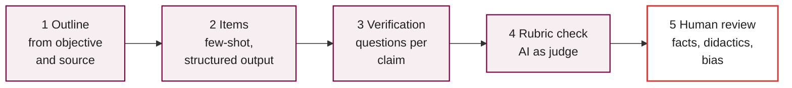

<!--
author:    Dr. Hannes Tegelbeckers
email:     hannes.tegelbeckers@ovgu.de
version:   3.0.0
language:  en
narrator:  UK English Female
mode:      Textbook

title:     S02 – AI and Prompting Level 2: reliable learning material (Self-learning unit)
comment:   AI in TVET II – Self-learning unit for session 2 (self-learning, 03.12.2026). Builds on AI in TVET I sessions 1–3: attention and context window, reliability of AI material generators, grounded vs. ungrounded generation, prompt pipelines (few-shot, structured output, chain-of-verification, LLM-as-judge), bias audit, human-centred AI lens applied. Obligatory SCORM unit.

import:    https://raw.githubusercontent.com/LiaTemplates/mermaid_template/0.1.4/README.md
-->

# S02 – AI and Prompting Level 2: Reliable Learning Material

> **Session 2 · 03.12.2026 · 🔵 Self-learning** – I am travelling; work through this unit individually and with your group (online).
>
> **Time needed:** about 3 hours
>
> **📦 Obligatory:** completing this unit [in Moodle (SCORM)](https://elearning.ovgu.de/course/section.php?id=202215) is part of the pass requirement – all 7 units by **15.02.2027**. Your experiment results are entered in this unit.

**This unit builds on AI in TVET I.** You already know how an LLM predicts the next token, what temperature does, the five prompt building blocks, the CLEAR framework, prompt patterns, why AI references must be checked, and the idea of human-centred AI ([AI in TVET I, sessions 1–3](https://ovgu-vet-teched.github.io/AI_in_TVET_I_WiSe_2026_2027/)). This unit does not repeat them. It asks the next question: **how reliable is AI when it produces learning material – and how do you build a workflow that catches its errors?**

**After this unit you will be able to …**

1. explain how attention, context window and sampling affect AI-generated learning material,
2. measure the reliability of an AI material generator and audit its output for bias,
3. compare grounded and ungrounded generation with an authoritative source,
4. design a prompt pipeline for learning material with few-shot examples, structured output, verification and a rubric check,
5. justify the human checkpoints of your pipeline with the human-centred AI lens.

## 1. Attention and Context Window

Next-token prediction – which you know from AI in TVET I – depends on **attention**: in every layer, each token weighs all earlier tokens and decides which ones matter for the next prediction. This is how a model resolves *it*, *this* or *the part* in a technical instruction. When the reference is ambiguous, attention can go wrong, and the model then explains or asks about the wrong object.

**Try it:** open the Transformer Explainer, type *"The apprentice replaced the fuse because it was broken"* and open the attention view. Which tokens does *"it"* attend to? Change *"broken"* to *"cheap"* – does the attention shift?

??[Transformer Explainer – Polo Club, Georgia Tech](https://poloclub.github.io/transformer-explainer/)

For a visual explanation of attention, read [The Illustrated Transformer](https://jalammar.github.io/illustrated-transformer/) (Alammar).

**Your observation – and what it means for long technical instructions:**

[[___ ___]]

### Lost in the middle

A large context window does not mean that everything in it is used equally. In experiments with long inputs, models used information at the **beginning and the end** much better than information in the **middle** (Liu et al., 2024). For learning material this has three practical consequences:

<!-- data-type="none" -->
| If you … | Risk | Better |
| --- | --- | --- |
| paste a 60-page regulation and ask for a quiz | key rules in the middle are ignored | paste only the relevant section |
| put the instructions before a long text | instructions "forgotten" | instructions before **and** after the source |
| ask about many topics at once | shallow, generic items | one topic per prompt (→ pipeline, chapter 4) |

**Check:** You need quiz items on section 7 of a 40-page safety regulation. Best input?

<!-- data-hint-button="1" data-solution-button="2" -->
- [( )] The whole regulation – more context is always better.
- [(X)] Section 7 only, delimited, with the instruction repeated after it.
- [( )] No source – the model knows the regulation.
[[?]] Remember "lost in the middle".
***
Only the relevant section, clearly delimited (e.g. with `"""`), with the instruction before and after it.
***

## 2. How Reliable Is Your Generator?

Because the next token is sampled, every run of the same prompt gives a different result. For entertainment this is a feature; for learning material it is a **quality problem**: an answer key can be correct today and wrong tomorrow. You cannot see this in a single run – you have to measure it.

### Experiment: same prompt, five runs

Run this prompt **five times**, each time in a new chat:

```text
Create 4 single-choice items (4 options each) with answer key on: <your topic>.
Target group: <…>. Format: LiaScript - [( )] / - [(X)].
```

Count **(a)** the items with a correct answer key and **(b)** the comparable items whose key is the same in every run. Enter your counts:

**Runs:** <script input="range" min="2" max="10" step="1" value="5" output="n">@input</script>

**Items per run:** <script input="range" min="1" max="10" step="1" value="4" output="k">@input</script>

**Items with a correct key (all runs together):** <script input="range" min="0" max="100" step="1" value="16" output="c">@input</script>

**Comparable items with the same key in every run:** <script input="range" min="0" max="10" step="1" value="2" output="s">@input</script>

<script modify="false" style="display:block">
const n = +@input(`n`), k = +@input(`k`), total = n * k;
const c = Math.min(+@input(`c`), total), s = Math.min(+@input(`s`), k);
const acc = c / total, cons = s / k;
const col = x => x >= 0.9 ? "#2e7d32" : (x >= 0.7 ? "#b7791f" : "#d03b3b");
const bar = (x, l) => `<div style="margin:4px 0"><span style="display:inline-block;width:150px">${l}</span><span style="display:inline-block;height:14px;width:${Math.round(x*260)}px;background:${col(x)};border-radius:3px"></span> <b>${Math.round(x*100)} %</b></div>`;
const verdict = acc >= 0.95 && cons >= 0.9 ? "🟢 Reliable enough for drafts – still check every item." : (acc >= 0.8 ? "🟡 Every item needs a human check." : "🔴 Not usable without grounding and verification.");
`HTML: ${bar(acc, "Correct keys")}${bar(cons, "Consistent keys")}<p>${verdict}</p>`
</script>

Even 90 % correct keys means: in a ten-item quiz, one item teaches something wrong. A lower temperature makes runs more similar, but **not more correct** – consistency and correctness are different things.

**Your result (topic, model, correct keys, consistent keys) and one wrong item you found:**

[[___ ___ ___]]

## 3. Grounded vs. Ungrounded Generation

In AI in TVET I you met retrieval-based tools such as NotebookLM. Now test what grounding actually changes for your topic.

### Experiment

1. Take **one authoritative source** for your topic – a manufacturer manual, an occupational safety rule, a curriculum section.
2. Upload it to [NotebookLM](https://notebooklm.google.com) (grounded) and ask the same questions in a normal chat without the source (ungrounded).
3. Ask **five questions**, including **one that the source cannot answer**.

<!-- data-type="none" -->
| Question | Ungrounded: correct? | Grounded: correct? | Grounded: cites the passage? |
| --- | --- | --- | --- |
| 1 … 4 | | | |
| 5 (not in the source) | invented? | "not in the source"? | – |

Typical result: grounded answers are more precise and traceable – but grounding is only as good as the source, and some tools still fill gaps with general knowledge. The decisive test is question 5.

**Check:** Question 5 is not covered by the source. Which answer shows good grounding?

<!-- data-hint-button="1" data-solution-button="2" -->
- [( )] A confident answer with general knowledge.
- [(X)] "The source does not cover this" – possibly with a suggestion where to look.
- [( )] A made-up quotation from the source.
[[?]] What should a grounded system do when the source is silent?

**Your result: source, number of correct answers ungrounded vs. grounded, and what happened with question 5:**

[[___ ___ ___]]

## 4. From Prompt to Pipeline

The prompt patterns from AI in TVET I improve a single prompt. For learning material that others will use, one prompt that does everything at once is too fragile. A **pipeline** splits the work into steps and puts a check between them.



### Techniques in the pipeline

<!-- data-type="none" -->
| Step | Technique | Why |
| --- | --- | --- |
| 1 | **Grounded outline:** facts with exact source passages | Every item can be traced to the source |
| 2 | **Few-shot** with one model item *you* wrote | Quality and style follow your example |
| 2 | **Structured output** (LiaScript syntax or a JSON schema) | Output can be tested and reused automatically |
| 3 | **Chain-of-verification:** the model writes check questions for each claim, answers them independently from the draft, then revises | Reduces hallucinations (Dhuliawala et al., 2023) |
| 4 | **LLM-as-judge** with your rubric | Fast screening of many items – but judges prefer long answers, the first option shown and their own style (Zheng et al., 2023) |
| all | **Reusable assistant** with a system prompt (Custom GPT, Claude Project, Gemini Gem) | The group works with the same rules every time |

The review by Chen et al. (2025) – reading for session 3 – describes these and further advanced techniques (self-consistency, least-to-most, ReAct).

### The four prompts

Adapt them to your objective and source, and run them one after another in the same chat, with the source pasted below the first prompt:

```text
Step 1 – Use ONLY the source below. Objective: "<objective>". Target group: <…>.
List the 4–6 facts learners must know, each with the exact source passage.

Step 2 – Here is one model item I wrote: <item>. Write 4 items in the same style,
LiaScript syntax - [( )] / - [(X)], one per fact from step 1, each with a hint [[?]]
and a *** explanation.

Step 3 – For each item: write 2 verification questions about its facts, answer them
using ONLY the source, then list the items that must change and change them.

Step 4 – Rate each item 1–3 on: correct key · plausible distractors · fits the
objective · B1 language. Quote the item. Do not rewrite. Flag anything below 3.
```

**Check:** What does chain-of-verification add to a single prompt?

<!-- data-hint-button="1" data-solution-button="2" -->
- [( )] More creative distractors.
- [(X)] Check questions per claim, answered independently, then a revision.
- [( )] A higher temperature for each step.
[[?]] The model questions its own draft.

**Compare with your reliability experiment: which errors did steps 3 and 4 catch – and which only you?**

[[___ ___ ___]]

## 5. Audit Your Generator for Bias

In AI in TVET I you saw that models carry the bias of their training data. In your own material, bias is rarely visible in a single case – it becomes visible in **patterns** across many outputs. A small audit makes it measurable.

**Task:** generate **10 short workplace cases** for the occupation of your target group (*"Write a 60-word workplace case for apprentices in …"*) and count:

| Count in your 10 cases | Number |
| --- | --- |
| Women as protagonists | <script input="range" min="0" max="10" step="1" value="2" output="w">@input</script> |
| Women in the expert role (master, engineer, trainer) | <script input="range" min="0" max="10" step="1" value="1" output="x">@input</script> |
| Names not typical for the majority population | <script input="range" min="0" max="10" step="1" value="1" output="m">@input</script> |
| Cases where the learner, not the expert, solves the problem | <script input="range" min="0" max="10" step="1" value="3" output="a">@input</script> |

<script modify="false" style="display:block">
const w = +@input(`w`), x = +@input(`x`), m = +@input(`m`), a = +@input(`a`);
const f = [];
if (w < 3) f.push("Women appear in only " + w + " of 10 cases – does this reflect your target group, or the training data?");
if (x < 2) f.push("Experts are almost always men – a hidden curriculum about who is competent.");
if (m < 2) f.push("Little diversity of names – learners with migration background rarely see themselves.");
if (a < 4) f.push("The expert usually solves the problem – learners rarely act as agents.");
`HTML: ${f.length ? "<ul><li>" + f.join("</li><li>") + "</li></ul><p>✍️ Add a rule to your system prompt – and audit again.</p>" : "<p>✅ No strong pattern in this sample. Audit again with another prompt or model.</p>"}`
</script>

If you find a pattern, add a rule to your system prompt (e.g. *"Vary gender, names and roles; let the learner solve the problem"*) and repeat the audit. The before-and-after comparison is strong material for your AI workflow slide.

**Your audit result before and after the rule:**

[[___ ___]]

## 6. The Human-Centred Lens – Applied

In AI in TVET I you met human-centred AI as an idea. The review by Schmager et al. (2025) turns it into three design elements – **purpose** (augmentation, AI autonomy, automation), **values** (ethical, protection, performance) and **properties** (oversight, comprehension, integrity). Apply them to your pipeline:

<!-- data-type="none" -->
| Element | Question for your pipeline | Example decision |
| --- | --- | --- |
| **Purpose** | Which steps does AI do, which does it only support? | AI drafts and screens, humans decide what learners see |
| **Values** | Where could the pipeline harm fairness, privacy or safety? | bias audit before every release; no learner data in prompts |
| **Properties** | Where can a human see, check and override? | step 5 human review, documented in the AI tools log |

**Your group's three decisions:**

[[___ ___ ___]]

### Optional: go further

Free courses that go beyond AI in TVET I – and examples of self-learning design by large providers (look at them critically: whose tools do they promote?):

- Anthropic: [AI Fluency for Educators](https://anthropic.skilljar.com/ai-fluency-for-educators) – the 4D framework *Delegation, Description, Discernment, Diligence*
- Microsoft: [AI for educators (Microsoft Learn)](https://learn.microsoft.com/en-us/training/paths/ai-education/)
- Google: [Generative AI for Educators](https://grow.google/ai-for-educators/)

## 7. Your Group's Reusable Assistant

Set up **one reusable assistant** for your group – a Custom GPT, a Claude Project or a Gemini Gem – with a system prompt that contains your objective, target group, the presentation template, the syntax rules from session 1 and the rule from your bias audit. Use it for all sample material from now on; it is the core of the AI workflow part of your presentation.

**Your assistant's system prompt (short version):**

[[___ ___ ___ ___]]

## Summary and Self-Check

- Attention resolves references in context; long inputs are not used evenly ("lost in the middle") – give the relevant section, delimited.
- Reliability must be measured: same prompt, several runs. Consistency is not correctness.
- Grounding makes answers traceable; the decisive test is the question the source cannot answer.
- A pipeline – grounded outline, few-shot items in structured output, chain-of-verification, rubric check, human review – catches errors a single prompt cannot.
- Bias shows in patterns; a small audit makes it measurable and correctable.
- Human-centred AI becomes concrete as decisions about purpose, values and properties of each step.

**Tick what you can do now:**

- [ ] I can explain "lost in the middle" and what it means for my prompts.
- [ ] I measured the reliability of a generator for my topic.
- [ ] I compared grounded and ungrounded answers, including a source-silent question.
- [ ] I ran a four-step pipeline and know which errors it catches.
- [ ] I audited generated cases for bias.
- [ ] Our group has a reusable assistant with a system prompt.

**Next session:** Thursday, 10.12.2026, 🔵 self-learning – AI vocabulary, models and workflows. **Group hand-in inside unit S03 by 16.12.2026, 23:59.**

## References

- Alammar, J. (2018). *The illustrated transformer*. https://jalammar.github.io/illustrated-transformer/
- Chen, B., Zhang, Z., Langrené, N., & Zhu, S. (2025). Unleashing the potential of prompt engineering for large language models. *Patterns, 6*, 101260. https://doi.org/10.1016/j.patter.2025.101260
- Dhuliawala, S., Komeili, M., Xu, J., Raileanu, R., Li, X., Celikyilmaz, A., & Weston, J. (2023). *Chain-of-verification reduces hallucination in large language models* (arXiv:2309.11495). https://arxiv.org/abs/2309.11495
- Liu, N. F., Lin, K., Hewitt, J., Paranjape, A., Bevilacqua, M., Petroni, F., & Liang, P. (2024). Lost in the middle: How language models use long contexts. *Transactions of the Association for Computational Linguistics, 12*, 157–173. https://doi.org/10.1162/tacl_a_00638
- Polo Club of Data Science. (n.d.). *Transformer Explainer* [Interactive visualisation]. Georgia Institute of Technology. https://poloclub.github.io/transformer-explainer/
- Schmager, S., Pappas, I. O., & Vassilakopoulou, P. (2025). Understanding human-centred AI: A review of its defining elements and a research agenda. *Behaviour & Information Technology, 44*(15), 3771–3810. https://doi.org/10.1080/0144929X.2024.2448719
- UNESCO. (2023). *Guidance for generative AI in education and research*. https://doi.org/10.54675/EWZM9535
- Zheng, L., Chiang, W.-L., Sheng, Y., Zhuang, S., Wu, Z., Zhuang, Y., Lin, Z., Li, Z., Li, D., Xing, E. P., Zhang, H., Gonzalez, J. E., & Stoica, I. (2023). Judging LLM-as-a-judge with MT-Bench and Chatbot Arena. In *Advances in Neural Information Processing Systems 36* (NeurIPS 2023). https://arxiv.org/abs/2306.05685

<small>Licence: CC BY 4.0 · Dr. Hannes Tegelbeckers, OVGU Magdeburg · Created with AI support (Claude), checked and revised by the author. Linked tools and explorables: their own licences apply.</small>
