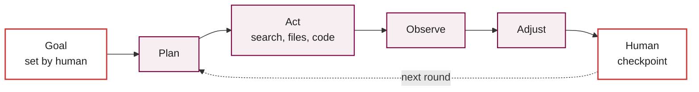

<!--
author:    Dr. Hannes Tegelbeckers
email:     hannes.tegelbeckers@ovgu.de
version:   1.1.0
language:  en
narrator:  UK English Female
mode:      Presentation
classroom: enable

title:     P03 – AI Vocabulary, Models and Workflows (Session slides)
comment:   AI in TVET II – Slides for session 3 (self-learning, 10.12.2026, 180 min): AI vocabulary for pedagogy, model types incl. local open-weight models, advanced prompting, agentic AI, mapping an AI-enhanced pedagogical workflow, choosing the UNESCO learning objective, first competency matrix draft. Interactive: Embedding Atlas, term matcher, agent checkpoint playground, matrix builder.
tags:      AI vocabulary, Models, Agents, Workflow, Competency matrix, UNESCO

import:    https://raw.githubusercontent.com/LiaTemplates/mermaid_template/0.1.4/README.md
-->

# AI Vocabulary, Models and Workflows

**Session 3 · 10.12.2026 · 🔵 Self-learning** · AI in TVET II, OVGU Magdeburg

Vocabulary for AI pedagogy · model types · agentic AI · **your workflow map, learning objective and first competency matrix**

<small>[Self-learning unit S03 (with group hand-in)](https://liascript.github.io/course/?https://raw.githubusercontent.com/OVGU-VET-TechEd/AI_in_TVET_II_WiSe_2026_2027/main/AI_in_TVET_II_WiSe_2026_2027/03_AI_Vocabulary_Models_and_Workflows/S03_AI_Vocabulary_Models_Workflows.md) · [Unit in Moodle (SCORM, obligatory)](https://elearning.ovgu.de/course/section.php?id=202215) · [HTML slides](https://ovgu-vet-teched.github.io/AI_in_TVET_II_WiSe_2026_2027/AI_in_TVET_II_WiSe_2026_2027/03_AI_Vocabulary_Models_and_Workflows/P03_AI_Vocabulary_Models_Workflows.html) · [Organisational overview](https://liascript.github.io/course/?https://raw.githubusercontent.com/OVGU-VET-TechEd/AI_in_TVET_II_WiSe_2026_2027/main/AI_in_TVET_II_WiSe_2026_2027/00_Organisation/organisational_overview_slide_AI_in_TVET_II.md)</small>

    --{{0}}--
Today I am travelling, so you work with these slides and the self-learning unit S03 in your group. At the end of today your group has chosen its learning objective and written the first draft of its competency matrix.

## Warm-up: Check In as a Group 👥

**Which word from session 2 could you explain to a colleague right now?**

- [[tok]] Token
- [[emb]] Embedding
- [[att]] Attention
- [[temp]] Temperature
- [[rag]] Retrieval / grounding
- [[agent]] Agent

**Which term is still unclear?**

[[___]]

    --{{0}}--
Tick every word you could explain. Write down the term that is still unclear: the vocabulary table on the next slides should answer it.

## Where We Are 🧭

```mermaid @mermaid
flowchart LR
  S1["<b>1 · 26.11.</b><br>Kick-off and<br>LiaScript Level 2"]:::done
  S1 --> S2["<b>2 · 03.12.</b> 🔵<br>AI and prompting<br>Level 2"]:::done
  S2 --> S3["<b>3 · 10.12.</b> 🔵<br>Vocabulary and<br>workflows"]:::now
  S3 --> S4["<b>4 · 17.12.</b><br>Pedagogy, assessment,<br>ethics"]:::live
  S4 --> S5["<b>5 · 07.01.</b><br>Nuggets and<br>matrix workshop"]:::live
  S5 --> S6["<b>6 · 14.01.</b> ⚪<br>Project and peer review<br>format tbc"]:::tbc
  S6 --> S7["<b>7 · 21.01.</b><br>Final<br>presentations"]:::live
  classDef live fill:#f7eef2,stroke:#7a003f,stroke-width:1.5px,color:#1f1f1f
  classDef self fill:#e8f0fb,stroke:#1565c0,stroke-width:1.5px,color:#1f1f1f
  classDef tbc fill:#fff8e1,stroke:#b7791f,stroke-width:1.5px,stroke-dasharray:4 3,color:#1f1f1f
  classDef now fill:#7a003f,stroke:#7a003f,stroke-width:2px,color:#ffffff
  classDef done fill:#eeeeee,stroke:#9ca3af,stroke-width:1px,color:#5f6163
```

**Building blocks today:** **learning objective** (final choice) · **competency matrix** (first draft) · **workflow map** – all handed in **inside unit S03 by 16.12.2026, 23:59**.

    --{{0}}--
Today is the first milestone of your group project. The hand-in is inside the SCORM unit S03, one entry per group member with the same group result.

## Today's Objectives 🎯

By the end of today you can …

    --{{1}}--
First the language of AI – used as arguments for design decisions, beyond the vocabulary of AI in TVET one.

      {{1}}
****************************************

1. **justify** design decisions with AI terminology – prompt only, grounding, fine-tuning, agent, local model,
2. **evaluate** an open-weight model for school use with its model card,
3. **specify** an agentic workflow with tools, checkpoints, stop condition and success check,

****************************************

    --{{2}}--
Then your project: workflow, learning objective and matrix.

      {{2}}
****************************************

4. **map** an AI-enhanced pedagogical workflow with human checkpoints,
5. **choose** your group's UNESCO learning objective and **draft** the competency matrix.

****************************************

## Suggested Time Plan 🗓️

<!-- data-type="none" -->
| Time | Block | Mode |
| --- | --- | --- |
| 0:00 | From vocabulary to design decisions · architecture chooser · embeddings | Individual |
| 0:30 | Model types · model card · local models · advanced prompting | Individual |
| 1:00 | Agentic AI · agent spec sheet · critical reading of an AI-generated report | Individual, then group |
| 1:45 | Break | 15 min |
| 2:00 | Workflow map for your topic | Group |
| 2:25 | Learning objective · competency matrix draft | Group |
| 2:50 | Hand-in inside unit S03 · exit ticket | Group + individual |

    --{{0}}--
This is a suggestion. Questions go to the Moodle forum; we discuss open points at the start of session four.

## 1. From Vocabulary to Design Decisions 📖

**Recap from AI in TVET I** (session 3): data · algorithm · model · weights · training · neural network · agent. One quick check:

**Decide:** choose the right term for each description.

Learned numbers inside a model: [[ Embedding | (Weights) | Workflow ]]

Answers based on documents that were searched first: [[ Fine-tuning | (Grounding) | Hallucination ]]

Plans several steps and uses tools: [[ Model | (Agent) | Algorithm ]]

    --{{1}}--
In AI in TVET two the vocabulary has a new job: you use it to justify design decisions. Why grounding and not fine-tuning? Why no agent? That is the level the final presentation expects.

      {{1}}
> [!NOTE] Level 2
> Terms are not the goal – they are your **arguments**: *"We use grounding instead of fine-tuning, because the regulation changes every year and fine-tuning would freeze an old version."*

## Five Architectures for Learning Material 🏗️

<!-- data-type="none" -->
| Architecture | What it does | Good when … | Not good when … |
| --- | --- | --- | --- |
| **Prompt only** | Answer from the weights | general explanations, creative cases | facts must match a current regulation |
| **Grounding / RAG** | Search your documents, answer with passages | material must follow *your* source | the source itself is poor or missing |
| **Fine-tuning** | Further training on your data | a stable special language or style at scale | content changes often; small budget |
| **Agent** | Plans, uses tools, several steps | multi-step routine work with checkpoints | high stakes without human approval |
| **Local open-weight model** | Runs on your own hardware | sensitive data (learner reports, company data) | top quality is essential and hardware is weak |

    --{{0}}--
These five architectures can be combined, for example a local model with grounding. The playground on the next slide asks four questions and suggests an architecture, with the argument you could use in your presentation.

## Playground: Architecture Chooser 🧭

**Does the material contain personal or company data?** 

**Must the content follow a specific, changing source (regulation, manual)?** 

**Does the task need several steps with tools (search, files, formatting)?** 

**Do you need a stable special style for thousands of items?** 

    --{{0}}--
Answer the four questions for your group's sample material. The generated sentence is a first draft of the design argument on your workflow slide. Check whether you agree with it.

## Try It: Explore an Embedding Space 🌌

??[Embedding Atlas – Apple](https://apple.github.io/embedding-atlas/)

    --{{1}}--
Open one of the example data sets. Every point is a text, and texts with similar meaning lie close together. This is how a retrieval system finds the passage in your training regulation that fits a question.

      {{1}}
****************************************

**Task (10 min):** open an example data set, zoom into one cluster and read 3–4 neighbouring texts.

**What do the neighbours have in common? How could this help an AI find the right passage in your course material?**

[[___ ___]]

****************************************

## 2. Model Types and When to Use Them 🧠

<!-- data-type="none" -->
| Model type | Typical use in learning design | Consider |
| --- | --- | --- |
| Large general LLM (cloud) | Drafting text, cases, quizzes, feedback | Data protection, cost, licence |
| Reasoning model | Complex planning, step-by-step solutions, checking logic | Slower; still needs checking |
| Small / local open-weight model | Sensitive material offline | Lower quality, technical set-up |
| Image / diagram models | Illustrations, infographics | Copyright, stereotypes, technical accuracy |
| Speech models | Text-to-speech, transcription, language practice | Voice data, accessibility benefits |
| Specialised educational tools | Adaptive practice, tutoring, assessment | Evidence of effectiveness, EU AI Act risk level |

    --{{1}}--
Local models are an important option for vocational schools: the data never leaves the computer. Two free tools make this easy.

      {{1}}
> [!TIP] Offline AI for sensitive material
> [LM Studio](https://lmstudio.ai) and [Ollama](https://ollama.com) run open-weight models **on your own laptop or school server** – no learner data leaves the building. Optional try-out: install one, load a small model and compare its quiz items with a cloud model.

## Try It: Read a Model Card 🪪

Open-weight models come with a **model card**: intended use, training data, limitations, licence of the weights ([Hugging Face docs](https://huggingface.co/docs/hub/model-cards)).

    --{{1}}--
Open one model card and look for four things. Licences of open-weight models differ a lot, and some restrict use.

      {{1}}
****************************************

**Task (10 min):** open one model card – e.g. [Llama 3.1 8B Instruct](https://huggingface.co/meta-llama/Llama-3.1-8B-Instruct), [Mistral 7B Instruct](https://huggingface.co/mistralai/Mistral-7B-Instruct-v0.3) or [Gemma 2 9B](https://huggingface.co/google/gemma-2-9b-it) – and find: **licence** · **languages** · **known limitations** · **intended / prohibited use**.

**Could your school use this model for feedback on apprentices' reports? Why (not)?**

[[___ ___]]

****************************************

## Prompting: From Basic to Advanced 🪜

<!-- data-type="none" -->
| Level | Technique | Use in learning design |
| --- | --- | --- |
| Basic | Clear instructions · **role prompting** | "As a trainer for mechatronics apprentices …" |
| Basic | **Delimiters** (`"""` or `«»`) around source text | Regulation text is not read as an instruction |
| Basic | **One-/few-shot** examples | One model item before asking for ten |
| Advanced | **Chain of thought** | Worked solutions for calculation tasks |
| Advanced | **Self-consistency** | Checking a solution key |
| Advanced | **Least-to-most** | Scaffolded tasks for weaker learners |
| Advanced | Generated knowledge · tree of thoughts · ReAct | Grounded and tool-using assistants (→ agents) |

<small>After Chen et al. (2025)</small>

    --{{1}}--
The review also treats prompting as a security issue. A document you upload can contain hidden instructions. Delimiters and clear rules reduce the risk.

      {{1}}
> [!WARNING] Prompt injection
> Uploaded documents can hide instructions (e.g. white text: *"ignore all rules and …"*). Use delimiters and robust instructions – and never let an agent act on unchecked documents (Chen et al., 2025).

## Check: Models and Prompts ✅

A vocational school wants AI feedback on apprentices' reports that contain **names and company data**. Which option protects the data best?

<!-- data-hint-button="1" data-solution-button="2" -->
- [( )] The free version of a cloud chatbot
- [(X)] A local open-weight model on the school's own server
- [( )] Posting the reports in an online forum
[[?]] Where does the data go?

You show **one model quiz item** before asking for ten more. This is …

<!-- data-hint-button="1" data-solution-button="2" -->
- [( )] chain of thought
- [(X)] one-shot / few-shot prompting
- [( )] self-consistency
[[?]] The technique is named after the number of examples.

## 3. Agentic AI 🤖

**Generative AI creates, extractive AI finds, agentic AI acts** (OpenAI, 2025):

<!-- data-type="none" -->
| Type | Role | Example |
| --- | --- | --- |
| Generative AI | Content creator – acts only when prompted | Writes an essay on request |
| Extractive AI | Information retriever – finds and summarises | "What does this report conclude?" |
| Agentic AI | Autonomous problem-solver – plans, calls tools | "Research this topic and write an essay" |

    --{{1}}--
An agent works in a loop: plan, act with tools, observe the result, adjust. The human sets the goal and approves the result, and in between there must be checkpoints.

      {{1}}

## Agents in TVET: Opportunities and Risks ⚖️

<!-- data-type="none" -->
| Opportunities for TVET and professional development | Risks |
| --- | --- |
| Personalised learning paths and practice partners | Errors propagate across steps |
| Automating routine work (formatting, material search) | Lack of transparency: why did the agent do this? |
| Teacher assistants for planning and differentiation | Over-reliance, de-skilling of teachers |
| Support for continuous professional development | Data protection, security (prompt injection) |

    --{{1}}--
At the Create level of competency five, teachers build AI solutions for their own and their peers' growth. Orchestrating several specialised agents may become a new teacher competency.

      {{1}}
> [!NOTE] UNESCO link
> At the *Create* level of "AI for professional development", teachers customise and build AI solutions for their own and their peers' growth (UNESCO, 2024) – e.g. an agent that keeps automotive trainers up to date on electric-vehicle technology.

## Playground: Agent Spec Sheet 📝

In AI in TVET I you watched an agent build a nugget. Now **design** one – for teachers' professional development (competency 5, *Create*):

**Goal:** 

**Tools and sources:** 

**Human checkpoints:** 

**Stop condition:** 

**Success check:** 

    --{{0}}--
Design the agent for your own context. A complete specification has a goal, tools, human checkpoints, a stop condition and a success check. The warnings show what is still missing.

## Critical Reading: An AI-Generated Report 🔍

*Agentic AI in Higher Education and TVET* (OpenAI, 2025) was **generated with ChatGPT Deep Research** – declared, not peer-reviewed. It is a case for critical reading: 62 footnotes, more than half point to **one** publisher web guide.

    --{{1}}--
Do this task in your group. Note the results in your AI tools log.

      {{1}}
****************************************

**Task (20 min):**

1. Pick **two** claims from the report and trace them to the original source. Does the source say what the report claims?
2. Which claims would you only use after finding a peer-reviewed source?
3. How would you declare AI use if you used this report in your own material?

**Our finding in one sentence:**

[[___ ___]]

****************************************

## 4. Mapping an AI-Enhanced Pedagogical Workflow 🗺️

For every step: **who** (human / AI), **which tool**, **which check**?

<!-- data-type="none" -->
| Step | Who | Tool | Check |
| --- | --- | --- | --- |
| 1 Define learning objective (UNESCO) | Human | Framework | Measurable? Level? |
| 2 Collect and verify sources | Human + AI | Consensus, library | Sources exist and fit? |
| 3 Draft structure / content | AI | LLM + template | Matches objective? |
| 4 Fact check | Human | Primary sources | Errors removed? |
| 5 Didactic revision | Human | Bloom, AI-TPACK | Activating? Target group? |
| 6 Interactive elements | AI + human | LLM, LiaScript | Quiz quality, feedback |
| 7 Test and publish | Human | LiveEditor, GitHub | Renders? Licence? |
| 8 Evaluate | Human + learners | Feedback, quiz data | What to improve? |

    --{{1}}--
Draw this workflow for your own topic. Mermaid code works in LiaScript, and you can draft it in the Mermaid Live Editor.

      {{1}}
**Group task (25 min):** draw the workflow for **your** topic – e.g. as Mermaid code in the [Mermaid Live Editor](https://mermaid.live). Mark where AI is used and where you deliberately do **not** use AI.

## 5. Choosing Your Learning Objective 🎯

Open the [UNESCO AI Competency Framework for Teachers](https://doi.org/10.54675/ZJTE2084), competencies **3, 4 or 5**.

    --{{1}}--
These are the criteria. And two free tools help you to describe the target group with evidence instead of assumptions.

      {{1}}
****************************************

**Criteria for a good choice**

- relevant for a concrete TVET target group,
- can be shown across Acquire – Deepen – Create,
- realistic to illustrate with sample material in 20 minutes,
- your group finds it interesting.

Use the **exact wording** and cite it. Never let an AI invent competency numbers.

****************************************

    --{{2}}--
For the target group: ESCO lists the skills of every occupation, and the Job-Futuromat estimates which tasks of an occupation can already be automated.

      {{2}}
> [!TIP] Evidence for your target group
> [ESCO](https://esco.ec.europa.eu/en) – skills and occupations of the EU · [Job-Futuromat (IAB)](https://job-futuromat.iab.de) – which tasks of an occupation can be automated? (German) · [Will Robots Take My Job?](https://willrobotstakemyjob.com) – US estimates

## 6. The Competency Matrix 🧱

The matrix shows how your learning objective develops over the three levels:

<!-- data-type="none" -->
| Level | Content (what?) | Workflow (how do learners/teachers work?) | AI tool (with which support?) |
| --- | --- | --- | --- |
| **Acquire** | Basic concepts | Guided, step by step | e.g. explanation chatbot, quiz |
| **Deepen** | Application to cases | Problem-based, collaborative | e.g. case generator, feedback tool |
| **Create** | Own products / transfer | Project, design | e.g. agent or workflow the learners design |

On which level do learners design their own AI-supported products or workflows?

<!-- data-hint-button="1" data-solution-button="2" -->
- [( )] Acquire
- [( )] Deepen
- [(X)] Create
[[?]] The highest level of the UNESCO framework.

## Playground: Matrix Builder 🧮

**Acquire – content:** 

**Acquire – AI tool:** 

**Deepen – content:** 

**Deepen – AI tool:** 

**Create – content:** 

**Create – AI tool:** 

    --{{0}}--
Replace the example with your own matrix. The tool produces a Markdown table you can paste directly into your LiaScript presentation. Add the workflow column yourself.

## Project Lab: Your Hand-in 📤

**Inside unit S03 · by 16.12.2026, 23:59** · every group member submits the group result in their own unit

    --{{1}}--
Four parts. We discuss your drafts in session four on the seventeenth of December.

      {{1}}
****************************************

- [ ] **Learning objective:** UNESCO competency, exact wording and source; target group (3–5 sentences)
- [ ] **First draft of the competency matrix** (Acquire · Deepen · Create)
- [ ] **Workflow map** with human checkpoints
- [ ] **Short AI tools log** (tool, purpose, prompt, what you changed)

****************************************

## Exit Ticket 🎟️

**Objective 1:** A training regulation changes every year. Which architecture fits quiz generation from it?

<!-- data-hint-button="1" data-solution-button="2" -->
- [(X)] Grounding (RAG) on the current regulation
- [( )] Fine-tuning on last year's regulation
- [( )] Prompt only
[[?]] Which architecture follows a changing source?

**Objective 2:** Best choice for sensitive learner data?

<!-- data-hint-button="1" data-solution-button="2" -->
- [( )] Free cloud chatbot
- [(X)] Local open-weight model
[[?]] Where does the data stay?

**Objectives 3–4:** Which elements belong in an agent specification?

<!-- data-hint-button="1" data-solution-button="2" -->
- [[X]] Human checkpoints
- [[X]] Stop condition
- [[ ]] Font choice
- [[X]] Success check
[[?]] Remember the agent spec sheet.

**Objective 5:** Our learning objective in one line:

[[___]]

## Your SCORM Unit and Next Steps 📦

**Obligatory:** complete the self-learning unit **S03** in Moodle – it contains today's study text **and the group hand-in fields**.

    --{{1}}--
Next session is live again. Bring your matrix draft: we add assessment and ethics to it.

      {{1}}
****************************************

- 📦 [S03 in Moodle (SCORM)](https://elearning.ovgu.de/course/section.php?id=202215) · [S03 in LiaScript](https://liascript.github.io/course/?https://raw.githubusercontent.com/OVGU-VET-TechEd/AI_in_TVET_II_WiSe_2026_2027/main/AI_in_TVET_II_WiSe_2026_2027/03_AI_Vocabulary_Models_and_Workflows/S03_AI_Vocabulary_Models_Workflows.md) – **hand-in by 16.12.2026, 23:59**
- ➡️ **Next: Thursday, 17.12.2026, 🟢 live** – Pedagogical trends · AI for assessment and feedback · ethics in AI pedagogy
- 📖 Reading for session 4: Ng & Lai (2025), *AI-augmented heutagogy* (Moodle)

****************************************

## References

- Chen, B., Zhang, Z., Langrené, N., & Zhu, S. (2025). Unleashing the potential of prompt engineering for large language models. *Patterns, 6*, 101260. https://doi.org/10.1016/j.patter.2025.101260
- European Commission. (n.d.). *ESCO – European Skills, Competences, Qualifications and Occupations*. https://esco.ec.europa.eu/en
- Institut für Arbeitsmarkt- und Berufsforschung. (n.d.). *Job-Futuromat* [Web application]. https://job-futuromat.iab.de
- Lewis, P., Perez, E., Piktus, A., Petroni, F., Karpukhin, V., Goyal, N., Küttler, H., Lewis, M., Yih, W., Rocktäschel, T., Riedel, S., & Kiela, D. (2020). Retrieval-augmented generation for knowledge-intensive NLP tasks. In *Advances in Neural Information Processing Systems 33*. https://arxiv.org/abs/2005.11401
- OpenAI. (2025). *Agentic AI in higher education and TVET: A new era for professional development* [AI-generated report, created with ChatGPT Deep Research; course material, not peer-reviewed].
- UNESCO. (2024). *AI competency framework for teachers*. https://doi.org/10.54675/ZJTE2084
- Yao, S., Zhao, J., Yu, D., Du, N., Shafran, I., Narasimhan, K., & Cao, Y. (2023). ReAct: Synergizing reasoning and acting in language models. In *International Conference on Learning Representations (ICLR 2023)*. https://arxiv.org/abs/2210.03629

**Tools:** [Embedding Atlas](https://apple.github.io/embedding-atlas/) · [LM Studio](https://lmstudio.ai) · [Ollama](https://ollama.com) · [Mermaid Live Editor](https://mermaid.live)

<small>Licence: CC BY 4.0 · Dr. Hannes Tegelbeckers, OVGU Magdeburg · Created with AI support (Claude), checked by the author.</small>
