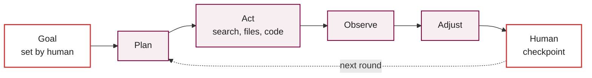

<!--
author:    Dr. Hannes Tegelbeckers
email:     hannes.tegelbeckers@ovgu.de
version:   2.1.0
language:  en
narrator:  UK English Female
mode:      Textbook

title:     S03 – AI vocabulary, models and workflows (Self-learning unit)
comment:   AI in TVET II – Self-learning unit for session 3 (self-learning, 10.12.2026): AI vocabulary for pedagogy, model types incl. local open-weight models, advanced prompting, agentic AI, mapping an AI-enhanced pedagogical workflow; choice of the UNESCO learning objective and first draft of the competency matrix. Obligatory SCORM unit with group hand-in.

import:    https://raw.githubusercontent.com/LiaTemplates/mermaid_template/0.1.4/README.md
-->

# S03 – AI Vocabulary, Models and Workflows

> **Session 3 · 10.12.2026 · 🔵 Self-learning** – I am travelling; work through this unit with your group.
>
> **Time needed:** about 3 hours
>
> **📦 Obligatory:** completing this unit [in Moodle (SCORM)](https://elearning.ovgu.de/course/section.php?id=202215) is part of the pass requirement – all 7 units by **15.02.2027**.
>
> **📤 Group hand-in inside this unit: 16.12.2026, 23:59** – see chapter 7. Every group member submits the group result in their own unit.

**After this unit you will be able to …**

1. justify design decisions with AI terminology – prompt only, grounding, fine-tuning, agent, local model,
2. evaluate an open-weight model for school use with its model card,
3. specify an agentic workflow with tools, checkpoints, stop condition and success check,
4. map an AI-enhanced pedagogical workflow for a TVET context,
5. choose your group's UNESCO learning objective and draft the competency matrix.

## 1. From Vocabulary to Design Decisions

You know the core vocabulary – data, algorithm, model, weights, training, neural network, agent – from session 3 of AI in TVET I ([S03 of AI in TVET I](https://liascript.github.io/course/?https://raw.githubusercontent.com/OVGU-VET-TechEd/AI_in_TVET_I_WiSe_2026_2027/main/Selflearn/S03_AI_Foundations.md)). In AI in TVET II the vocabulary gets a new job: you use it as **arguments for design decisions**. *"We use grounding instead of fine-tuning, because the regulation changes every year and fine-tuning would freeze an old version"* – that is the level the final presentation expects.

**Recall:** choose the right term for each description.

Learned numbers inside a model: [[ Embedding | (Weights) | Workflow ]]

Answers based on documents that were searched first: [[ Fine-tuning | (Grounding) | Hallucination ]]

Plans several steps and uses tools: [[ Model | (Agent) | Algorithm ]]

### Five architectures for learning material

<!-- data-type="none" -->
| Architecture | What it does | Good when … | Not good when … |
| --- | --- | --- | --- |
| **Prompt only** | Answer from the weights | general explanations, creative cases | facts must match a current regulation |
| **Grounding / RAG** | Search your documents, answer with passages | material must follow *your* source | the source itself is poor or missing |
| **Fine-tuning** | Further training on your data | a stable special language or style at scale | content changes often; small budget |
| **Agent** | Plans, uses tools, several steps | multi-step routine work with checkpoints | high stakes without human approval |
| **Local open-weight model** | Runs on your own hardware | sensitive data (learner reports, company data) | top quality is essential and hardware is weak |

These architectures can be combined – e.g. a local model with grounding.

### Architecture chooser

Answer the four questions for your group's sample material. The generated sentence is a first draft of the design argument on your workflow slide – check whether you agree.

**Does the material contain personal or company data?** 

**Must the content follow a specific, changing source (regulation, manual)?** 

**Does the task need several steps with tools (search, files, formatting)?** 

**Do you need a stable special style for thousands of items?** 

**Your architecture and argument (2–3 sentences):**

[[___ ___]]

### Embeddings: meaning as numbers

Embeddings are the reason why retrieval works. A text is turned into a long list of numbers; texts with similar meaning get similar numbers and lie close together in the "embedding space". When you ask a grounded system a question, it searches for the passages whose embeddings are closest to the embedding of your question.

Explore an embedding space yourself: open an example data set, zoom into one cluster and read a few neighbouring texts. What do they have in common?

??[Embedding Atlas – Apple](https://apple.github.io/embedding-atlas/)

**Check:** You want the AI to answer *only* from the training regulation you upload. Which concept describes this?

<!-- data-hint-button="1" data-solution-button="2" -->
- [( )] Fine-tuning
- [(X)] Grounding / retrieval-augmented generation
- [( )] Hallucination
[[?]] Which approach searches documents first?
***
Grounding (RAG) searches your documents – via embeddings – and answers with the passages found. Fine-tuning would change the model's weights.
***

## 2. Model Types and When to Use Them

There is no single "AI". Different model types fit different pedagogical tasks – and come with different risks.

<!-- data-type="none" -->
| Model type | Typical use in learning design | Consider |
| --- | --- | --- |
| Large general LLM (cloud) | Drafting text, cases, quizzes, feedback | Data protection, cost, licence |
| Reasoning model | Complex planning, step-by-step solutions, checking logic | Slower; still needs checking |
| Small / local open-weight model | Working with sensitive material offline | Lower quality, technical set-up |
| Image / diagram models | Illustrations, infographics | Copyright, stereotypes, technical accuracy |
| Speech models | Text-to-speech, transcription, language practice | Voice data, accessibility benefits |
| Specialised educational tools | Adaptive practice, tutoring, assessment | Evidence of effectiveness, EU AI Act risk level |

### Local models: offline AI for sensitive material

Open-weight models can run **on your own laptop or a school server**. No learner data leaves the building – an important option for feedback on apprentices' reports or company documents. Two free tools make this easy: [LM Studio](https://lmstudio.ai) (desktop app) and [Ollama](https://ollama.com) (command line and server). Small models are weaker than large cloud models, so the human check becomes even more important.

**Optional try-out (20 min):** install LM Studio, download a small model and ask it for three quiz items on your topic. Compare them with the items of a cloud model from session 2.

If you want to see how an image model works, the [Diffusion Explainer](https://poloclub.github.io/diffusion-explainer/) shows step by step how noise becomes a picture.

### Read a model card

Open-weight models come with a **model card** describing intended use, training data, languages, limitations and the **licence of the weights** ([Hugging Face documentation](https://huggingface.co/docs/hub/model-cards)). Licences differ a lot – some restrict commercial use or require attribution, some list prohibited uses. Before a school uses a model, someone has to read the card.

**Task (10 min):** open one model card – e.g. [Llama 3.1 8B Instruct](https://huggingface.co/meta-llama/Llama-3.1-8B-Instruct), [Mistral 7B Instruct](https://huggingface.co/mistralai/Mistral-7B-Instruct-v0.3) or [Gemma 2 9B](https://huggingface.co/google/gemma-2-9b-it) – and find licence, languages, known limitations and intended or prohibited use.

**Could your school use this model for feedback on apprentices' reports? Why (not)?**

[[___ ___]]

### Prompting techniques: from basic to advanced

A review of prompt engineering distinguishes foundational and advanced techniques (Chen et al., 2025):

<!-- data-type="none" -->
| Level | Technique | Use in learning design |
| --- | --- | --- |
| Basic | Clear, precise instructions; **role prompting** | "As a trainer for mechatronics apprentices …" |
| Basic | **Delimiters** (e.g. `"""` or `«»`) to separate instructions from source text | Paste a regulation text without it being read as an instruction |
| Basic | **One-/few-shot** examples | Show one model quiz item before asking for ten |
| Basic | **Temperature / top-p** | Low temperature for consistent answer keys, higher for creative case ideas |
| Advanced | **Chain of thought** ("Let's think step by step") | Worked solutions for calculation tasks |
| Advanced | **Self-consistency** – several reasoning paths, take the most consistent answer | Checking a solution key |
| Advanced | **Least-to-most** – split a problem into simpler sub-problems | Scaffolded tasks for weaker learners |
| Advanced | **Generated knowledge**, tree of thoughts, retrieval augmentation, ReAct | Grounded and tool-using assistants (→ agents) |

The review also treats prompt engineering as a **security** issue: adversarial prompts (e.g. *prompt injection* hidden in uploaded documents) can manipulate a model – delimiters and robust instructions reduce the risk (Chen et al., 2025).

**Check:** A vocational school wants AI feedback on apprentices' reports that contain names and company data. Which option protects the data best?

<!-- data-hint-button="1" data-solution-button="2" -->
- [( )] The free version of a cloud chatbot
- [(X)] A local open-weight model on the school's own server
- [( )] Copying the reports into a public forum
[[?]] Where does the data go?

## 3. Agentic AI

**Agentic AI** describes systems that pursue a goal with some autonomy: they **plan**, use **tools**, keep **memory** and **adapt** based on results.

> **Reading for this section:** *Agentic AI in Higher Education and TVET: A New Era for Professional Development* (OpenAI, 2025). **This report was generated with ChatGPT Deep Research** – it is an AI-generated text, not a peer-reviewed source. We use it deliberately: declaring the AI tool used is best practice, and the report is itself a case for critical reading (see the task below).

**Generative AI creates, extractive AI finds, agentic AI acts** (OpenAI, 2025):

<!-- data-type="none" -->
| Type | Role | Example |
| --- | --- | --- |
| Generative AI | Content creator – acts only when prompted | Writes an essay on request |
| Extractive AI | Information retriever – finds and summarises existing information | Answers "What does this report conclude?" |
| Agentic AI | Autonomous problem-solver – plans sub-tasks, calls generative and extractive functions and tools | "Research this topic and write an essay": searches literature, takes notes, drafts and revises |

<!-- data-type="none" -->
| Opportunities for TVET and professional development | Risks |
| --- | --- |
| Personalised learning paths and practice partners | Errors propagate across steps |
| Automating routine work (formatting, material search) | Lack of transparency: why did the agent do this? |
| Teacher assistants for planning and differentiation | Over-reliance, de-skilling of teachers |
| Support for continuous professional development | Data protection, security (prompt injection) |

**Principle:** keep a **human in the loop** at every step where pedagogical or high-stakes decisions are made.

### Setting up an agentic workflow

The report describes six design steps (OpenAI, 2025) – use them for your own project:

1. **Goal and scope** – what should the agent achieve, and what must it *not* do?
2. **Knowledge and tools** – curriculum documents, textbooks, LMS, search, code interpreter …
3. **Plan the workflow** – stepwise instructions, e.g. *(a) analyse the learning objectives, (b) gather materials, (c) draft a lesson plan, (d) ask for approval, (e) refine*.
4. **Execute and iterate** – the *plan → act → observe → adjust* loop.
5. **User interaction and oversight** – pause, review, redirect mid-stream.
6. **Outcome and feedback** – the result is a draft that the teacher reviews.

**Mitigations named in the report:** require sources for factual claims, build validation steps into the workflow, let the agent say "I don't know" or ask for help when confidence is low, and treat all agent output as a **draft that needs teacher approval**.

**Link to the UNESCO framework:** At the *Create* level of "AI for professional development", teachers customise and build AI solutions for their own and their peers' growth (UNESCO, 2024) – for example an agent that keeps a team of automotive trainers up to date on electric-vehicle technology. Orchestrating several specialised agents may become a new teacher competency: **delegating tasks and supervising agents**.

### Specify an agent

In AI in TVET I you watched an agent build a nugget. Now **design** one. A complete specification has five parts: goal, tools and sources, human checkpoints, a stop condition (when must the agent ask a human?) and a success check (how do you know it helps?). Specify an agent for teachers' professional development in your field – competency 5 at the *Create* level:

**Goal:** 

**Tools and sources:** 

**Human checkpoints:** 

**Stop condition:** 

**Success check:** 

### Critical reading task (20 min)

The AI-generated report has 62 footnotes, but more than half of them point to **one** web guide by a publisher (Elsevier). Others point to blogs and preprints.

1. Pick **two** claims from the report and trace them to the original source. Does the source say what the report claims?
2. Which claims would you only use after finding a peer-reviewed source?
3. How would you declare AI use if you used this report in your own course?

**Your group's finding (2–4 sentences):**

[[___ ___ ___]]

**Check:** Which feature is typical for an AI agent but not for a single chat answer?

<!-- data-hint-button="1" data-solution-button="2" -->
- [( )] It produces text.
- [(X)] It executes several steps and uses tools to reach a goal.
- [( )] It is always more accurate.
[[?]] Think of the plan – act – observe – adjust loop.

## 4. Mapping an AI-Enhanced Pedagogical Workflow

A workflow map makes visible **who** does each step (human or AI), **which tool** is used and **which check** follows. It is the core of the AI workflow part of your presentation.

<!-- data-type="none" -->
| Step | Who | Tool | Check |
| --- | --- | --- | --- |
| 1 Define learning objective (UNESCO) | Human | Framework | Is it measurable? Level? |
| 2 Collect and verify sources | Human + AI | Consensus, library | Sources exist and fit? |
| 3 Draft structure / content | AI | LLM + template | Matches objective? |
| 4 Fact check | Human | Primary sources | Errors removed? |
| 5 Didactic revision | Human | Bloom, AI-TPACK | Activating? Target group? |
| 6 Interactive elements | AI + human | LLM, LiaScript | Quiz quality, feedback |
| 7 Test and publish | Human | LiveEditor, GitHub | Renders? Licence? |
| 8 Evaluate | Human + learners | Feedback, quiz data | What to improve? |

The same workflow as a Mermaid diagram – the code can go directly into your LiaScript presentation (add the import line of the Mermaid template to the header):

```mermaid @mermaid
flowchart LR
  A["1 Objective"]:::human --> B["2 Sources"]:::human --> C["3 AI draft"]:::sys --> D["4 Fact check"]:::human
  D --> E["5 Didactic revision"]:::human --> F["6 Interactive elements"]:::sys --> G["7 Test and publish"]:::human --> H["8 Evaluate"]:::human
  classDef sys fill:#f7eef2,stroke:#7a003f,stroke-width:1.5px,color:#1f1f1f
  classDef human fill:#ffffff,stroke:#d03b3b,stroke-width:2px,color:#1f1f1f
```

**Group task (30 min):** draw this workflow for **your** topic – as Mermaid code (draft it in the [Mermaid Live Editor](https://mermaid.live)), as a table or as a photo of a paper sketch. Mark where AI is used and where you deliberately do *not* use AI.

## 5. Choosing Your Learning Objective

Open the **UNESCO AI Competency Framework for Teachers** (UNESCO, 2024) and look at competencies **3 (AI foundations and applications)**, **4 (AI pedagogy)** and **5 (AI for professional development)**. Each competency is described with curricular goals and learning objectives for the levels Acquire, Deepen and Create.

**Criteria for a good choice**

- relevant for a concrete TVET target group,
- can be shown across Acquire – Deepen – Create,
- realistic to illustrate with sample material in 20 minutes,
- your group finds it interesting.

Use the **exact wording** of the framework and cite it. Do not let an AI invent competency numbers.

### Describe your target group with evidence

A target group description like "apprentices" is too vague. Free tools help you to be concrete:

- [ESCO](https://esco.ec.europa.eu/en) – the EU's classification of occupations and skills: which skills does the occupation of your target group need?
- [Job-Futuromat (IAB)](https://job-futuromat.iab.de) – which tasks of an occupation can already be automated? (German occupations, German interface)
- [Will Robots Take My Job?](https://willrobotstakemyjob.com) – automation estimates for US occupations

Use one of them to write 3–5 sentences about your target group: occupation, typical tasks, where AI already changes the work.

## 6. The Competency Matrix

The matrix shows how your learning objective develops over the three levels. On each level, content, workflow and AI tool must fit together – and each level must build on the previous one.

<!-- data-type="none" -->
| Level | Content (what?) | Workflow (how do learners/teachers work?) | AI tool (with which support?) |
| --- | --- | --- | --- |
| **Acquire** | Basic concepts | Guided, step by step | e.g. explanation chatbot, quiz |
| **Deepen** | Application to cases | Problem-based, collaborative | e.g. case generator, feedback tool |
| **Create** | Own products / transfer | Project, design | e.g. agent or workflow the learners design |

**Example** (competency 3, target group: first-year apprentices in electrical trades):

<!-- data-type="none" -->
| Level | Content | Workflow | AI tool |
| --- | --- | --- | --- |
| Acquire | What an AI chatbot is and why it can be wrong | Short explanation, guided quiz | Explanation chatbot, LiaScript quiz |
| Deepen | Checking a chatbot answer on a safety rule in a workplace case | Case work in pairs, compare with the regulation | Case generator, grounded chatbot with the regulation |
| Create | Rules for chatbot use in the training workshop | Project: learners draft and test rules | Learners configure a grounded assistant |

**Check:** On which level do learners design their own AI-supported products or workflows?

<!-- data-hint-button="1" data-solution-button="2" -->
- [( )] Acquire
- [( )] Deepen
- [(X)] Create
[[?]] The highest level of the UNESCO framework.

## 7. Group Hand-in for Session 3

**Deadline: 16.12.2026, 23:59 · inside this unit** – every group member enters the **same group result** in their own unit and submits it. We discuss your drafts in the live session on **17.12.2026**.

### Part 1: learning objective and target group

**UNESCO competency, exact wording and source; target group (3–5 sentences, use ESCO or the Job-Futuromat):**

[[___ ___ ___ ___]]

### Part 2: first draft of the competency matrix

Write the matrix as a Markdown table (Level · Content · Workflow · AI tool) or as a link to the file in your group repository.

[[___ ___ ___ ___]]

### Part 3: workflow map

Paste your Mermaid code or the link to the workflow map in your repository. Mark where you deliberately do **not** use AI.

[[___ ___ ___]]

### Part 4: short AI tools log

Tool · purpose · prompt · what you kept · what you changed – at least three entries, including the critical reading task.

[[___ ___ ___]]

**Group name and members:**

[[___]]

## Summary and Self-Check

- AI vocabulary becomes an argument: prompt only, grounding, fine-tuning, agent or local model – each fits different data, sources and scales.
- Model choice is a pedagogical and a data-protection decision; local open-weight models keep data in the building.
- Agents plan and act in loops – goal, source approval and final approval stay with humans.
- A workflow map shows who does what, with which tool and which check.
- Your learning objective uses the exact UNESCO wording; the matrix develops it over Acquire – Deepen – Create.

**Tick what you can do now:**

- [ ] I can justify our architecture with AI terminology.
- [ ] I can read a model card and judge whether a school may use the model.
- [ ] I can write an agent specification with checkpoints and stop condition.
- [ ] I can justify the choice of a cloud, reasoning or local model.
- [ ] I can name three human checkpoints for an agentic workflow.
- [ ] Our group has chosen its learning objective and drafted the matrix.
- [ ] Our group has submitted the hand-in in this unit.

**Next session:** Thursday, 17.12.2026, 🟢 live – pedagogical trends, AI for assessment and feedback, ethics. Reading: Ng & Lai (2025), *AI-augmented heutagogy* (Moodle).

## References

- Chen, B., Zhang, Z., Langrené, N., & Zhu, S. (2025). Unleashing the potential of prompt engineering for large language models. *Patterns, 6*, 101260. https://doi.org/10.1016/j.patter.2025.101260
- European Commission. (n.d.). *ESCO – European Skills, Competences, Qualifications and Occupations*. https://esco.ec.europa.eu/en
- Institut für Arbeitsmarkt- und Berufsforschung. (n.d.). *Job-Futuromat* [Web application]. https://job-futuromat.iab.de
- Lewis, P., Perez, E., Piktus, A., Petroni, F., Karpukhin, V., Goyal, N., Küttler, H., Lewis, M., Yih, W., Rocktäschel, T., Riedel, S., & Kiela, D. (2020). Retrieval-augmented generation for knowledge-intensive NLP tasks. In *Advances in Neural Information Processing Systems 33*. https://arxiv.org/abs/2005.11401
- Ning, Y., Zhang, C., Xu, B., Zhou, Y., & Wijaya, T. T. (2024). Teachers’ AI-TPACK: Exploring the relationship between knowledge elements. *Sustainability, 16*(3), 978. https://doi.org/10.3390/su16030978
- OpenAI. (2025). *Agentic AI in higher education and TVET: A new era for professional development* [AI-generated report, created with ChatGPT Deep Research; course material, not peer-reviewed].
- UNESCO. (2024). *AI competency framework for teachers*. https://doi.org/10.54675/ZJTE2084
- Yao, S., Zhao, J., Yu, D., Du, N., Shafran, I., Narasimhan, K., & Cao, Y. (2023). ReAct: Synergizing reasoning and acting in language models. In *International Conference on Learning Representations (ICLR 2023)*. https://arxiv.org/abs/2210.03629

<small>Licence: CC BY 4.0 · Dr. Hannes Tegelbeckers, OVGU Magdeburg · Created with AI support (Claude), checked and revised by the author. Linked tools and explorables: their own licences apply.</small>
