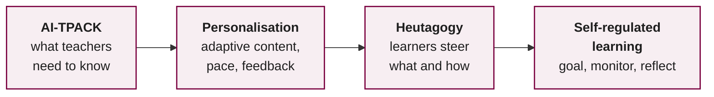

<!--
author:    Dr. Hannes Tegelbeckers
email:     hannes.tegelbeckers@ovgu.de
version:   1.1.0
language:  en
narrator:  UK English Female
mode:      Presentation
classroom: enable

title:     P04 – Pedagogy, Assessment and Ethics in AI-Supported TVET (Session slides)
comment:   AI in TVET II – Slides for session 4 (live, 17.12.2026, 180 min): labour-market trends, AI-TPACK, personalisation, AI-augmented heutagogy, self-regulated learning; AI for formative and summative assessment and feedback; cognitive offloading, bias, EU AI Act, human-centred mindset. Interactive: Job-Futuromat, heutagogy slider, feedback lab, AI assessment tool evaluation grid, PAIR explorables.
tags:      AI pedagogy, Assessment, Feedback, Ethics, Heutagogy, EU AI Act, TVET

import:    https://raw.githubusercontent.com/LiaTemplates/mermaid_template/0.1.4/README.md
-->

# Pedagogy, Assessment and Ethics in AI-Supported TVET

**Session 4 · 17.12.2026 · 🟢 Live · 09:00–12:00** · AI in TVET II, OVGU Magdeburg

Trends · AI-TPACK and heutagogy · **AI for assessment and feedback** · ethics and the human-centred mindset · your matrix gets assessment and safeguards

<small>[Self-learning unit S04](https://liascript.github.io/course/?https://raw.githubusercontent.com/OVGU-VET-TechEd/AI_in_TVET_II_WiSe_2026_2027/main/AI_in_TVET_II_WiSe_2026_2027/04_Pedagogy_Assessment_and_Ethics/S04_Pedagogy_Assessment_Ethics.md) · [Unit in Moodle (SCORM, obligatory)](https://elearning.ovgu.de/course/section.php?id=202215) · [HTML slides](https://ovgu-vet-teched.github.io/AI_in_TVET_II_WiSe_2026_2027/AI_in_TVET_II_WiSe_2026_2027/04_Pedagogy_Assessment_and_Ethics/P04_Pedagogy_Assessment_Ethics.html) · [Organisational overview](https://liascript.github.io/course/?https://raw.githubusercontent.com/OVGU-VET-TechEd/AI_in_TVET_II_WiSe_2026_2027/main/AI_in_TVET_II_WiSe_2026_2027/00_Organisation/organisational_overview_slide_AI_in_TVET_II.md)</small>

    --{{0}}--
Welcome back. Last week you chose your learning objective and drafted your matrix. Today we ask the pedagogical questions: how do learners learn with AI, how do we know they have learned, and where must humans decide?

## Warm-up: Which Tasks Will AI Take Over? 🔮

??[Job-Futuromat – IAB](https://job-futuromat.iab.de)

    --{{1}}--
Enter the occupation of your target group. The Job-Futuromat shows which share of its core tasks could already be automated with today's technology.

      {{1}}
****************************************

**Task (5 min):** enter the occupation of **your target group** (German occupation names, e.g. *Mechatroniker/in*, *Pflegefachfrau/-mann*).

**Share of automatable core tasks:**

- [(1)] below 30 %
- [(2)] 30–50 %
- [(3)] 50–70 %
- [(4)] above 70 %

**What should apprentices in this occupation learn *because of* AI?**

[[___]]

****************************************

## Where We Are 🧭

```mermaid @mermaid
flowchart LR
  S1["<b>1 · 26.11.</b><br>Kick-off and<br>LiaScript Level 2"]:::done
  S1 --> S2["<b>2 · 03.12.</b> 🔵<br>AI and prompting<br>Level 2"]:::done
  S2 --> S3["<b>3 · 10.12.</b> 🔵<br>Vocabulary and<br>workflows"]:::done
  S3 --> S4["<b>4 · 17.12.</b><br>Pedagogy, assessment,<br>ethics"]:::now
  S4 --> S5["<b>5 · 07.01.</b><br>Nuggets and<br>matrix workshop"]:::live
  S5 --> S6["<b>6 · 14.01.</b> ⚪<br>Project and peer review<br>format tbc"]:::tbc
  S6 --> S7["<b>7 · 21.01.</b><br>Final<br>presentations"]:::live
  classDef live fill:#f7eef2,stroke:#7a003f,stroke-width:1.5px,color:#1f1f1f
  classDef self fill:#e8f0fb,stroke:#1565c0,stroke-width:1.5px,color:#1f1f1f
  classDef tbc fill:#fff8e1,stroke:#b7791f,stroke-width:1.5px,stroke-dasharray:4 3,color:#1f1f1f
  classDef now fill:#7a003f,stroke:#7a003f,stroke-width:2px,color:#ffffff
  classDef done fill:#eeeeee,stroke:#9ca3af,stroke-width:1px,color:#5f6163
```



**Building blocks today:** your matrix gets two new columns – **assessment / feedback** and **human decision / ethical safeguard** – and you sharpen the **human role** in your design.

## Today's Objectives 🎯

By the end of today you can …

    --{{1}}--
First, pedagogy: what changes in teaching and learning.

      {{1}}
****************************************

1. **apply** pedagogical trends – AI-augmented heutagogy, self-regulated learning, OECD evidence on learning vs. performance – to your competency matrix,

****************************************

    --{{2}}--
Second, assessment and feedback, and third, ethics.

      {{2}}
****************************************

2. **design** AI-supported formative feedback for your learning objective,
3. **evaluate** the reliability of AI grading with a mini-study and decide where AI may support assessment,
4. **co-create** ethical rules for AI use in your learning design and **justify** where humans decide.

****************************************

## Today's Agenda 🗓️

<!-- data-type="none" -->
| Time | Block | Mode |
| --- | --- | --- |
| 09:00 | Warm-up: Job-Futuromat · questions on your S03 hand-in | Individual + plenary |
| 09:20 | Pedagogical trends applied: heutagogy planner, SRL coach | Input + playground |
| 10:00 | AI for assessment and feedback · feedback lab | Input + individual |
| 10:35 | Break | 10 min |
| 10:45 | Grading reliability mini-study | Pairs → plenary |
| 11:10 | Ethics: offloading, EC guidelines, co-creating ethical rules | Input + playground |
| 11:35 | Project lab: matrix + assessment + safeguards · exit ticket | Groups |

## 1. Pedagogical Trends 📈



    --{{1}}--
AI-TPACK extends the well-known TPACK model: teachers need to know what AI can do, how it changes teaching methods and how it changes the subject content itself.

      {{1}}
****************************************

- **AI-TPACK** (recap from AI in TVET I): knowing what AI can do, how it changes methods and how it changes the content (Ning et al., 2024).
- **Personalisation:** benefits for engagement and performance – when **teachers orchestrate** the use (du Plooy et al., 2024; Zhao & Ko, 2024).

****************************************

    --{{2}}--
The OECD Digital Education Outlook 2026 adds an important warning: better performance with a chatbot is not the same as learning.

      {{2}}
> [!WARNING] Performance is not learning
> With general-purpose chatbots, students produce better work – but the advantage disappears or reverses when access is removed in exams. Tools designed with a clear pedagogical purpose show more lasting gains (OECD, 2026).

## Heutagogy Planner for Your Matrix 🧭

You met AI-augmented heutagogy (Ng & Lai, 2025) in AI in TVET I. Now **apply** it: which AI paradigm fits each level of **your** competency matrix?

**Acquire level – AI paradigm:** <script input="select" options="AI-informed,AI-supported,AI-empowered" value="AI-informed" output="h1">@input</script>

**Deepen level – AI paradigm:** <script input="select" options="AI-informed,AI-supported,AI-empowered" value="AI-supported" output="h2">@input</script>

**Create level – AI paradigm:** <script input="select" options="AI-informed,AI-supported,AI-empowered" value="AI-supported" output="h3">@input</script>

<script modify="false" style="display:block">
const rank = {"AI-informed":1,"AI-supported":2,"AI-empowered":3};
const solo = {1:"pre-/uni-structural",2:"multi-structural, relational",3:"extended abstract"};
const v = [`@input(`h1`)`,`@input(`h2`)`,`@input(`h3`)`].map(x => rank[`${x}`.trim()] || 1);
const lv = ["Acquire","Deepen","Create"];
const rows = v.map((x,i) => `<li><b>${lv[i]}</b>: ${Object.keys(rank)[x-1]} · SOLO ${solo[x]}</li>`).join("");
const tips = [];
if (v[0] > v[1] || v[1] > v[2]) tips.push("📉 Autonomy decreases somewhere – learners should gain agency from level to level.");
if (v[2] < 3) tips.push("🎯 At <b>Create</b>, learners should use AI as a partner for open problems (AI-empowered) – otherwise the top level stays teacher-led.");
if (v[0] === 3) tips.push("⚠️ AI-empowered already at <b>Acquire</b> overloads novices – they need guidance first.");
`HTML: <ul>${rows}</ul><p>${tips.length ? tips.join("<br>") : "✅ Learner autonomy rises from Acquire to Create – the heutagogy progression fits your matrix."}</p>`
</script>

    --{{0}}--
Choose a paradigm for each level of your matrix. Learner autonomy should rise from Acquire to Create. The planner warns you if it does not.

## Self-Regulated Learning with Chatbots 🔁

AI chatbots can support the SRL cycle – **goal setting, monitoring, feedback, reflection** – if they ask questions instead of giving answers (Chang et al., 2023).

**Decide:** Which design supports self-regulated learning best?

<!-- data-hint-button="1" data-solution-button="2" -->
- [( )] A chatbot that immediately provides complete solutions.
- [(X)] A chatbot that asks the learner for a goal, gives hints and prompts reflection.
- [( )] A chatbot that grades every answer without explanation.
[[?]] Who does the thinking in each design?

    --{{1}}--
This is the core design question for your sample material: who does the thinking?

      {{1}}
```text
You are a learning coach for apprentices. Never give the full solution.
1) Ask the learner for their goal for this task.
2) Ask what they have tried so far.
3) Give one hint at a time, then ask them to try again.
4) At the end, ask: "What will you do differently next time?"
```

## 2. AI for Assessment and Feedback 📝

<!-- data-type="none" -->
| | Formative | Summative |
| --- | --- | --- |
| Purpose | Support learning | Certify achievement |
| Timing | During learning | At the end |
| AI role | Generate tasks, give immediate feedback, adapt practice | Support only; humans decide |
| Risk | Over-reliance, generic feedback | Unfair or wrong decisions; **high risk under the EU AI Act** |

    --{{1}}--
Good feedback answers three questions. Use them as a template whenever you prompt an AI for feedback.

      {{1}}
> [!NOTE] Three feedback questions (Hattie & Timperley, 2007)
> **Where am I going?** (goal) · **How am I going?** (progress) · **Where to next?** (next steps)

## What Does Research Say? 🔬

    --{{1}}--
Three findings you should know before you use AI feedback.

      {{1}}
****************************************

- Randomised field experiment, blinded feedback sources (N = 90): students rated LLM and peer feedback as fairer and easier to accept – but **teacher feedback improved their work most**, LLM feedback least (Weidlich et al., 2025).
- LLM grading of exams can deviate considerably from human grading (Flodén, 2025); acceptance depends on perceived fairness (Jones-Jang et al., 2025).
- Teachers' own value judgements change when they know work was AI-assisted (Luo & Dawson, 2025).

****************************************

**Decide:** What follows from Weidlich et al. (2025)?

<!-- data-hint-button="1" data-solution-button="2" -->
- [( )] Replace teacher feedback with AI feedback – students like it more.
- [(X)] Use AI feedback as an addition, but keep teacher feedback where improvement matters most.
- [( )] Never use AI feedback.
[[?]] Acceptance and effect are not the same.

## Try It: Feedback Lab (15 min) 🧪

**Apprentice's fault-diagnosis report** (fictitious):

> *"The machine stopped. I think the motor is broken because it made a noise. I changed the fuse but it did not help. Then I called the master."*

    --{{1}}--
First write your own feedback, then let the AI write one with this prompt, then compare.

      {{1}}
****************************************

1. Write **your own** feedback (max. 80 words).
2. Prompt an AI tool:

```text
Give feedback to an apprentice on the following fault-diagnosis report.
Structure: (1) goal of the task, (2) what is already correct, (3) one or two
concrete next steps. Do not give the full solution. Max. 120 words.
Report: """<paste report>"""
```

3. Compare: which feedback is more **specific**, more **motivating**, more **correct**?

****************************************

    --{{2}}--
Write down the biggest difference. We collect three examples in the plenary.

      {{2}}
**The biggest difference between my feedback and the AI's:**

[[___ ___]]

## AI-Supported Assessment in Practice ✅

<!-- data-type="none" -->
| Task | AI support | Human check |
| --- | --- | --- |
| Item generation | Quiz items from your verified text | Correctness, difficulty, distractors |
| Rubric design | Draft criteria and levels | Alignment with learning objective |
| Formative feedback | First feedback draft | Tone, accuracy, next steps |
| Competency-based task | Workplace scenario variants | Authenticity, safety |
| Summative decision | none / analysis only | **Teacher decides** |

**Decide:** Under the EU AI Act, AI systems used to **evaluate learning outcomes** are …

<!-- data-hint-button="1" data-solution-button="2" -->
- [( )] minimal risk
- [(X)] high risk
- [( )] always prohibited
[[?]] Annex III lists education and vocational training.

## Try It: Can AI Grade Your Learners? 📏

In AI in TVET I you discussed *whether* you would let an AI grade you. Now **test it** with a mini-study (15 min):

    --{{1}}--
Take three short answers from your topic, write a simple three-level rubric, and let an AI grade each answer twice, in two new chats. Then grade them yourself.

      {{1}}
****************************************

1. Write **3 short learner answers** (one good, one medium, one weak) and a **3-level rubric**.
2. Let an AI grade each answer **twice** (two new chats, same prompt).
3. Grade them **yourself** before you look at the AI grades.

****************************************

## Playground: Grading Reliability 📊

**Answers graded:** <script input="range" min="1" max="10" step="1" value="3" output="ga">@input</script>

**AI run 1 = AI run 2 (same grade):** <script input="range" min="0" max="10" step="1" value="2" output="gb">@input</script>

**AI = your grade (exactly):** <script input="range" min="0" max="10" step="1" value="1" output="gc">@input</script>

**AI = your grade (± one level):** <script input="range" min="0" max="10" step="1" value="2" output="gd">@input</script>

<script modify="false" style="display:block">
const n = +@input(`ga`), self = Math.min(+@input(`gb`), n), ex = Math.min(+@input(`gc`), n), adj = Math.max(Math.min(+@input(`gd`), n), ex);
const p = x => Math.round(100 * x / n);
const bar = (x, l) => `<div style="margin:3px 0"><span style="display:inline-block;width:190px">${l}</span><span style="display:inline-block;height:14px;width:${p(x)*2.4}px;background:${p(x) >= 80 ? "#2e7d32" : (p(x) >= 60 ? "#b7791f" : "#d03b3b")};border-radius:3px"></span> <b>${p(x)} %</b></div>`;
const verdict = p(self) < 80 ? "🔴 The AI does not even agree with itself – not usable for grading, at most for first feedback drafts." : (p(ex) < 70 ? "🟡 Consistent, but different from your judgement – use for formative feedback only, you decide on grades." : "🟢 Close to your judgement in this small sample – still: summative decisions stay with you (EU AI Act: high risk).");
`HTML: ${bar(self, "AI agrees with itself")}${bar(ex, "AI = you (exact)")}${bar(adj, "AI = you (± 1 level)")}<p>${verdict}</p><p><small>${n} answers – a mini-study, not a validation. Compare: Flodén (2025).</small></p>`
</script>

    --{{0}}--
Enter your counts. A tool that does not agree with itself cannot be valid. And even high agreement in three answers is no validation: summative decisions stay with the teacher.

## 3. Ethics: Cognitive Offloading 🧠

If learners let AI do the thinking, learning can suffer:

    --{{1}}--
Two studies are often quoted. Note that the second one is a preprint.

      {{1}}
****************************************

- Higher AI tool use was associated with lower critical-thinking scores, mediated by cognitive offloading (Gerlich, 2025).
- In an essay study, LLM users showed lower brain connectivity and weaker recall of their own text than those writing without tools (Kosmyna et al., 2025, preprint).

****************************************

    --{{2}}--
The design consequence is simple: plan phases without AI, let learners think first, and use AI as a sparring partner.

      {{2}}
> [!IMPORTANT] Design consequence
> Plan phases **without** AI · let learners **think first** · use AI as a **sparring partner**, not a solution generator.

## Ethical Guidelines for Educators 📜

The European Commission (2022) names **four key considerations** for AI and data in teaching:

<!-- data-type="none" -->
| Consideration | Question for your design |
| --- | --- |
| **Human agency** | Do learners and teachers stay in control of decisions about learning? |
| **Fairness** | Is everyone treated fairly – incl. language, disability, background? |
| **Humanity** | Are dignity, identity and well-being respected? |
| **Justified choice** | Can you justify *why* AI is used here – with evidence and transparency? |

    --{{1}}--
The UNESCO framework puts the human-centred mindset first: human agency, human accountability and social responsibility. It is the lens for every decision in your project.

      {{1}}
> [!NOTE] UNESCO: human-centred mindset
> **Human agency** · **human accountability** · **social responsibility** – and teachers remain accountable for grading and pedagogical decisions (UNESCO, 2024).

## Co-Creating Ethical Rules 🤝

AI in TVET I: ethical **principles** (UNESCO CFT dimension 2, *Acquire*). AI in TVET II: **co-creating ethical rules** with learners (dimension 2, *Create*). Draft an AI agreement for your learning design:

**Learners may use AI for:** <script input="select" options="explanations and hints only,drafts they revise and declare,everything except the assessed part" value="explanations and hints only" output="r1">@input</script>

**Phase without AI:** <script input="select" options="first attempt at every task,the practical skill check,none" value="first attempt at every task" output="r2">@input</script>

**Declaration:** <script input="select" options="one line: tool and purpose,AI log with prompts,no declaration" value="one line: tool and purpose" output="r3">@input</script>

**Data:** <script input="select" options="no personal or company data in AI tools,anonymised data only,any data" value="no personal or company data in AI tools" output="r4">@input</script>

**Feedback and grades:** <script input="select" options="AI drafts feedback - the trainer decides on grades,AI grades - the trainer checks samples" value="AI drafts feedback - the trainer decides on grades" output="r5">@input</script>

<script modify="false" style="display:block">
const g = k => `${k}`.trim();
const a = [g(`@input(`r1`)`), g(`@input(`r2`)`), g(`@input(`r3`)`), g(`@input(`r4`)`), g(`@input(`r5`)`)];
const w = [];
if (a[1] === "none") w.push("No phase without AI – risk of cognitive offloading (Gerlich, 2025).");
if (a[2] === "no declaration") w.push("No declaration – transparency and fairness suffer.");
if (a[3] === "any data") w.push("Any data – conflicts with data protection (GDPR) and the human-agency principle.");
if (a[4].startsWith("AI grades")) w.push("AI grades – high-risk use under the EU AI Act; requires human oversight of every decision.");
`HTML: <div style="border:2px solid #7a003f;border-radius:10px;padding:10px 14px;max-width:560px"><b>📜 Our AI agreement</b><ol><li>You may use AI for: ${a[0]}.</li><li>Without AI: ${a[1]}.</li><li>Declare AI use: ${a[2]}.</li><li>Data: ${a[3]}.</li><li>${a[4]}.</li></ol></div><p>${w.length ? "⚠️ " + w.join("<br>⚠️ ") : "✅ Consistent with the four key considerations – now discuss it with learners and revise it together."}</p>`
</script>

    --{{0}}--
This is a draft. Co-creating means: you discuss and revise it with your learners. Put the final version into your sample material.

## Project Lab: Assessment and Safeguards 🛠️

Add two columns to your matrix from S03:

<!-- data-type="none" -->
| Level | Assessment / feedback (how do we know learners reached it?) | Human decision / ethical safeguard (what without AI?) |
| --- | --- | --- |
| Acquire | | |
| Deepen | | |
| Create | | |

    --{{1}}--
Discuss the three questions in your group. The answers become part of your presentation.

      {{1}}
****************************************

1. Which **pedagogical trend** fits your learning objective best – and why?
2. Where could AI make learners **passive** in your design? How do you prevent it?
3. Which **piece of sample material** will you show in your presentation?

**Our two new columns (or the repository link):**

[[___ ___ ___]]

****************************************

## Exit Ticket 🎟️

**Objective 1:** In AI-empowered heutagogy – the right paradigm for the *Create* level – learners …

<!-- data-hint-button="1" data-solution-button="2" -->
- [( )] receive information chosen by the teacher
- [(X)] use AI as a partner for complex, open-ended problems with full autonomy
- [( )] only practise with adaptive quizzes
[[?]] The highest of the three paradigms.

**Objective 2:** Which three questions structure good feedback?

<!-- data-hint-button="1" data-solution-button="2" -->
- [(X)] Where am I going? · How am I going? · Where to next?
- [( )] What? · Who? · When?
- [( )] Correct? · Wrong? · Grade?
[[?]] Hattie and Timperley.

**Objective 3:** In our grading mini-study, the AI …

- [(1)] did not even agree with itself
- [(2)] was consistent, but differed from my grades
- [(3)] was close to my grades

**Objective 4:** One decision in our design that must stay human:

[[___]]

## Your SCORM Unit and Next Steps 📦

**Obligatory:** complete the self-learning unit **S04** in Moodle – the study text for today with feedback lab, tool evaluation and your reflection.

    --{{1}}--
Enjoy the Christmas break. In January we turn your matrix into learning nuggets.

      {{1}}
****************************************

- 📦 [S04 in Moodle (SCORM)](https://elearning.ovgu.de/course/section.php?id=202215) · [S04 in LiaScript](https://liascript.github.io/course/?https://raw.githubusercontent.com/OVGU-VET-TechEd/AI_in_TVET_II_WiSe_2026_2027/main/AI_in_TVET_II_WiSe_2026_2027/04_Pedagogy_Assessment_and_Ethics/S04_Pedagogy_Assessment_Ethics.md) – all 7 units by **15.02.2027**
- ⚪ **Christmas break** 21.12.2026 – 01.01.2027
- ➡️ **Next: Thursday, 07.01.2027, 🟢 live** – nuggets and micro-credentials · **competency matrix workshop** – bring your extended matrix

****************************************

## References

- Chang, D. H., Lin, M. P.-C., Hajian, S., & Wang, Q. Q. (2023). Educational design principles of using AI chatbot that supports self-regulated learning in education: Goal setting, feedback, and personalization. *Sustainability, 15*(17), 12921. https://doi.org/10.3390/su151712921
- du Plooy, E., Casteleijn, D., & Franzsen, D. (2024). Personalized adaptive learning in higher education: A scoping review of key characteristics and impact on academic performance and engagement. *Heliyon, 10*(21), e39630. https://doi.org/10.1016/j.heliyon.2024.e39630
- European Commission. (2022). *Ethical guidelines on the use of artificial intelligence (AI) and data in teaching and learning for educators*. Publications Office of the European Union. https://data.europa.eu/doi/10.2766/153756
- European Union. (2024). *Regulation (EU) 2024/1689 (Artificial Intelligence Act)*. https://eur-lex.europa.eu/eli/reg/2024/1689/oj
- Flodén, J. (2025). Grading exams using large language models: A comparison between human and AI grading of exams in higher education using ChatGPT. *British Educational Research Journal, 51*(1), 201–224. https://doi.org/10.1002/berj.4069
- Gerlich, M. (2025). AI tools in society: Impacts on cognitive offloading and the future of critical thinking. *Societies, 15*(1), 6. https://doi.org/10.3390/soc15010006
- Hattie, J., & Timperley, H. (2007). The power of feedback. *Review of Educational Research, 77*(1), 81–112. https://doi.org/10.3102/003465430298487
- Jones-Jang, S. M., Chung, M., Choi, J., Kim, N., & Lee, S. (2025). Fairness perceptions of AI in grading systems. *Computers and Education: Artificial Intelligence, 8*, 100419. https://doi.org/10.1016/j.caeai.2025.100419
- Kosmyna, N., Hauptmann, E., Yuan, Y. T., Situ, J., Liao, X.-H., Beresnitzky, A. V., Braunstein, I., & Maes, P. (2025). *Your brain on ChatGPT: Accumulation of cognitive debt when using an AI assistant for essay writing task* (arXiv:2506.08872). https://arxiv.org/abs/2506.08872
- Luo, J., & Dawson, P. (2025). Exploring value judgements in grading: Will teachers mark down student work assisted by GenAI, and should they? *Studies in Higher Education*. https://doi.org/10.1080/03075079.2025.2552825
- Ng, S. H. S., & Lai, J. W. (2025). AI-augmented heutagogy: A framework for fostering self-determined learning and agency in higher education. *Higher Education Research & Development*. https://doi.org/10.1080/07294360.2025.2564977
- Ning, Y., Zhang, C., Xu, B., Zhou, Y., & Wijaya, T. T. (2024). Teachers’ AI-TPACK: Exploring the relationship between knowledge elements. *Sustainability, 16*(3), 978. https://doi.org/10.3390/su16030978
- OECD. (2026). *OECD digital education outlook 2026*. OECD Publishing. https://www.oecd.org/en/publications/oecd-digital-education-outlook-2026_062a7394-en.html
- UNESCO. (2024). *AI competency framework for teachers*. https://doi.org/10.54675/ZJTE2084
- Weidlich, J., Gotsch, F., Schudel, K., Marusic-Würscher, C., Mazzarella, J., Bolten, H., Bütler, D., Luger, S., Wohlfender, B., & Maag Merki, K. (2025). Teacher, peer, or AI? Comparing effects of feedback sources in higher education. *Computers and Education Open, 9*, 100300. https://doi.org/10.1016/j.caeo.2025.100300
- Zhao, Y., & Ko, J. (2024). Orchestrating vocational education classrooms for adaptive instruction and collaborative learning. *Cogent Education, 11*(1). https://doi.org/10.1080/2331186X.2024.2351238

**Tools:** [Job-Futuromat](https://job-futuromat.iab.de)

<small>Licence: CC BY 4.0 · Dr. Hannes Tegelbeckers, OVGU Magdeburg · Created with AI support (Claude), checked by the author.</small>
