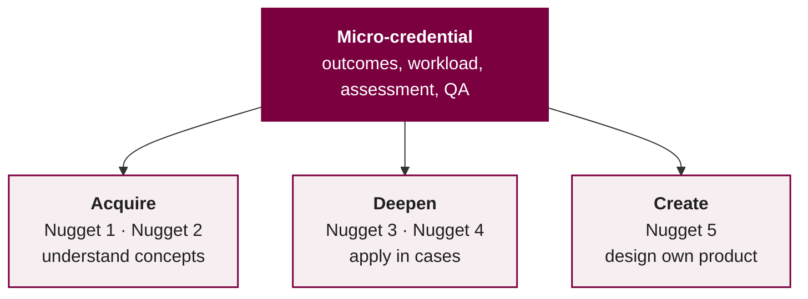

<!--
author:    Dr. Hannes Tegelbeckers
email:     hannes.tegelbeckers@ovgu.de
version:   1.1.0
language:  en
narrator:  UK English Female
mode:      Presentation
classroom: enable

title:     P05 – Nuggets, Micro-credentials and the Competency Matrix Workshop (Session slides)
comment:   AI in TVET II – Slides for session 5 (live, 07.01.2027, 180 min): learning nuggets and micro-credentials (EU approach), competency matrix workshop with peer check, sample material with AI and LiaScript, open licensing of AI-supported material, structure of the 20-minute group presentation. Interactive: progression checker, licence finder, presentation planner.
tags:      Micro-credentials, Learning nuggets, Competency matrix, LiaScript, OER, Creative Commons

import:    https://raw.githubusercontent.com/LiaTemplates/mermaid_template/0.1.4/README.md
-->

# Nuggets, Micro-credentials and the Competency Matrix Workshop

**Session 5 · 07.01.2027 · 🟢 Live · 09:00–12:00** · AI in TVET II, OVGU Magdeburg

From matrix to nuggets · **competency matrix workshop** · sample material in LiaScript · open licensing · your 20-minute storyline

<small>[Self-learning unit S05](https://liascript.github.io/course/?https://raw.githubusercontent.com/OVGU-VET-TechEd/AI_in_TVET_II_WiSe_2026_2027/main/AI_in_TVET_II_WiSe_2026_2027/05_Nuggets_Microcredentials_and_Matrix/S05_Nuggets_Microcredentials_LiaScript.md) · [Unit in Moodle (SCORM, obligatory)](https://elearning.ovgu.de/course/section.php?id=202215) · [HTML slides](https://ovgu-vet-teched.github.io/AI_in_TVET_II_WiSe_2026_2027/AI_in_TVET_II_WiSe_2026_2027/05_Nuggets_Microcredentials_and_Matrix/P05_Nuggets_Microcredentials_LiaScript.html) · [Organisational overview](https://liascript.github.io/course/?https://raw.githubusercontent.com/OVGU-VET-TechEd/AI_in_TVET_II_WiSe_2026_2027/main/AI_in_TVET_II_WiSe_2026_2027/00_Organisation/organisational_overview_slide_AI_in_TVET_II.md)</small>

    --{{0}}--
Happy new year and welcome back. Today is workshop day: your matrix gets its final shape, you build the first piece of sample material, and you leave with a plan for your twenty-minute presentation.

## Warm-up: Where Is Your Group? 🚦

**Our competency matrix is …**

- [(1)] 🌱 a first draft (from S03)
- [(2)] 🌿 extended with assessment and safeguards (from S04)
- [(3)] 🌳 nearly final

**Our sample material is …**

- [(1)] 💭 an idea
- [(2)] 📝 a draft
- [(3)] ✅ a working LiaScript file

**What do you need most today?**

[[___]]

    --{{0}}--
Your answers tell me which groups I should visit first in the workshop phase.

## Where We Are 🧭

```mermaid @mermaid
flowchart LR
  S1["<b>1 · 26.11.</b><br>Kick-off and<br>LiaScript Level 2"]:::done
  S1 --> S2["<b>2 · 03.12.</b> 🔵<br>AI and prompting<br>Level 2"]:::done
  S2 --> S3["<b>3 · 10.12.</b> 🔵<br>Vocabulary and<br>workflows"]:::done
  S3 --> S4["<b>4 · 17.12.</b><br>Pedagogy, assessment,<br>ethics"]:::done
  S4 --> S5["<b>5 · 07.01.</b><br>Nuggets and<br>matrix workshop"]:::now
  S5 --> S6["<b>6 · 14.01.</b> ⚪<br>Project and peer review<br>format tbc"]:::tbc
  S6 --> S7["<b>7 · 21.01.</b><br>Final<br>presentations"]:::live
  classDef live fill:#f7eef2,stroke:#7a003f,stroke-width:1.5px,color:#1f1f1f
  classDef self fill:#e8f0fb,stroke:#1565c0,stroke-width:1.5px,color:#1f1f1f
  classDef tbc fill:#fff8e1,stroke:#b7791f,stroke-width:1.5px,stroke-dasharray:4 3,color:#1f1f1f
  classDef now fill:#7a003f,stroke:#7a003f,stroke-width:2px,color:#ffffff
  classDef done fill:#eeeeee,stroke:#9ca3af,stroke-width:1px,color:#5f6163
```



**Building blocks today:** **final competency matrix** · **sample material** (first version) · **licence and AI declaration** · **presentation storyline**.

## Today's Objectives 🎯

By the end of today you can …

    --{{1}}--
First the design level: nuggets, micro-credentials and the matrix.

      {{1}}
****************************************

1. **align** outcome, learning activity and evidence for each nugget of your micro-credential design,
2. **finalise** your competency matrix across Acquire – Deepen – Create after a peer check,

****************************************

    --{{2}}--
Then the product level: material, licence, storyline.

      {{2}}
****************************************

3. **create** sample learning material with AI and **implement** it in LiaScript with an interactive element,
4. **determine** a licence for material that mixes own, AI-generated and third-party sources, and make it findable,
5. **structure** your 20-minute group presentation.

****************************************

## Today's Agenda 🗓️

<!-- data-type="none" -->
| Time | Block | Mode |
| --- | --- | --- |
| 09:00 | Warm-up · constructive alignment per nugget | Plenary |
| 09:25 | Competency matrix workshop: check, complete, peer check | Groups |
| 10:20 | Break | 10 min |
| 10:30 | Sample material with AI and LiaScript | Live demo + groups |
| 11:15 | Licensing Level 2: mixing sources · metadata | Input + playground |
| 11:30 | Your 20-minute storyline · exit ticket · SCORM | Groups + individual |

## 1. From Matrix to Nuggets (Recap) 🧱



<!-- data-type="none" -->
| Learning nugget | Micro-credential |
| --- | --- |
| 5–15 minutes, one learning objective | Small volume of learning, several outcomes |
| Interactive element + short check | Assessment against transparent criteria |
| Reusable in other contexts | Recorded and recognised (e.g. digital badge) |

    --{{0}}--
Each level of your matrix can become one or two nuggets. Together they could form a micro-credential. For your presentation you show the design and one piece of sample material, not all nuggets.

## Constructive Alignment per Nugget 🎯

In AI in TVET I you filled in the EU micro-credential card (outcomes, workload, assessment …). Level 2: **does each nugget really lead to its outcome?** Outcome, learning activity and evidence must be on the same level (Biggs & Tang, 2011).

**Nugget outcome:** <script input="text" value="Apprentices check a chatbot answer against the regulation" output="ao" input-always-active>@input</script>

**Learning activity:** <script input="select" options="read an explanation,answer a quiz,work on a realistic case,design an own product" value="answer a quiz" output="aa">@input</script>

**Assessment / evidence:** <script input="select" options="single-choice quiz,case analysis with justification,product with criteria-based review,attendance" value="single-choice quiz" output="ae">@input</script>

<script modify="false" style="display:block">
const o = `@input(`ao`)`.toLowerCase();
const lvl = /\b(design|create|develop|construct|plan|build|formulate)\b/.test(o) ? 3 : (/\b(apply|check|compare|analy[sz]e|test|solve|use|examine)\b/.test(o) ? 2 : (/\b(explain|describe|identify|recognise|recognize|name|list|define)\b/.test(o) ? 1 : 0));
const act = {"read an explanation":1,"answer a quiz":1,"work on a realistic case":2,"design an own product":3}[`@input(`aa`)`.trim()];
const ev = {"single-choice quiz":1,"case analysis with justification":2,"product with criteria-based review":3,"attendance":0}[`@input(`ae`)`.trim()];
const L = ["?","Acquire","Deepen","Create"];
const msg = [];
if (!lvl) msg.push("❓ No clear action verb in the outcome.");
if (lvl && act < lvl) msg.push("📉 The activity (" + L[act] + ") is below the outcome (" + L[lvl] + ") – learners never practise what the outcome demands.");
if (lvl && ev < lvl) msg.push("📉 The evidence (" + (L[ev] || "none") + ") cannot show the outcome (" + L[lvl] + ").");
if (ev === 0) msg.push("🚫 Attendance is no evidence of a learning outcome.");
`HTML: <p>Outcome: <b>${L[lvl]}</b> · activity: <b>${L[act]}</b> · evidence: <b>${L[ev] || "none"}</b></p><p>${msg.length ? msg.join("<br>") : "✅ Outcome, activity and evidence are aligned."}</p>`
</script>

    --{{0}}--
Test one nugget of your matrix. A typical mistake: a Create-level outcome, but learners only answer a quiz. Then the quiz cannot show what the outcome promises.

## 2. Competency Matrix Workshop 🔧

**Step 1 – check your learning objective (10 min)**

    --{{1}}--
Three checks for the objective, then you complete the matrix.

      {{1}}
****************************************

- [ ] exact UNESCO wording and source (competency 3, 4 or 5)?
- [ ] observable action verb?
- [ ] concrete TVET target group (occupation, year, setting)?

****************************************

    --{{2}}--
For learner-facing objectives, the UNESCO framework for students and ESCO give you precise wording.

      {{2}}
> [!TIP] Wording help
> Learner-facing objectives: [UNESCO AI CFT for Students](https://doi.org/10.54675/JKJB9835) (levels *Understand – Apply – Create*) · occupational skills: [ESCO](https://esco.ec.europa.eu/en)

## Step 2 – Complete the Matrix (25 min) 🧮

<!-- data-type="none" -->
| Level | Content | Workflow | AI tool | Assessment / feedback | Human decision |
| --- | --- | --- | --- | --- | --- |
| **Acquire** | | | | | |
| **Deepen** | | | | | |
| **Create** | | | | | |

    --{{1}}--
Check that the action verbs rise from level to level. The progression checker on the next slide helps.

      {{1}}
> [!NOTE] Progression
> Each level must **build on** the previous one: *recognise / explain* → *apply / analyse* → *design / create*.

## Playground: Progression Checker 📶

**Acquire objective:** <script input="text" value="Apprentices explain why an AI chatbot can give a wrong safety rule" output="o1" input-always-active>@input</script>

**Deepen objective:** <script input="text" value="Apprentices check a chatbot answer against the regulation in a workplace case" output="o2" input-always-active>@input</script>

**Create objective:** <script input="text" value="Apprentices design rules for chatbot use in the training workshop" output="o3" input-always-active>@input</script>

<script modify="false" style="display:block">
const lv = [
  [1, /\b(name|list|define|recognise|recognize|identify|describe|explain|summari[sz]e|state)\b/],
  [2, /\b(apply|use|check|compare|analy[sz]e|classify|test|solve|calculate|examine|distinguish)\b/],
  [3, /\b(evaluate|assess|justify|design|create|develop|construct|plan|compose|build|formulate)\b/]];
const lvl = s => { s = s.toLowerCase(); let r = 0; for (const [n, re] of lv) if (re.test(s)) r = Math.max(r, n); return r; };
const o = [`@input(`o1`)`, `@input(`o2`)`, `@input(`o3`)`];
const v = o.map(lvl), names = ["Acquire","Deepen","Create"], word = ["?","recall/understand","apply/analyse","evaluate/create"];
const rows = v.map((x,i) => `<li><b>${names[i]}</b>: verb level <b>${word[x]}</b> ${x === i+1 ? "✅" : (x === 0 ? "❓ no known action verb" : "⚠️ expected " + word[i+1])}</li>`).join("");
const ok = v[0] <= v[1] && v[1] <= v[2] && v[0] > 0 && v[2] === 3;
`HTML: <ul>${rows}</ul><p>${ok ? "📈 Progression is visible." : "🔧 Check your verbs: the levels should rise from understanding to creating."}</p><p><small>Keyword check only – your judgement decides.</small></p>`
</script>

    --{{0}}--
Paste your three objectives. The checker looks for typical action verbs. It is a helper, not a judge: a well-justified objective can use other verbs.

## Step 3 – Peer Check (10 min per group) 👀

Another group checks your matrix with three questions:

1. Is the **progression** visible – does each level build on the previous one?
2. Do **content, workflow and AI tool** fit together on each level?
3. Where is the **human role** clear – and where is AI used just because it is possible?

    --{{1}}--
Write down the most important feedback you received.

      {{1}}
**The most important feedback we received:**

[[___ ___]]

## 3. Sample Material with AI and LiaScript 🤖📄

```text
You are an instructional designer for vocational education.
Create a LiaScript section (mode: Presentation) for this learning objective:
"<UNESCO learning objective, exact wording>" – level: <Acquire | Deepen | Create>.
Target group: <…>. Language: English, B1–B2.
Include: workplace scenario (max. 120 words), explanation with a table or a
Mermaid diagram, 2 single-choice items (- [( )] / - [(X)]) with hints ([[?]]),
1 reflection task, summary in 3 bullets, speaker notes (--{{0}}--).
Do not invent sources or statistics; mark gaps with <!-- CHECK -->.
Never indent text by 4 or more spaces.
```

    --{{1}}--
I run this prompt live for one group's objective. Watch what we keep and what we change.

      {{1}}
> [!TIP] Give the AI an example
> Attach the [presentation template](https://liascript.github.io/course/?https://raw.githubusercontent.com/OVGU-VET-TechEd/AI_in_TVET_II_WiSe_2026_2027/main/AI_in_TVET_II_WiSe_2026_2027/00_Organisation/Template_LiaScript_Presentation.md) or one of your own working slides – the syntax then stays correct.

## Beyond Syntax: Accessible and Inclusive Material ♿

Session 1 covered the Level-2 LiaScript features. Now the quality that learners notice first: **can everybody use it?**

<!-- data-type="none" -->
| Check | Why | LiaScript |
| --- | --- | --- |
| Alt text for every image | screen readers ([WCAG](https://www.w3.org/WAI/standards-guidelines/wcag/)) | `` |
| Narration for key slides | low reading skills, second language | `--{{0}}--` + `narrator:` |
| Plain language, B1 | vocational classes with mixed language levels | your revision |
| Several ways to engage | Universal Design for Learning ([UDL](https://udlguidelines.cast.org/)) | quiz · case · playground · video |
| Colour is never the only signal | colour blindness | icons + text |

    --{{1}}--
For the Create level, think beyond quizzes. One example from the AI explorables: apprentices train their own small image classifier and discover how training data shapes it.

      {{1}}
> [!TIP] Create-level idea
> Apprentices train a quality-inspection classifier with [Teachable Machine](https://teachablemachine.withgoogle.com/) (e.g. "good / faulty weld seam"), test it with new photos and **write rules** for when a human must re-check – learning *with* AI and *about* AI at once.

## Try It: Build Your Sample Material (30 min) 🧪

**Choose one level of your matrix** and build one nugget section with the prompt.

    --{{1}}--
Then run the quality checklist. Everything you change goes into your AI tools log.

      {{1}}
****************************************

- [ ] Factually correct and sources checked
- [ ] Aligned with the learning objective and level
- [ ] Authentic for the vocational field
- [ ] Activating (learners have to think, not only read)
- [ ] Inclusive language and examples, no stereotypes
- [ ] Renders correctly in LiaScript
- [ ] Licence, image credits and AI declaration

****************************************

    --{{2}}--
Paste the link to your sample material so we can look at two examples together.

      {{2}}
**LiaScript link to your sample material:**

[[___]]

## 4. Licensing Level 2: Mixing Sources ©️

AI in TVET I: CC licences, TASL, AI output and copyright. Level 2: your sample material **mixes** sources – what licence is still possible?

<!-- data-type="none" -->
| Source in your file | Effect on your licence |
| --- | --- |
| Your own text, revised AI drafts | free choice – CC BY 4.0 recommended; declare AI parts |
| Adapted **CC BY-SA** material | adaptation must be **CC BY-SA** |
| Copied **CC BY-NC** material | adaptation cannot be fully open (NC) |
| BY-SA **and** BY-NC in one adaptation | **incompatible** – replace one |
| Embedded or linked website / video | not copied – keeps its own licence, credit it |
| All-rights-reserved image | not allowed without permission – link instead |

## Playground: Licence Compatibility Checker 🧩

**Adapted CC BY-SA material (e.g. a Wikipedia figure you changed):** <script input="select" options="no,yes" value="no" output="c1">@input</script>

**CC BY-NC material copied into your file:** <script input="select" options="no,yes" value="no" output="c2">@input</script>

**All-rights-reserved image copied into your file:** <script input="select" options="no,yes" value="no" output="c3">@input</script>

**Third-party websites or videos only embedded or linked (??[…], !?[…]):** <script input="select" options="yes,no" value="yes" output="c4">@input</script>

<script modify="false" style="display:block">
const y = k => `${k}`.trim() === "yes";
const sa = y(`@input(`c1`)`), nc = y(`@input(`c2`)`), arr = y(`@input(`c3`)`), emb = y(`@input(`c4`)`);
const notes = []; let lic;
if (arr) notes.push("🚫 All-rights-reserved image: remove it, ask for permission, or link instead of copying.");
if (sa && nc) { lic = "❌ conflict"; notes.push("BY-SA and BY-NC cannot be combined in one adaptation – replace one of the sources."); }
else if (sa) { lic = "CC BY-SA 4.0"; notes.push("ShareAlike: your adaptation must use the same licence."); }
else if (nc) { lic = "CC BY-NC 4.0"; notes.push("NonCommercial: schools or companies selling courses may not reuse it – not fully open."); }
else lic = "CC BY 4.0";
if (emb) notes.push("Embedded/linked content is not copied: it keeps its own licence – credit it, but it does not restrict yours.");
notes.push("AI-generated parts: declare them; check the terms of your AI tool.");
`HTML: <p>Possible licence for your file: <b>${lic}</b></p><ul><li>${notes.join("</li><li>")}</li></ul><p><small>Simplified – see the <a href="https://wiki.creativecommons.org/wiki/Wiki/cc_license_compatibility" target="_blank" rel="noopener">CC compatibility chart</a>.</small></p>`
</script>

    --{{0}}--
Enter what your sample material contains. The checker shows which licence is still possible and what you have to change to stay fully open.

## Make It Findable: Metadata and OER Repositories 🔍

Open material only helps if others **find** it:

- **LiaScript header** as metadata: `title`, `comment`, `tags`, `language`, `version`, `author`
- **README** with topic, target group, UNESCO objective, licence and LiaScript badge
- **OER search engines** and repositories: [OERSI](https://oersi.org) (search across German higher-education OER) · [twillo](https://www.twillo.de) (OER portal for higher education in Lower Saxony)

    --{{1}}--
Write your header and README so that a teacher searching for your topic finds your work.

      {{1}}
**Your header `tags:` line:**

[[___]]

## 5. Your 20-Minute Storyline 🎬

<!-- data-type="none" -->
| Part | Content | Time |
| --- | --- | --- |
| 1 | Introduction: group, topic, why this objective matters | 2 min |
| 2 | Learning objective and target group | 2 min |
| 3 | Competency matrix: Acquire – Deepen – Create | 5 min |
| 4 | Sample material, live, with an interactive element for the audience | 6 min |
| 5 | AI workflow: tools, prompts, what you checked and changed | 3 min |
| 6 | Human role, lessons learned, references, licence | 2 min |
| | **Discussion** | 5 min |

    --{{1}}--
Split the parts among group members, but rehearse once together with a timer. The planner on the next slide helps.

      {{1}}
**Tip:** split the parts among members – and rehearse once together with a timer.

## Playground: Presentation Planner ⏱️

| Part | Minutes |
| --- | --- |
| 1 Introduction | <script input="range" min="0" max="5" step="0.5" value="2" output="q1">@input</script> |
| 2 Objective and target group | <script input="range" min="0" max="5" step="0.5" value="2" output="q2">@input</script> |
| 3 Competency matrix | <script input="range" min="0" max="8" step="0.5" value="5" output="q3">@input</script> |
| 4 Sample material, live | <script input="range" min="0" max="10" step="0.5" value="6" output="q4">@input</script> |
| 5 AI workflow | <script input="range" min="0" max="6" step="0.5" value="3" output="q5">@input</script> |
| 6 Human role, lessons, licence | <script input="range" min="0" max="5" step="0.5" value="2" output="q6">@input</script> |

<script modify="false" style="display:block">
const v = [@input(`q1`),@input(`q2`),@input(`q3`),@input(`q4`),@input(`q5`),@input(`q6`)].map(Number);
const t = v.reduce((a,b) => a+b, 0);
const cols = ["#5c002f","#7a003f","#9b3366","#bc7f9f","#1565c0","#2e7d32"];
const bar = v.map((x,i) => x > 0 ? `<div title="Part ${i+1}: ${x} min" style="background:${cols[i]};width:${x/Math.max(20,t)*100}%;height:26px;color:#fff;font-size:0.8em;text-align:center;line-height:26px">${i+1}</div>` : "").join("");
const msg = t > 20 ? `⏰ <b>${t} min – too long.</b> Cut ${t-20} min.` : (t < 18 ? `🕳️ <b>${t} min</b> – time left: strengthen the live demo or the human role.` : `✅ <b>${t} min</b> – good timing.`);
const tip = v[3] < 4 ? "<br>💡 The live sample material is the heart of the presentation – give it at least 4 minutes." : "";
const tip2 = v[2] < 3 ? "<br>💡 The matrix is a core criterion – give it at least 3 minutes." : "";
`HTML: <div style="display:flex;width:100%;border:1px solid #94a3b8;border-radius:6px;overflow:hidden">${bar}</div><p>${msg}${tip}${tip2}</p>`
</script>

## Look Critically: Examples from the Previous Cohort 🔍

Open one example and rate it with today's criteria:

- [AI Competency Assessment Programme – trainer guide, UNESCO LO 5.1.2, Acquire](https://liascript.github.io/course/?https://raw.githubusercontent.com/OVGU-VET-TechEd/AI_in_TVET_II_-LearningObjective-/main/AI-Competency-Trainer-Assessment-.md)
- [Feedback 4.0: AI-enhanced inclusive teaching in TVET](https://liascript.github.io/course/?https://raw.githubusercontent.com/OVGU-VET-TechEd/AI_in_TVET_II_-LearningObjective-/main/Final%20of%20AI%20in%20Tevt%20II.md)
- [TVET teachers leading the AI transformation in medical imaging](https://liascript.github.io/course/?https://raw.githubusercontent.com/OVGU-VET-TechEd/AI_in_TVET_II_-LearningObjective-/main/TVET%20Teachers_%20A%2020-Minute%20Workshop%20by%20Maira%20Mazhar.md)

    --{{1}}--
Which of today's criteria does the example meet best, and which one would you improve? Learn from it for your own presentation.

      {{1}}
**Which criterion does it meet best – which would you improve?**

- [(obj)] Exact learning objective
- [(prog)] Visible progression
- [(act)] Activating material
- [(lic)] Licence and AI declaration
- [(human)] Clear human role

## Project Lab: Until 14.01.2027 🛠️

- [ ] final competency matrix in the presentation file
- [ ] sample material works and has an interactive element
- [ ] AI tools log up to date (≥ 5 entries)
- [ ] licence line + AI declaration on the last slide
- [ ] **complete draft** of the presentation pushed to GitHub **before 14.01.** – the peer review starts then

    --{{0}}--
The draft must be online on the fourteenth of January, because another group reviews it that day.

## Exit Ticket 🎟️

**Objective 1:** A nugget's outcome is "design rules for chatbot use". Which evidence fits?

<!-- data-hint-button="1" data-solution-button="2" -->
- [( )] A single-choice quiz
- [(X)] A product (the rules) reviewed with criteria
- [( )] Attendance
[[?]] Outcome and evidence on the same level.

**Objective 2:** Our matrix progression is …

- [(1)] clear
- [(2)] partly clear
- [(3)] still unclear

**Objectives 3–4:** You adapted a CC BY-SA figure and copied a CC BY-NC video still into the same nugget. What follows?

<!-- data-hint-button="1" data-solution-button="2" -->
- [( )] CC BY 4.0 is still possible.
- [(X)] The licences conflict – replace one source (e.g. embed the video instead of copying).
- [( )] The stricter licence wins automatically.
[[?]] ShareAlike and NonCommercial in one adaptation.

**Objective 5:** Who presents which part in our group?

[[___ ___]]

## Your SCORM Unit and Next Steps 📦

**Obligatory:** complete the self-learning unit **S05** in Moodle – the reference for building your sample material and presentation.

    --{{1}}--
Session six is the peer review, with the second group hand-in. Whether we meet live or you work self-paced will be announced in Moodle.

      {{1}}
****************************************

- 📦 [S05 in Moodle (SCORM)](https://elearning.ovgu.de/course/section.php?id=202215) · [S05 in LiaScript](https://liascript.github.io/course/?https://raw.githubusercontent.com/OVGU-VET-TechEd/AI_in_TVET_II_WiSe_2026_2027/main/AI_in_TVET_II_WiSe_2026_2027/05_Nuggets_Microcredentials_and_Matrix/S05_Nuggets_Microcredentials_LiaScript.md) – all 7 units by **15.02.2027**
- ➡️ **Next: Thursday, 14.01.2027, ⚪ format to be confirmed (live or self-learning)** – project development and **peer review on GitHub**
- 📤 **Group hand-in inside unit S06: 18.01.2027, 23:59**

****************************************

## References

- Anderson, L. W., & Krathwohl, D. R. (Eds.). (2001). *A taxonomy for learning, teaching, and assessing: A revision of Bloom's taxonomy of educational objectives*. Longman.
- Council of the European Union. (2022). *Council Recommendation of 16 June 2022 on a European approach to micro-credentials for lifelong learning and employability* (2022/C 243/02). https://eur-lex.europa.eu/legal-content/EN/TXT/?uri=CELEX:32022H0627(02)
- Biggs, J., & Tang, C. (2011). *Teaching for quality learning at university* (4th ed.). Open University Press.
- CAST. (2024). *Universal Design for Learning guidelines* (Version 3.0). https://udlguidelines.cast.org/
- Creative Commons. (n.d.). *CC license compatibility chart*. https://wiki.creativecommons.org/wiki/Wiki/cc_license_compatibility
- European Commission. (n.d.). *ESCO – European Skills, Competences, Qualifications and Occupations*. https://esco.ec.europa.eu/en
- LiaScript. (n.d.). *LiaScript documentation*. https://liascript.github.io/course/?https://raw.githubusercontent.com/liaScript/docs/master/README.md
- W3C. (2023). *Web Content Accessibility Guidelines (WCAG) 2.2*. https://www.w3.org/TR/WCAG22/
- UNESCO. (2019). *Recommendation on Open Educational Resources (OER)*. https://www.unesco.org/en/legal-affairs/recommendation-open-educational-resources-oer
- UNESCO. (2024a). *AI competency framework for students*. https://doi.org/10.54675/JKJB9835
- UNESCO. (2024b). *AI competency framework for teachers*. https://doi.org/10.54675/ZJTE2084

<small>Licence: CC BY 4.0 · Dr. Hannes Tegelbeckers, OVGU Magdeburg · Created with AI support (Claude), checked by the author. Examples of the previous cohort: MIT licence, see their repository.</small>
