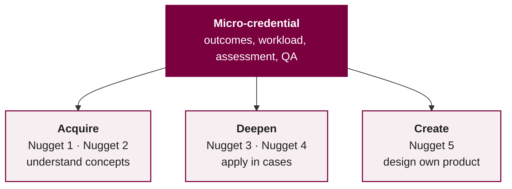

<!--
author:    Dr. Hannes Tegelbeckers
email:     hannes.tegelbeckers@ovgu.de
version:   2.1.0
language:  en
narrator:  UK English Female
mode:      Textbook

title:     S05 – Designing self-learning nuggets and micro-credentials with LiaScript (Self-learning unit)
comment:   AI in TVET II – Self-learning unit for session 5 (live, 07.01.2027): learning nuggets and micro-credentials (EU approach), Acquire–Deepen–Create progression, competency matrix workshop, sample material with AI and LiaScript, open licensing of AI-supported material, structure of the 20-minute group presentation. Obligatory SCORM unit.

import:    https://raw.githubusercontent.com/LiaTemplates/mermaid_template/0.1.4/README.md
-->

# S05 – Designing Self-Learning Nuggets and Micro-credentials with LiaScript

> **Session 5 · 07.01.2027 · 🟢 Live · Competency matrix workshop** – bring your matrix from S03/S04. This unit is also your reference for building the group presentation.
>
> **Time needed:** about 2 hours
>
> **📦 Obligatory:** completing this unit [in Moodle (SCORM)](https://elearning.ovgu.de/course/section.php?id=202215) is part of the pass requirement – all 7 units by **15.02.2027**.

**After this unit you will be able to …**

1. align outcome, learning activity and evidence for each nugget of your micro-credential design,
2. finalise a competency matrix across Acquire – Deepen – Create,
3. create sample learning material with AI and implement it in LiaScript,
4. determine a licence for material that mixes own, AI-generated and third-party sources, and make it findable,
5. structure your 20-minute group presentation.

## 1. Nuggets and Micro-credentials

A **learning nugget** is a short, self-contained learning unit (5–15 minutes) for one learning objective, with an interactive element and a short check. Several nuggets, aligned to learning outcomes and assessed, can form a **micro-credential** – a small, recognised unit of learning. Each level of your competency matrix can become one or two nuggets.



<!-- data-type="none" -->
| Learning nugget | Micro-credential |
| --- | --- |
| 5–15 minutes, one learning objective | Small volume of learning, several outcomes |
| Interactive element + short check | Assessment against transparent criteria |
| Can be reused in other contexts | Recorded and recognised (e.g. digital badge) |

### Constructive alignment per nugget

In AI in TVET I you described your micro-credential with the mandatory elements of the European approach (Council of the European Union, 2022) – outcomes, workload, assessment, quality assurance. Level 2 asks whether each nugget **really leads** to its outcome. In a constructively aligned design, the outcome, the learning activity and the evidence (assessment) are on the same level (Biggs & Tang, 2011). A typical mistake: a *Create*-level outcome, but learners only answer a quiz – the quiz cannot show what the outcome promises.

Test one nugget of your matrix:

**Nugget outcome:** <script input="text" value="Apprentices check a chatbot answer against the regulation" output="ao" input-always-active>`@input`</script>

**Learning activity:** <script input="select" options="read an explanation|answer a quiz|work on a realistic case|design an own product" value="answer a quiz" output="aa">`@input`</script>

**Assessment / evidence:** <script input="select" options="single-choice quiz|case analysis with justification|product with criteria-based review|attendance" value="single-choice quiz" output="ae">`@input`</script>

<script modify="false" style="display:block">
const o = `@input(`ao`)`.toLowerCase();
const lvl = /\b(design|create|develop|construct|plan|build|formulate)\b/.test(o) ? 3 : (/\b(apply|check|compare|analy[sz]e|test|solve|use|examine)\b/.test(o) ? 2 : (/\b(explain|describe|identify|recognise|recognize|name|list|define)\b/.test(o) ? 1 : 0));
const act = {"read an explanation":1,"answer a quiz":1,"work on a realistic case":2,"design an own product":3}[`@input(`aa`)`.trim()];
const ev = {"single-choice quiz":1,"case analysis with justification":2,"product with criteria-based review":3,"attendance":0}[`@input(`ae`)`.trim()];
const L = ["?","Acquire","Deepen","Create"];
const msg = [];
if (!lvl) msg.push("❓ No clear action verb in the outcome.");
if (lvl && act < lvl) msg.push("📉 The activity (" + L[act] + ") is below the outcome (" + L[lvl] + ") – learners never practise what the outcome demands.");
if (lvl && ev < lvl) msg.push("📉 The evidence (" + (L[ev] || "none") + ") cannot show the outcome (" + L[lvl] + ").");
if (ev === 0) msg.push("🚫 Attendance is no evidence of a learning outcome.");
`HTML: <p>Outcome: <b>${L[lvl]}</b> · activity: <b>${L[act]}</b> · evidence: <b>${L[ev] || "none"}</b></p><p>${msg.length ? msg.join("<br>") : "✅ Outcome, activity and evidence are aligned."}</p>`
</script>

**For your group presentation:** you do not need to build all nuggets. Show the **design** (matrix, nugget plan with alignment) and **one piece of sample material**.

## 2. The Competency Matrix Workshop

The matrix is the heart of your presentation. In the workshop you check your learning objective, complete the matrix and let another group check it.

### Step 1 – Check your learning objective

- Exact UNESCO wording and source (competency 3, 4 or 5)?
- Action verb that can be observed?
- Concrete TVET target group (occupation, year, setting)?

For **learner-facing** objectives, the [UNESCO AI Competency Framework for Students](https://doi.org/10.54675/JKJB9835) gives precise wording with the levels *Understand – Apply – Create*. For occupational skills, [ESCO](https://esco.ec.europa.eu/en) provides standard skill descriptions.

### Step 2 – Complete the matrix

<!-- data-type="none" -->
| Level | Content | Workflow | AI tool | Assessment / feedback | Human decision |
| --- | --- | --- | --- | --- | --- |
| **Acquire** | | | | | |
| **Deepen** | | | | | |
| **Create** | | | | | |

Each level must **build on** the previous one. The action verbs show it: *recognise / explain* (Acquire) → *apply / analyse / check* (Deepen) → *evaluate / design / create* (Create) (Anderson & Krathwohl, 2001). Test your three objectives:

**Acquire objective:** <script input="text" value="Apprentices explain why an AI chatbot can give a wrong safety rule" output="o1" input-always-active>`@input`</script>

**Deepen objective:** <script input="text" value="Apprentices check a chatbot answer against the regulation in a workplace case" output="o2" input-always-active>`@input`</script>

**Create objective:** <script input="text" value="Apprentices design rules for chatbot use in the training workshop" output="o3" input-always-active>`@input`</script>

<script modify="false" style="display:block">
const lv = [
  [1, /\b(name|list|define|recognise|recognize|identify|describe|explain|summari[sz]e|state)\b/],
  [2, /\b(apply|use|check|compare|analy[sz]e|classify|test|solve|calculate|examine|distinguish)\b/],
  [3, /\b(evaluate|assess|justify|design|create|develop|construct|plan|compose|build|formulate)\b/]];
const lvl = s => { s = s.toLowerCase(); let r = 0; for (const [n, re] of lv) if (re.test(s)) r = Math.max(r, n); return r; };
const o = [`@input(`o1`)`, `@input(`o2`)`, `@input(`o3`)`];
const v = o.map(lvl), names = ["Acquire","Deepen","Create"], word = ["?","recall/understand","apply/analyse","evaluate/create"];
const rows = v.map((x,i) => `<li><b>${names[i]}</b>: verb level <b>${word[x]}</b> ${x === i+1 ? "✅" : (x === 0 ? "❓ no known action verb" : "⚠️ expected " + word[i+1])}</li>`).join("");
const ok = v[0] <= v[1] && v[1] <= v[2] && v[0] > 0 && v[2] === 3;
`HTML: <ul>${rows}</ul><p>${ok ? "📈 Progression is visible." : "🔧 Check your verbs: the levels should rise from understanding to creating."}</p><p><small>Keyword check only – your judgement decides.</small></p>`
</script>

### Step 3 – Peer check

Another group checks your matrix with three questions:

1. Is the progression visible (does each level build on the previous one)?
2. Do content, workflow and AI tool fit together on each level?
3. Where is the human role clear – and where is AI used just because it is possible?

**Check:** Which sequence describes a coherent progression?

<!-- data-hint-button="1" data-solution-button="2" -->
- [( )] Learners design an AI workflow → learn basic terms → apply them in a case
- [(X)] Learners learn basic terms → apply them in a case → design their own AI-supported product
- [( )] Learners only take quizzes on all three levels
[[?]] Understanding comes before application, application before design.

## 3. Sample Material with AI and LiaScript

Your sample material is the part of the presentation that the audience experiences directly. It should be short, correct, activating – and clearly tied to one level of your matrix.

### Prompt template for a nugget section

```text
You are an instructional designer for vocational education.
Create a LiaScript section (mode: Presentation) for this learning objective:
"<UNESCO learning objective, exact wording>" – level: <Acquire | Deepen | Create>.
Target group: <…>. Language: English, B1–B2.
Include: workplace scenario (max. 120 words), explanation with a table or a
Mermaid diagram, 2 single-choice items (- [( )] / - [(X)]) with hints ([[?]]),
1 reflection task, summary in 3 bullets, speaker notes (--{{0}}--).
Do not invent sources or statistics; mark gaps with <!-- CHECK -->.
Never indent text by 4 or more spaces.
```

Attach the [presentation template](https://liascript.github.io/course/?https://raw.githubusercontent.com/OVGU-VET-TechEd/AI_in_TVET_II_WiSe_2026_2027/main/AI_in_TVET_II_WiSe_2026_2027/00_Organisation/Template_LiaScript_Presentation.md) or one of your working slides as an example – the syntax then stays correct.

### Beyond syntax: accessible and inclusive material

Session 1 covered the Level-2 LiaScript features. The quality learners notice first is whether **everybody** can use the material:

<!-- data-type="none" -->
| Check | Why | LiaScript |
| --- | --- | --- |
| Alt text for every image | screen readers ([WCAG](https://www.w3.org/WAI/standards-guidelines/wcag/)) | `` |
| Narration for key slides | low reading skills, second language | `--{{0}}--` + `narrator:` |
| Plain language, B1 | vocational classes with mixed language levels | your revision |
| Several ways to engage | Universal Design for Learning ([UDL](https://udlguidelines.cast.org/)) | quiz · case · playground · video |
| Colour is never the only signal | colour blindness | icons + text |

**Create-level idea:** apprentices train a quality-inspection classifier with [Teachable Machine](https://teachablemachine.withgoogle.com/) (e.g. "good / faulty weld seam"), test it with new photos and **write rules** for when a human must re-check – learning *with* AI and *about* AI at once.

### Quality checklist for AI-generated material

- [ ] Factually correct and sources checked
- [ ] Aligned with the learning objective and level
- [ ] Authentic for the vocational field
- [ ] Activating (learners have to think, not only read)
- [ ] Inclusive language and examples, no stereotypes
- [ ] Renders correctly in LiaScript
- [ ] Licence (e.g. CC BY 4.0), image credits and AI declaration

## 4. Licensing Level 2: Mixing Sources

AI in TVET I covered Creative Commons licences, TASL attribution and the copyright status of AI output. Your sample material now **mixes** sources – own text, revised AI drafts, figures, videos, embedded explorables. Which licence is still possible?

<!-- data-type="none" -->
| Source in your file | Effect on your licence |
| --- | --- |
| Your own text, revised AI drafts | free choice – CC BY 4.0 recommended; declare AI parts |
| Adapted **CC BY-SA** material | adaptation must be **CC BY-SA** |
| Copied **CC BY-NC** material | adaptation cannot be fully open (NC) |
| BY-SA **and** BY-NC in one adaptation | **incompatible** – replace one |
| Embedded or linked website / video | not copied – keeps its own licence, credit it |
| All-rights-reserved image | not allowed without permission – link instead |

Check your own material:

**Adapted CC BY-SA material (e.g. a Wikipedia figure you changed):** <script input="select" options="no|yes" value="no" output="c1">`@input`</script>

**CC BY-NC material copied into your file:** <script input="select" options="no|yes" value="no" output="c2">`@input`</script>

**All-rights-reserved image copied into your file:** <script input="select" options="no|yes" value="no" output="c3">`@input`</script>

**Third-party websites or videos only embedded or linked (??[…], !?[…]):** <script input="select" options="yes|no" value="yes" output="c4">`@input`</script>

<script modify="false" style="display:block">
const y = k => `${k}`.trim() === "yes";
const sa = y(`@input(`c1`)`), nc = y(`@input(`c2`)`), arr = y(`@input(`c3`)`), emb = y(`@input(`c4`)`);
const notes = []; let lic;
if (arr) notes.push("🚫 All-rights-reserved image: remove it, ask for permission, or link instead of copying.");
if (sa && nc) { lic = "❌ conflict"; notes.push("BY-SA and BY-NC cannot be combined in one adaptation – replace one of the sources."); }
else if (sa) { lic = "CC BY-SA 4.0"; notes.push("ShareAlike: your adaptation must use the same licence."); }
else if (nc) { lic = "CC BY-NC 4.0"; notes.push("NonCommercial: schools or companies selling courses may not reuse it – not fully open."); }
else lic = "CC BY 4.0";
if (emb) notes.push("Embedded/linked content is not copied: it keeps its own licence – credit it, but it does not restrict yours.");
notes.push("AI-generated parts: declare them; check the terms of your AI tool.");
`HTML: <p>Possible licence for your file: <b>${lic}</b></p><ul><li>${notes.join("</li><li>")}</li></ul><p><small>Simplified – see the <a href="https://wiki.creativecommons.org/wiki/Wiki/cc_license_compatibility" target="_blank" rel="noopener">CC compatibility chart</a>.</small></p>`
</script>

**Check:** You adapted a CC BY-SA figure and copied a CC BY-NC video still into the same nugget. What follows?

<!-- data-hint-button="1" data-solution-button="2" -->
- [( )] CC BY 4.0 is still possible.
- [(X)] The licences conflict – replace one source (e.g. embed the video instead of copying).
- [( )] The stricter licence wins automatically.
[[?]] ShareAlike and NonCommercial in one adaptation.
***
ShareAlike requires the same licence for the adaptation, NonCommercial forbids commercial use – no licence satisfies both. Embedding or linking avoids copying.
***

### Make it findable

Open material only helps if others **find** it. Use the LiaScript header as metadata (`title`, `comment`, `tags`, `language`, `version`, `author`), write a README with topic, target group, UNESCO objective, licence and LiaScript badge, and check OER search engines such as [OERSI](https://oersi.org) or [twillo](https://www.twillo.de) – would a teacher searching for your topic find your work?

## 5. Structuring the 20-Minute Group Presentation

Use the presentation template from the course website. A possible timing:

<!-- data-type="none" -->
| Part | Content | Time |
| --- | --- | --- |
| 1 | Introduction: group, topic, why this learning objective matters | 2 min |
| 2 | Learning objective and target group | 2 min |
| 3 | Competency matrix: Acquire – Deepen – Create | 5 min |
| 4 | Sample learning material, shown live (with interactive element for the audience) | 6 min |
| 5 | AI workflow: tools, prompts, what you checked and changed | 3 min |
| 6 | Human role, lessons learned, references, licence | 2 min |
| | **Discussion** | 5 min |

**Tip:** split the parts among group members, but rehearse once together with a timer.

### Learn from the previous cohort

Look critically at one or two student products of the last run – what works, what would you improve with today's criteria?

- [AI Competency Assessment Programme – trainer guide, UNESCO LO 5.1.2, Acquire](https://liascript.github.io/course/?https://raw.githubusercontent.com/OVGU-VET-TechEd/AI_in_TVET_II_-LearningObjective-/main/AI-Competency-Trainer-Assessment-.md)
- [Feedback 4.0: AI-enhanced inclusive teaching in TVET](https://liascript.github.io/course/?https://raw.githubusercontent.com/OVGU-VET-TechEd/AI_in_TVET_II_-LearningObjective-/main/Final%20of%20AI%20in%20Tevt%20II.md)
- [TVET teachers leading the AI transformation in medical imaging](https://liascript.github.io/course/?https://raw.githubusercontent.com/OVGU-VET-TechEd/AI_in_TVET_II_-LearningObjective-/main/TVET%20Teachers_%20A%2020-Minute%20Workshop%20by%20Maira%20Mazhar.md)

## 6. Your Task for Session 5

Submit your results **inside this unit** – there is no separate upload.

**Our final competency matrix (Markdown table or link to the file in our repository):**

[[___ ___ ___ ___]]

**The most important peer feedback on our matrix – and what we changed:**

[[___ ___]]

**LiaScript link to our sample material and the level of the matrix it belongs to:**

[[___]]

**Our licence line and AI declaration:**

[[___ ___]]

## Summary and Self-Check

- Nuggets stack into a micro-credential; in each nugget, outcome, activity and evidence must be aligned.
- The matrix shows a visible progression Acquire → Deepen → Create, with content, workflow, AI tool, assessment and human decision per level.
- Sample material is generated with a structured prompt and revised with the quality checklist.
- Mixed sources limit your licence: BY-SA and BY-NC conflict, embedding avoids copying; metadata makes your OER findable.
- Accessibility (alt text, narration, plain language, UDL) is part of quality.

**Tick what you can do now:**

- [ ] I can explain the relation between nuggets and a micro-credential.
- [ ] Our matrix passed the peer check.
- [ ] Our sample material works in LiaScript and has an interactive element.
- [ ] We checked the licence compatibility of all sources in our sample material.
- [ ] Our sample material passes the accessibility checks.
- [ ] We know who presents which part.

**Until 14.01.2027:** complete draft of your presentation on GitHub – the peer review in session 6 starts that day.

## References

- Anderson, L. W., & Krathwohl, D. R. (Eds.). (2001). *A taxonomy for learning, teaching, and assessing: A revision of Bloom's taxonomy of educational objectives*. Longman.
- Council of the European Union. (2022). *Council Recommendation of 16 June 2022 on a European approach to micro-credentials for lifelong learning and employability* (2022/C 243/02). https://eur-lex.europa.eu/legal-content/EN/TXT/?uri=CELEX:32022H0627(02)
- Biggs, J., & Tang, C. (2011). *Teaching for quality learning at university* (4th ed.). Open University Press.
- CAST. (2024). *Universal Design for Learning guidelines* (Version 3.0). https://udlguidelines.cast.org/
- Creative Commons. (n.d.). *CC license compatibility chart*. https://wiki.creativecommons.org/wiki/Wiki/cc_license_compatibility
- European Commission. (n.d.). *ESCO – European Skills, Competences, Qualifications and Occupations*. https://esco.ec.europa.eu/en
- LiaScript. (n.d.). *LiaScript documentation*. https://liascript.github.io/course/?https://raw.githubusercontent.com/liaScript/docs/master/README.md
- W3C. (2023). *Web Content Accessibility Guidelines (WCAG) 2.2*. https://www.w3.org/TR/WCAG22/
- UNESCO. (2019). *Recommendation on Open Educational Resources (OER)*. https://www.unesco.org/en/legal-affairs/recommendation-open-educational-resources-oer
- UNESCO. (2024a). *AI competency framework for students*. https://doi.org/10.54675/JKJB9835
- UNESCO. (2024b). *AI competency framework for teachers*. https://doi.org/10.54675/ZJTE2084

<small>Licence: CC BY 4.0 · Dr. Hannes Tegelbeckers, OVGU Magdeburg · Created with AI support (Claude), checked and revised by the author.</small>
