<!--
author:    Dr. Hannes Tegelbeckers
email:     hannes.tegelbeckers@ovgu.de
version:   1.1.0
language:  en
narrator:  UK English Female
mode:      Presentation
classroom: enable

title:     P06 – Project Development and Peer Review (Session slides)
comment:   AI in TVET II – Slides for session 6 (14.01.2027, 180 min, format to be confirmed: live or self-learning): structured written peer review of another group's presentation draft, final quality check of sample material, references and licences, revision plan, reflection on automation vs. human-centred pedagogy. Interactive: feedback sorter, peer-review rubric, readiness check.
tags:      Peer review, Feedback, Quality assurance, Reflection, LiaScript

import:    https://raw.githubusercontent.com/LiaTemplates/mermaid_template/0.1.4/README.md
-->

# Project Development and Peer Review

**Session 6 · 14.01.2027 · ⚪ Format to be confirmed (live or self-learning)** · AI in TVET II, OVGU Magdeburg

Good feedback · **peer review via GitHub issues and pull requests** · final quality check · revision plan · reflection

<small>[Self-learning unit S06 (with group hand-in)](https://liascript.github.io/course/?https://raw.githubusercontent.com/OVGU-VET-TechEd/AI_in_TVET_II_WiSe_2026_2027/main/AI_in_TVET_II_WiSe_2026_2027/06_Project_Development_and_Peer_Review/S06_Project_Development_Peer_Review.md) · [Unit in Moodle (SCORM, obligatory)](https://elearning.ovgu.de/course/section.php?id=202215) · [HTML slides](https://ovgu-vet-teched.github.io/AI_in_TVET_II_WiSe_2026_2027/AI_in_TVET_II_WiSe_2026_2027/06_Project_Development_and_Peer_Review/P06_Project_Development_Peer_Review.html) · [Organisational overview](https://liascript.github.io/course/?https://raw.githubusercontent.com/OVGU-VET-TechEd/AI_in_TVET_II_WiSe_2026_2027/main/AI_in_TVET_II_WiSe_2026_2027/00_Organisation/organisational_overview_slide_AI_in_TVET_II.md)</small>

    --{{0}}--
Today you review another group's draft with the same criteria that will be used for your own presentation, and you use the feedback you receive to plan your final revisions. Whether we meet in the room or you work self-paced will be announced in Moodle: these slides work for both.

## Warm-up: How Ready Is Your Draft? 🚦

**Our presentation draft is …**

- [(1)] 😬 incomplete – some parts are missing
- [(2)] 🛠️ complete, but untested
- [(3)] ✅ complete and tested via the LiaScript link

**The part we are least sure about:**

- [(obj)] Learning objective
- [(mat)] Competency matrix
- [(sam)] Sample material
- [(wf)] AI workflow
- [(hum)] Human role

    --{{0}}--
Be honest. The part you are least sure about is the part where you should ask your review partner for specific feedback.

## Where We Are 🧭

```mermaid @mermaid
flowchart LR
  S1["<b>1 · 26.11.</b><br>Kick-off and<br>LiaScript Level 2"]:::done
  S1 --> S2["<b>2 · 03.12.</b> 🔵<br>AI and prompting<br>Level 2"]:::done
  S2 --> S3["<b>3 · 10.12.</b> 🔵<br>Vocabulary and<br>workflows"]:::done
  S3 --> S4["<b>4 · 17.12.</b><br>Pedagogy, assessment,<br>ethics"]:::done
  S4 --> S5["<b>5 · 07.01.</b><br>Nuggets and<br>matrix workshop"]:::done
  S5 --> S6["<b>6 · 14.01.</b> ⚪<br>Project and peer review<br>format tbc"]:::now
  S6 --> S7["<b>7 · 21.01.</b><br>Final<br>presentations"]:::live
  classDef live fill:#f7eef2,stroke:#7a003f,stroke-width:1.5px,color:#1f1f1f
  classDef self fill:#e8f0fb,stroke:#1565c0,stroke-width:1.5px,color:#1f1f1f
  classDef tbc fill:#fff8e1,stroke:#b7791f,stroke-width:1.5px,stroke-dasharray:4 3,color:#1f1f1f
  classDef now fill:#7a003f,stroke:#7a003f,stroke-width:2px,color:#ffffff
  classDef done fill:#eeeeee,stroke:#9ca3af,stroke-width:1px,color:#5f6163
```



**Building blocks today:** **written peer review on GitHub** · **revision plan** · **reflection on the human role** – handed in **inside unit S06 by 18.01.2027, 23:59**.

<small>⚪ Format to be confirmed in Moodle: live in the room or self-learning – the tasks are the same.</small>

## Today's Objectives 🎯

By the end of today you can …

    --{{1}}--
First, giving and using feedback.

      {{1}}
****************************************

1. **give** structured, criteria-based written feedback on another group's draft – as a GitHub issue with concrete change suggestions,
2. **use** the feedback you receive to plan concrete revisions,

****************************************

    --{{2}}--
Then, quality and reflection.

      {{2}}
****************************************

3. **check** sample material, references and licences systematically before the final presentation,
4. **reflect** on the balance between automation and human-centred pedagogy in your design.

****************************************

## Time Plan (Live or Self-Paced) 🗓️

<!-- data-type="none" -->
| Time | Activity | Mode |
| --- | --- | --- |
| 0:00 | Finish your draft and push it to GitHub | Group |
| 0:45 | Send the LiaScript link to your review partner group (pairing in Moodle) | Group |
| 1:00 | Review the partner group's draft with the rubric – as a GitHub issue | Group |
| 2:00 | Break | 10 min |
| 2:10 | Discuss the feedback you received · revision plan | Group |
| 2:35 | Reflection · hand-in inside unit S06 · exit ticket | Group + individual |

## 1. What Makes Feedback Useful? 💬

Use the three feedback questions (Hattie & Timperley, 2007):

1. **Where are they going?** – Are the learning objective and the goal of the presentation clear?
2. **How are they going?** – What already works? What is missing or unclear?
3. **Where to next?** – Which 2–3 concrete changes would improve it most?

    --{{1}}--
Four rules make written feedback easy to use.

      {{1}}
****************************************

**Rules:** be **specific** (refer to slides) · be **constructive** ("You could …") · **prioritise** (three most important points first) · AI may *structure* your feedback, but the **judgement is yours** – and declared.

****************************************

## Try It: Sort the Feedback 🗂️

**Decide:** useful or not useful feedback?

<!-- data-hint-button="1" data-solution-button="2" data-show-partial-solution -->
[(useful) (not useful)]
[  ( )        (X)      ] "Nice presentation, well done!"
[  (X)        ( )      ] "Slide 5: the Deepen level repeats the Acquire content. You could add a case where learners check a chatbot answer."
[  ( )        (X)      ] "The matrix is bad."
[  (X)        ( )      ] "The quiz on slide 8 has one obviously wrong distractor ('banana'). A plausible one would make learners think."
[  (X)        ( )      ] "Your workflow slide does not show where a human checks the AI draft – add the fact-check step."

    --{{0}}--
Useful feedback names the place, the problem and a possible next step. Praise is welcome, but only specific praise helps the group to keep what works.

## 2. The Peer-Review Rubric 📋

Rate each criterion: **++** convincing · **+** mostly there · **–** needs work. Add one comment per criterion.

<!-- data-type="none" -->
| Criterion | Guiding question |
| --- | --- |
| **Learning objective** | Exact UNESCO wording, competency and target group clear? |
| **Competency matrix** | Progression Acquire → Deepen → Create visible and consistent? |
| **Sample material** | Fits the objective and level? Activating? Correct? |
| **AI workflow** | Tools, prompts and human revisions transparent? |
| **Human-centred design** | Clear where humans decide and where AI is deliberately not used? |
| **LiaScript use** | Slides, step-by-step reveal, ≥ 1 interactive element, renders correctly? |
| **Sources and licence** | References (APA 7) correct and verifiable? Licence, image credits, AI declaration? |
| **Timing** | Realistic for 20 minutes? |

    --{{0}}--
These are the same criteria that will be used for your own presentation. Reviewing another group is the best preparation for your own.

## Playground: Peer-Review Rubric ⭐

**Partner group:** <script input="text" value="Group X" output="pg" input-always-active>@input</script>

| Criterion | 0 = – · 1 = + · 2 = ++ |
| --- | --- |
| Learning objective | <script input="range" min="0" max="2" step="1" value="1" output="r1">@input</script> |
| Competency matrix | <script input="range" min="0" max="2" step="1" value="1" output="r2">@input</script> |
| Sample material | <script input="range" min="0" max="2" step="1" value="1" output="r3">@input</script> |
| AI workflow | <script input="range" min="0" max="2" step="1" value="1" output="r4">@input</script> |
| Human-centred design | <script input="range" min="0" max="2" step="1" value="1" output="r5">@input</script> |
| LiaScript use | <script input="range" min="0" max="2" step="1" value="1" output="r6">@input</script> |
| Sources and licence | <script input="range" min="0" max="2" step="1" value="1" output="r7">@input</script> |
| Timing | <script input="range" min="0" max="2" step="1" value="1" output="r8">@input</script> |

<script modify="false" style="display:block">
const n = ["Learning objective","Competency matrix","Sample material","AI workflow","Human-centred design","LiaScript use","Sources and licence","Timing"];
const v = [@input(`r1`),@input(`r2`),@input(`r3`),@input(`r4`),@input(`r5`),@input(`r6`),@input(`r7`),@input(`r8`)].map(Number);
const sym = ["–","+","++"], g = `@input(`pg`)`.replace(/</g,"&lt;");
const strong = n.filter((x,i) => v[i] === 2), work = n.filter((x,i) => v[i] === 0);
const lines = n.map((x,i) => `${x}: ${sym[v[i]]}`).join("\n");
`HTML: <p><b>${g}</b> · ✅ strongest: ${strong.length ? strong.join(", ") : "–"} · 🔧 needs work first: ${work.length ? work.join(", ") : "–"}</p><pre style="white-space:pre-wrap;background:#f7eef2;border-left:4px solid #7a003f;padding:8px">${lines}</pre><p>📋 Copy the ratings into your hand-in and add one comment per criterion.</p>`
</script>

<small>For the peer review only – grading is done by the lecturer.</small>

## Review on GitHub: Issues and Pull Requests 🐙

In AI in TVET I the panel gave oral feedback after the pitch. Level 2: **written, traceable review where the work lives** – in the partner group's repository.

    --{{1}}--
Two tools. An issue holds your complete review. A suggestion in a pull request proposes a concrete change that the authors can accept with one click.

      {{1}}
****************************************

- **Issue** = your complete review: rubric ratings, comments with slide references, three recommendations.
- **Pull request / suggested change** = a concrete fix (e.g. a broken quiz, a missing alt text) that the authors accept or reject.
- **The authors decide** – they answer every point: *accepted · changed differently · not changed, because …*

****************************************

    --{{2}}--
Copy this template into a new issue in the partner group's repository.

      {{2}}
```markdown
## Peer review by <group>
**Pinned link reviewed:** <link with commit hash>

| Criterion | Rating (++ / + / –) | Comment (slide no.) |
| --- | --- | --- |
| Learning objective | | |
| Competency matrix | | |
| Sample material | | |
| AI workflow | | |
| Human-centred design | | |
| LiaScript use | | |
| Sources and licence | | |
| Timing | | |

### Top 3 recommendations
1. …
```

## 3. Final Quality Check 🔍

    --{{1}}--
Before the final presentation, check your own file as strictly as your partner's.

      {{1}}
****************************************

- [ ] **Renders:** opened via the LiaScript link, no `[[`, `{{` or `-->` visible, every quiz works
- [ ] **References:** every DOI opens at [doi.org](https://doi.org); claims checked with [Consensus](https://consensus.app) or the library
- [ ] **AI declaration** and **licence line** on the last slide; third-party material with TASL
- [ ] **Accessibility:** alt text for images, speaker notes, readable contrast
- [ ] **Facts:** no invented statistics, no unchecked safety rules
- [ ] **Timing:** rehearsed once with a timer – 20 minutes

****************************************

    --{{2}}--
You may also ask an AI for a critical review, but read the result as one more opinion, not as a verdict.

      {{2}}
```text
Act as a critical reviewer for a 20-minute teacher-training presentation.
Use only these criteria: <paste the rubric>. For each criterion, quote the slide
you refer to, name one strength and one concrete improvement. Do not rewrite
the presentation. Mark every statement you are unsure about.
Presentation: """<paste your .md file>"""
```

## 4. Reflection: The Human Role 🪞

Answer as a group (5–8 sentences):

1. Which part of your design would **not** work without human expertise?
2. Where did AI **save** time – and where did it **cost** time (checking, correcting)?
3. What would you change if learners used your material **without a teacher**?

    --{{1}}--
Connect your answer to one framework from the seminar: the human-centred AI lens from session two, the heutagogy paradigms or the EC key considerations from session four.

      {{1}}
> [!TIP] Use a framework
> Purpose · values · properties (Schmager et al., 2025) · AI-informed → AI-supported → AI-empowered (Ng & Lai, 2025) · human agency, fairness, humanity, justified choice (European Commission, 2022)

## Project Lab: Your Hand-in 📤

**Inside unit S06 · by 18.01.2027, 23:59** · every group member submits the group result in their own unit

    --{{1}}--
Four parts. And do not forget the presentation file deadline on the twentieth of January.

      {{1}}
****************************************

- [ ] **Written peer review** of the partner group's draft as a **GitHub issue** (rubric + three recommendations) – link in the unit
- [ ] **Revision plan** for your own presentation based on the feedback you received
- [ ] **Reflection** (5–8 sentences)
- [ ] Link to your **current presentation draft** on GitHub

**Presentation file (link in Moodle): 20.01.2027, 23:59** · **Final presentations: 21.01.2027**

****************************************

## Exit Ticket 🎟️

**Objective 1:** Which feedback is most useful?

<!-- data-hint-button="1" data-solution-button="2" -->
- [( )] "Looks good."
- [(X)] "Slide 6: the Create level lacks an AI tool – you could let learners configure a grounded assistant."
- [( )] "Change everything."
[[?]] Place, problem, next step.

**Objective 2:** Our most important revision:

[[___]]

**Objective 3:** How do you check a reference quickly?

<!-- data-hint-button="1" data-solution-button="2" -->
- [(X)] Open the DOI at doi.org and compare authors, year and title.
- [( )] Ask the AI whether the reference is correct.
- [( )] Trust it if it has a DOI.
[[?]] Remember the reference check from session 2.

**Objective 4:** One thing in our design that must stay human:

[[___]]

## Your SCORM Unit and Next Steps 📦

**Obligatory:** complete the self-learning unit **S06** in Moodle – it contains today's study text **and the group hand-in fields**.

    --{{1}}--
Next week is the final session with your presentations. Good luck with the last revisions.

      {{1}}
****************************************

- 📦 [S06 in Moodle (SCORM)](https://elearning.ovgu.de/course/section.php?id=202215) · [S06 in LiaScript](https://liascript.github.io/course/?https://raw.githubusercontent.com/OVGU-VET-TechEd/AI_in_TVET_II_WiSe_2026_2027/main/AI_in_TVET_II_WiSe_2026_2027/06_Project_Development_and_Peer_Review/S06_Project_Development_Peer_Review.md) – **hand-in by 18.01.2027, 23:59**
- 📎 **Presentation file:** link in Moodle by **20.01.2027, 23:59**
- ➡️ **Next: Thursday, 21.01.2027, 🟢 live** – **final group presentations** and reflection

****************************************

## References

- European Commission. (2022). *Ethical guidelines on the use of artificial intelligence (AI) and data in teaching and learning for educators*. Publications Office of the European Union. https://data.europa.eu/doi/10.2766/153756
- Hattie, J., & Timperley, H. (2007). The power of feedback. *Review of Educational Research, 77*(1), 81–112. https://doi.org/10.3102/003465430298487
- Ng, S. H. S., & Lai, J. W. (2025). AI-augmented heutagogy: A framework for fostering self-determined learning and agency in higher education. *Higher Education Research & Development*. https://doi.org/10.1080/07294360.2025.2564977
- Schmager, S., Pappas, I. O., & Vassilakopoulou, P. (2025). Understanding human-centred AI: A review of its defining elements and a research agenda. *Behaviour & Information Technology, 44*(15), 3771–3810. https://doi.org/10.1080/0144929X.2024.2448719
- UNESCO. (2024). *AI competency framework for teachers*. https://doi.org/10.54675/ZJTE2084

<small>Licence: CC BY 4.0 · Dr. Hannes Tegelbeckers, OVGU Magdeburg · Created with AI support (Claude), checked by the author.</small>
