<!--
author:    Dr. Hannes Tegelbeckers
email:     hannes.tegelbeckers@ovgu.de
version:   1.0.0
language:  en
narrator:  UK English Female
mode:      Presentation
classroom: enable

title:     P07 – Final Group Presentations and Reflection (Session slides)
comment:   AI in TVET II – Slides for session 7 (live, 21.01.2027, 180 min): stage rules and criteria, 20-minute group presentations with discussion, audience feedback, UNESCO AI CFT self-check repeated, red line of the seminar, final submission and SCORM checklist, course feedback. Interactive: audience card, quick rating, CFT radar, submission checklist.
tags:      Presentation, Reflection, UNESCO, Assessment, LiaScript

import:    https://raw.githubusercontent.com/LiaTemplates/mermaid_template/0.1.4/README.md
-->

# Final Group Presentations and Reflection

**Session 7 · 21.01.2027 · 🟢 Live · 09:00–12:00** · AI in TVET II, OVGU Magdeburg

🎤 **Your presentations** · discussion · how far did you come? · final submission and SCORM checklist

<small>[Self-learning unit S07](https://liascript.github.io/course/?https://raw.githubusercontent.com/OVGU-VET-TechEd/AI_in_TVET_II_WiSe_2026_2027/main/AI_in_TVET_II_WiSe_2026_2027/07_Final_Presentations_and_Reflection/S07_Final_Presentations_Reflection.md) · [Unit in Moodle (SCORM, obligatory)](https://elearning.ovgu.de/course/section.php?id=202215) · [HTML slides](https://ovgu-vet-teched.github.io/AI_in_TVET_II_WiSe_2026_2027/AI_in_TVET_II_WiSe_2026_2027/07_Final_Presentations_and_Reflection/P07_Final_Presentations_Reflection.html) · [Organisational overview](https://liascript.github.io/course/?https://raw.githubusercontent.com/OVGU-VET-TechEd/AI_in_TVET_II_WiSe_2026_2027/main/AI_in_TVET_II_WiSe_2026_2027/00_Organisation/organisational_overview_slide_AI_in_TVET_II.md)</small>

    --{{0}}--
Welcome to our final session. Today the stage is yours. Every group presents its learning concept for one UNESCO learning objective, and at the end we look back at how far you have come since November.

## How Do You Feel? 🚦

**Right now I feel …**

- [(1)] 😱 nervous
- [(2)] 🙂 ready
- [(3)] 🚀 can't wait

**Our presentation …**

- [(1)] 🛠️ still has a small issue
- [(2)] ✅ is tested via the LiaScript link

    --{{0}}--
A little nervousness is normal. Open your presentation via your LiaScript link once more before your turn.

## Where We Are 🧭

```mermaid @mermaid
flowchart LR
  S1["<b>1 · 26.11.</b><br>Kick-off and<br>LiaScript Level 2"]:::done
  S1 --> S2["<b>2 · 03.12.</b> 🔵<br>AI and prompting<br>Level 2"]:::done
  S2 --> S3["<b>3 · 10.12.</b> 🔵<br>Vocabulary and<br>workflows"]:::done
  S3 --> S4["<b>4 · 17.12.</b><br>Pedagogy, assessment,<br>ethics"]:::done
  S4 --> S5["<b>5 · 07.01.</b><br>Nuggets and<br>matrix workshop"]:::done
  S5 --> S6["<b>6 · 14.01.</b> ⚪<br>Project and peer review<br>format tbc"]:::done
  S6 --> S7["<b>7 · 21.01.</b><br>Final<br>presentations"]:::now
  classDef live fill:#f7eef2,stroke:#7a003f,stroke-width:1.5px,color:#1f1f1f
  classDef self fill:#e8f0fb,stroke:#1565c0,stroke-width:1.5px,color:#1f1f1f
  classDef tbc fill:#fff8e1,stroke:#b7791f,stroke-width:1.5px,stroke-dasharray:4 3,color:#1f1f1f
  classDef now fill:#7a003f,stroke:#7a003f,stroke-width:2px,color:#ffffff
  classDef done fill:#eeeeee,stroke:#9ca3af,stroke-width:1px,color:#5f6163
```

**Today all building blocks come together:** learning objective · competency matrix · sample material · AI workflow · human role.

## Today's Objectives 🎯

By the end of today you can …

    --{{1}}--
First, presenting and discussing.

      {{1}}
****************************************

1. **present** your group's design – objective, matrix, sample material, AI workflow – in 20 minutes,
2. **ask** and **answer** argued questions in the discussion,

****************************************

    --{{2}}--
Then, looking back and finishing well.

      {{2}}
****************************************

3. **reflect** on your competency development with the UNESCO AI CFT,
4. **complete** your final submission and all SCORM units.

****************************************

## Today's Agenda 🗓️

<!-- data-type="none" -->
| Time | Block | Mode |
| --- | --- | --- |
| 09:00 | Set-up, running order, stage rules | Plenary |
| 09:10 | Presentations 1–3 (25 min each) | Groups present |
| 10:25 | Break | 10 min |
| 10:35 | Presentations 4–5 (25 min each) | Groups present |
| 11:25 | How far did you come? CFT self-check | Individual |
| 11:40 | Anonymous course feedback in Moodle | Individual |
| 11:50 | Final submission · SCORM checklist · thank you | Plenary |

<small>Running order and number of slots are confirmed in Moodle the day before.</small>

## Criteria for Your Presentation 🏆

<!-- data-type="none" -->
| Criterion | Expectation |
| --- | --- |
| Content | Learning objective, matrix and sample material are consistent |
| Pedagogy | Progression Acquire → Deepen → Create is visible |
| LiaScript use | Slides, step-by-step animations, at least one interactive element |
| Reflection | Critical view on AI output and your human contribution |
| Sources and AI | References (APA 7), licences, AI use declared |

    --{{0}}--
These are the criteria you know from the kick-off and from the peer review. Nothing new today.

## 🎤 Stage Rules

1. Open your presentation via **your LiaScript link**.
2. Start the **classroom** so the audience can answer your quiz or poll.
3. **20 minutes** – I show a sign at 15 and at 19 minutes ⏰
4. **5 minutes discussion** – every group member answers at least one question.

    --{{1}}--
The audience has a task too.

      {{1}}
> [!NOTE] Audience task
> For every group: note **one strength** and **one question**. Ask your question in the discussion.

## Audience Card 🗳️ (repeat for each group)

**Group:** 

**Would you use this design with your own learners?**

- [(1)] Yes, as presented
- [(2)] Yes, with changes
- [(3)] Not yet

**Strongest point:**

[[___]]

**Question for the group:**

[[___]]

    --{{0}}--
Use this slide for every group: change the group name, vote, and write your strongest point and your question.

## Playground: Quick Rating ⭐

Rate the last presentation from 1 to 5:

**Group:** 

| Criterion | Rating |
| --- | --- |
| Content |  |
| Pedagogy |  |
| LiaScript use |  |
| Reflection |  |
| Sources and AI |  |

<small>Informal peer feedback only – grading is done by the lecturer.</small>

## 1. Looking Back: The Red Line 🧵

```mermaid @mermaid
flowchart LR
  A["<b>1</b> LiaScript Level 2<br>nugget, repository"]:::sys --> B["<b>2</b> Reliability, pipeline,<br>bias audit"]:::sys
  B --> C["<b>3</b> Architecture, objective,<br>matrix draft"]:::sys
  C --> D["<b>4</b> Grading study,<br>ethical rules"]:::sys
  D --> E["<b>5</b> Alignment, sample<br>material, licence"]:::sys
  E --> F["<b>6</b> Peer review<br>on GitHub"]:::sys
  F --> G["<b>7</b> Presentation<br>and reflection"]:::now
  classDef sys fill:#f7eef2,stroke:#7a003f,stroke-width:1.5px,color:#1f1f1f
  classDef now fill:#7a003f,stroke:#7a003f,stroke-width:2px,color:#ffffff
```

    --{{1}}--
Every session added one building block. Which one was the most important for your group?

      {{1}}
**Which building block helped your group most?**

- [(1)] LiaScript Level 2 and GitHub workflow
- [(2)] Reliability experiment, pipeline and bias audit
- [(3)] Architecture choice, workflow map and matrix draft
- [(4)] Grading study and ethical rules
- [(5)] Alignment, matrix workshop and licensing
- [(6)] Peer review on GitHub

## Playground: How Far Did You Come? 🕸️

Rate yourself now and compare with your baseline from session 1 (= your end of AI in TVET I) – growth across both seminars. **0** = not yet · **1** = Acquire · **2** = Deepen · **3** = Create

| Dimension | Your level now |
| --- | --- |
| 1 Human-centred mindset |  |
| 2 Ethics of AI |  |
| 3 AI foundations and applications |  |
| 4 AI pedagogy |  |
| 5 AI for professional development |  |

    --{{0}}--
Compare this radar with your screenshot from the kick-off. Where did you move, and what is your evidence? You need this for the reflection in unit S07.

## 2. Course Feedback (10 min) 📝

Please complete the **anonymous feedback in Moodle** – before grades are published.

    --{{1}}--
For every competency of the seminar you rate where you were before and where you are now. It takes ten minutes and directly improves the next run.

      {{1}}
****************************************

- For each seminar competency: *before the seminar* and *now* (1–5)
- Two open questions: what helped you most · what should change
- Three questions on workload, self-learning units and assessment criteria

👉 [Moodle course](https://elearning.ovgu.de/course/view.php?id=21949) → *Course feedback*

****************************************

## 3. Final Submission: 15.02.2027 📦

**To pass, you need all three** (see the [organisational overview](https://liascript.github.io/course/?https://raw.githubusercontent.com/OVGU-VET-TechEd/AI_in_TVET_II_WiSe_2026_2027/main/AI_in_TVET_II_WiSe_2026_2027/00_Organisation/organisational_overview_slide_AI_in_TVET_II.md)):

- [ ] **All 7 SCORM units completed in Moodle** (obligatory) – S01 … S07
- [ ] **Group presentation** held today ✅
- [ ] **GitHub link** to your group's final LiaScript presentation (incl. competency matrix) in Moodle – revised after today's discussion

    --{{1}}--
Check the details of your final file.

      {{1}}
****************************************

**In the final file:** licence line · AI declaration · references in APA 7 · image credits (TASL) · AI tools log (last slide or appendix)

****************************************

## Playground: SCORM Checklist ✅

Set each unit you have **completed in Moodle** to 1:

| Unit | Done? |
| --- | --- |
| S01 Kick-off and LiaScript Level 2 |  |
| S02 AI and prompting Level 2 |  |
| S03 Vocabulary and workflows (hand-in) |  |
| S04 Pedagogy, assessment, ethics |  |
| S05 Nuggets and matrix |  |
| S06 Peer review (hand-in) |  |
| S07 Final presentations and reflection |  |

    --{{0}}--
Set each completed unit to one. If anything is red, plan it now: without all seven units you cannot pass.

## Exit Ticket 🎟️

**Objective 1:** The part of our presentation that worked best:

[[___]]

**Objective 2:** The best question we were asked:

[[___]]

**Objective 3:** The CFT dimension where I moved most:

- [(1)] Human-centred mindset
- [(2)] Ethics of AI
- [(3)] AI foundations and applications
- [(4)] AI pedagogy
- [(5)] AI for professional development

**Objective 4:** SCORM units still open for me:

- [(0)] none
- [(1)] one
- [(2)] two or more

## Thank You and Outlook 🎉

**AI in TVET II – done!** 🎓

    --{{1}}--
Your presentations are open educational resources. Publish them, share them with colleagues, and keep improving them.

      {{1}}
****************************************

- 🌍 **Share your work** as OER – your repository is public and CC BY licensed.
- 📚 **Keep learning:** [UNESCO AI CFT for Teachers](https://doi.org/10.54675/ZJTE2084) · [Microsoft Learn: AI for educators](https://learn.microsoft.com/en-us/training/paths/ai-education/) · [Anthropic: AI Fluency for Educators](https://anthropic.skilljar.com/ai-fluency-for-educators) · [Elements of AI](https://www.elementsofai.com/)
- 🧪 **Play on:** [Teachable Machine](https://teachablemachine.withgoogle.com/) · [Transformer Explainer](https://poloclub.github.io/transformer-explainer/) · [LM Studio](https://lmstudio.ai) · [ESCO](https://esco.ec.europa.eu/en)

****************************************

    --{{2}}--
One last vote: how would you rate the seminar overall?

      {{2}}
****************************************

**How would you rate this seminar overall?**

- [(1)] ⭐
- [(2)] ⭐⭐
- [(3)] ⭐⭐⭐
- [(4)] ⭐⭐⭐⭐
- [(5)] ⭐⭐⭐⭐⭐

****************************************

## References

- Council of the European Union. (2022). *Council Recommendation of 16 June 2022 on a European approach to micro-credentials for lifelong learning and employability* (2022/C 243/02). https://eur-lex.europa.eu/legal-content/EN/TXT/?uri=CELEX:32022H0627(02)
- LiaScript. (n.d.). *LiaScript documentation*. https://liascript.github.io/course/?https://raw.githubusercontent.com/liaScript/docs/master/README.md
- UNESCO. (2019). *Recommendation on Open Educational Resources (OER)*. https://www.unesco.org/en/legal-affairs/recommendation-open-educational-resources-oer
- UNESCO. (2024). *AI competency framework for teachers*. https://doi.org/10.54675/ZJTE2084

<small>Licence: CC BY 4.0 · Dr. Hannes Tegelbeckers, OVGU Magdeburg · Created with AI support (Claude), checked by the author.</small>
