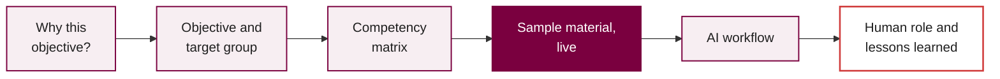

<!--
author:    Dr. Hannes Tegelbeckers
email:     hannes.tegelbeckers@ovgu.de
version:   1.0.0
language:  en
narrator:  UK English Female
mode:      Textbook

title:     S07 – Final presentations, reflection and submission (Self-learning unit)
comment:   AI in TVET II – Self-learning unit for session 7 (live, 21.01.2027): presenting a learning design in LiaScript, handling discussion questions, reflecting on competency development with the UNESCO AI CFT, final submission and SCORM checklist, next steps as OER author. Obligatory SCORM unit.

import:    https://raw.githubusercontent.com/LiaTemplates/mermaid_template/0.1.4/README.md
-->

# S07 – Final Presentations, Reflection and Submission

> **Session 7 · 21.01.2027 · 🟢 Live · Final presentations** – read chapters 1–2 before your presentation; complete chapters 3–4 after the session.
>
> **Time needed:** about 75 minutes
>
> **📦 Obligatory:** completing this unit [in Moodle (SCORM)](https://elearning.ovgu.de/course/section.php?id=202215) is part of the pass requirement – all 7 units by **15.02.2027**.

**After this unit you will be able to …**

1. present your group's learning design in LiaScript within 20 minutes,
2. answer discussion questions with arguments from the seminar,
3. reflect on your own competency development with the UNESCO AI Competency Framework for Teachers,
4. complete the final submission and check that all pass requirements are met.

## 1. Presenting Your Design

On 21.01.2027 each group has **20 minutes** to present and **5 minutes** for discussion. The audience are teachers and trainers – your fellow students – who ask themselves: *Would I use this with my learners?*

### What the audience must take home

Your storyline follows the building blocks of the seminar:

The **live sample material** is the heart: let the audience answer your quiz or poll via the LiaScript classroom. The **human role** is the end: what must stay with teachers and learners, and why?

### Criteria

These are the criteria from the kick-off – the same that you used in the peer review:

<!-- data-type="none" -->
| Criterion | Expectation |
| --- | --- |
| Content | Learning objective, matrix and sample material are consistent |
| Pedagogy | Progression Acquire → Deepen → Create is visible |
| LiaScript use | Slides, step-by-step animations, at least one interactive element |
| Reflection | Critical view on AI output and your human contribution |
| Sources and AI | References (APA 7), licences, AI use declared |

### Technical checklist for the day

- [ ] Presentation opens via your **LiaScript link** (not the GitHub page)
- [ ] **Classroom** started so the audience can answer (button at the top of the LiaScript page)
- [ ] Narrator switched **off** if you speak yourself (sound icon)
- [ ] Full screen tested on the room projector · second device ready
- [ ] Every member knows their part and the transition

## 2. Handling the Discussion

The discussion is part of the presentation. Every group member should answer at least one question. Three kinds of questions are typical – prepare one answer for each.

<!-- data-type="none" -->
| Question type | Example | How to answer |
| --- | --- | --- |
| **Why?** | "Why did you choose an agent at the Create level?" | Name the objective and the level, then the pedagogical reason |
| **What if?** | "What if learners use your chatbot to get the solutions?" | Name the safeguard in your design (phase without AI, hints only, teacher check) |
| **Evidence?** | "Is there research that AI feedback works?" | Cite a source from the seminar – and its limits (e.g. Weidlich et al., 2025) |

**Check:** A colleague asks: *"Isn't your AI case generator just making learners passive?"* Which answer is strongest?

<!-- data-hint-button="1" data-solution-button="2" -->
- [( )] "No, AI is always activating."
- [(X)] "In our Deepen level, learners first solve the case without AI; the generator only creates new variants, and the teacher discusses the solutions."
- [( )] "We did not think about that."
[[?]] Name the safeguard in your design.
***
A strong answer refers to a concrete element of your design – the phase without AI and the human role – instead of a general claim.
***

### Your own question for the other groups

For every other group, note **one strength** and **one question** during the presentation and ask it in the discussion. Good questions refer to a specific slide and are open: *"How would your matrix change for learners without German language skills?"*

## 3. Reflection: How Far Did You Come?

At the kick-off you entered your baseline – your end values of AI in TVET I – on the five dimensions of the UNESCO AI Competency Framework for Teachers. Enter it in the left column and rate yourself again now. **0** = not yet · **1** = Acquire · **2** = Deepen · **3** = Create

| Dimension | Session 1 | Now |
| --- | --- | --- |
| 1 Human-centred mindset |  |  |
| 2 Ethics of AI |  |  |
| 3 AI foundations and applications |  |  |
| 4 AI pedagogy |  |  |
| 5 AI for professional development |  |  |

### Reflection prompts

Write your **individual** reflection (8–12 sentences). Use evidence from your group's AI tools log and from the presentation.

1. In which dimension did you move most – and what is your **evidence**?
2. Where did AI really help you design learning material – and where did it mislead you?
3. Which decisions did you deliberately keep **human**? (→ human-centred mindset)
4. Which ethical question did you meet in practice? (→ ethics of AI)
5. What will you do differently as a teacher or trainer? (→ AI pedagogy, professional development)

**Your reflection:**

[[___ ___ ___ ___ ___]]

## 4. Final Submission and SCORM Checklist

To pass AI in TVET II, you need **all three** requirements. Check them now.

<!-- data-type="none" -->
| Requirement | Deadline | Where |
| --- | --- | --- |
| **1 · All 7 SCORM units completed** (S01–S07, incl. hand-ins in S03 and S06) | 15.02.2027 | Moodle |
| **2 · Group presentation** held | 21.01.2027 | Live session |
| **3 · Final submission:** GitHub link to the group's final LiaScript presentation (incl. competency matrix), revised after the discussion | 15.02.2027 | Moodle |

**In the final file:** licence line · AI declaration · references in APA 7 · image credits (TASL) · AI tools log (last slide or appendix).

### Which units have you completed?

- [ ] S01 – Kick-off and LiaScript Level 2
- [ ] S02 – AI and prompting Level 2
- [ ] S03 – AI vocabulary, models and workflows (group hand-in)
- [ ] S04 – Pedagogy, assessment and ethics
- [ ] S05 – Nuggets, micro-credentials and the competency matrix
- [ ] S06 – Project development and peer review (group hand-in)
- [ ] S07 – Final presentations, reflection and submission (this unit)

> [!IMPORTANT] Pass requirement
> A unit counts as completed when Moodle shows it as completed. Without all 7 units you cannot pass – even with an excellent presentation.

**Final LiaScript link of your group's presentation (the same link you submit in Moodle):**

[[___]]

**What did you change after the discussion on 21.01.?**

[[___ ___]]

### Course feedback

Please also complete the **anonymous course feedback** in the [Moodle course](https://elearning.ovgu.de/course/view.php?id=21949): for every seminar competency you rate where you were before and where you are now. It takes ten minutes and improves the next run.

## 5. Outlook: You Are an OER Author Now

Your presentation is an open educational resource: public, CC BY licensed, built with AI and checked by you. Three ways to keep going:

- **Share** it with colleagues at your school or training company – and invite them to adapt it.
- **Extend** it: turn one level of your matrix into a complete nugget, export it as SCORM for your school's Moodle.
- **Keep learning:** [Microsoft Learn: AI for educators](https://learn.microsoft.com/en-us/training/paths/ai-education/) · [Anthropic: AI Fluency for Educators](https://anthropic.skilljar.com/ai-fluency-for-educators) · [Google: Generative AI for Educators](https://grow.google/ai-for-educators/) · [Elements of AI](https://www.elementsofai.com/) · [UNESCO AI CFT for Teachers](https://doi.org/10.54675/ZJTE2084)

## Summary and Self-Check

- The 20-minute storyline leads from the objective via matrix and live sample material to the human role.
- Strong answers in the discussion refer to concrete elements of your design and to sources.
- Reflection uses evidence – the CFT self-check and your AI tools log.
- To pass: all 7 SCORM units, the group presentation and the final GitHub link by 15.02.2027.

**Tick what you can do now:**

- [ ] I presented my part and answered at least one question.
- [ ] I wrote my individual reflection with evidence.
- [ ] All 7 SCORM units are completed in Moodle (or planned before 15.02.2027).
- [ ] Our group's final link is submitted in Moodle.

## References

- Council of the European Union. (2022). *Council Recommendation of 16 June 2022 on a European approach to micro-credentials for lifelong learning and employability* (2022/C 243/02). https://eur-lex.europa.eu/legal-content/EN/TXT/?uri=CELEX:32022H0627(02)
- Hattie, J., & Timperley, H. (2007). The power of feedback. *Review of Educational Research, 77*(1), 81–112. https://doi.org/10.3102/003465430298487
- UNESCO. (2019). *Recommendation on Open Educational Resources (OER)*. https://www.unesco.org/en/legal-affairs/recommendation-open-educational-resources-oer
- UNESCO. (2024). *AI competency framework for teachers*. https://doi.org/10.54675/ZJTE2084
- Weidlich, J., Gotsch, F., Schudel, K., Marusic-Würscher, C., Mazzarella, J., Bolten, H., Bütler, D., Luger, S., Wohlfender, B., & Maag Merki, K. (2025). Teacher, peer, or AI? Comparing effects of feedback sources in higher education. *Computers and Education Open, 9*, 100300. https://doi.org/10.1016/j.caeo.2025.100300

<small>Licence: CC BY 4.0 · Dr. Hannes Tegelbeckers, OVGU Magdeburg · Created with AI support (Claude), checked and revised by the author.</small>
